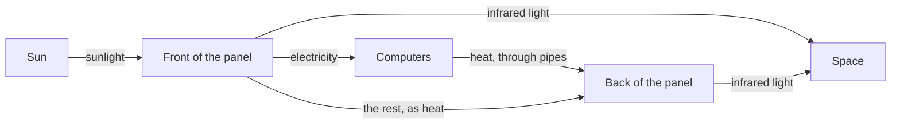

# Data centres in space

Say we launch a fleet with !`compute = 1GW` of computers. Let's see how much profit that would generate before reverting to inanimate matter.

The computers cost the same price in orbit and on the ground. Say that price is !`chip_price = 25USD/W` for each watt of computers, near the rack price further down.[^25] On each side that is !`chip_bill = chip_price * compute`. The sums also count what the computers need: power, a way to get rid of their heat, and a building or a spacecraft to hold them.

## Sunlight that doesn't set

Above the air, the sun brings !`sunlight = 1361W/m^2`. The fleet circles over the line between day and night, a dawn–dusk orbit, at !`alt = 1380km`. At that height it is in the sun !`sun = let Re = 6378.137, r = Re + max(0.0, alt / 1km), cosi = clamp(-2 * (2pi / (365.2422 * 86400)) * r^3.5 / (3 * 1.08262668e-3 * Re^2 * sqrt(3.986004418e5)), -1.0, 1.0), α = acos(cosi) - pi / 2, sin_b = Re / r, cos_b = sqrt(max(0.0, 1 - sin_b^2)), b_crit = asin(sin_b), eps = 23.439 * pi / 180; ecl = sum(let δ = asin(sin(eps) * sin(2pi * (d - 0.5) / 365)), β = pi / 2 - abs(δ + α); abs(β) < b_crit ? acos(clamp(cos_b / cos(β), -1.0, 1.0)) / pi : 0.0 end for d in 1:365) / 365; 100Percent * round(1 - ecl, digits=3) end` of the time.

It isn't 100% below about 1,400 km because the Earth's axis is tilted. For a few months of each year the orbit dips into shadow on each pass, for a small part of each orbit.[^3] The Moon hardly counts: it's in the way only during a solar eclipse.

Two things wear the fleet down, and nobody can go up to fix either of them.

### The solar cells

Radiation slowly wears down the power of the solar cells. Say they lose !`fade = 1.0Percent/yr`.[^1] The share of their first power that the cells still give after $t$ years is

$$
\text{power}(t) = e^{-\text{fade}\,t}
$$

```sheet
Age = 0yr to 100yr
Power of the cells = 100Percent * exp(-fade * age)
```

```chart
kind: lines
title: The power of the cells, in % of their first, by the fleet's age in years
show: Power of the cells
```

### The chips

Chips break too, and nobody can swap them. Once the early failures are past, data centres replace about !`fail = 0.6Percent/yr` of their GPUs, each year.[^2] It's hard to find info on how that failure rate changes over time, but let's say it increases by !`ageing = 3Percent` each year. The share of the chips that still work after $t$ years is then

$$
\text{working}(t) = \exp\!\left(-\frac{a}{b}\left(e^{b t} - 1\right)\right)
$$

Here $a$ is the fail rate, and $b = \ln(1 + \text{ageing})$. This is the Gompertz model. When the ageing is 0, it's $e^{-a t}$.

```sheet
Age = 0yr to 100yr
Chips that work = 100Percent * (ageing == 0Percent ? exp(-fail * age) : exp(-(fail * 1yr) / log(1 + ageing) * ((1 + ageing)^(age / 1yr) - 1)))
```

```chart
kind: lines
title: The chips that still work, in %, by the fleet's age in years
show: Chips that work
```

### The work that the fleet does

A chip with no power does no work, and power with no chip does none either. So each year the fleet does the work that the lower of the two lines allows. The fleet carries no battery, so its computers also stop while it's in the Earth's shadow. They run only the !`sun` of the time that it's in the sun. Added up until nothing is left, that's as much work as !`years = let d = float(fade * 1yr), a = float(fail * 1yr), g = float(ageing); round(float(sun) * 0.05 * sum(min(exp(-d * t), g == 0 ? exp(-a * t) : exp(-a / log(1 + g) * ((1 + g)^t - 1))) for t in 0.025:0.05:2000), digits=1) end` years at full size:

$$
\text{years at full size} = \text{sun} \int_0^{\infty} \min\big(\text{power}(t),\ \text{working}(t)\big)\,dt
$$

So before the fleet is gone, its computers use !`energy = convert(TWh, compute * years * yr)` of electricity. There's no standard rate to convert energy into tokens. Say each token takes !`joules = 0.6J`.[^20] That electricity is then !`tokens = round(convert(J, energy) / joules, sigdigits=3)` tokens. That's the work that the fleet does.

The solar panels are just big enough to run every computer on the first day, so they make !`panels = round(convert(MW, compute) / 1MW) * 1MW`. Smaller panels would leave some new chips with no power. Bigger panels would waste power at first, but later they'd make up for the cells' fade. That pays only while the line of the cells is under the line of the chips. !`crossover = let d = float(fade * 1yr), a = float(fail * 1yr), b = log(1 + float(ageing)); y = findfirst(t -> (b == 0 ? a * t : a / b * expm1(b * t)) >= d * t, 1:2000); a >= d ? 0 : y === nothing ? Inf : y end; crossover == 0 ? "The chips wear out at least as fast from the first day, so a bigger panel never pays." : crossover == Inf ? "The cells stay the limit for as far as these sums look." : string("With these numbers, the cells are the limit until year ", crossover, ". After that, dead chips hold the fleet back, and more power does nothing.")` So whether bigger panels are worth their launch depends on which line falls faster.

```chart
kind: lines
title: The cells and the chips, in %, by the fleet's age in years
show: Power of the cells, Chips that work
from: The solar cells, The chips
```

## Where the heat goes



Every watt that a panel takes in must leave again, and in space it can only leave as light. The front of the panel takes in !`absorb = 0.92` of the sunlight that hits it, which is !`heat = round(Int, sunlight / (1W/m^2) * absorb)` watts on each square metre. The glass reflects the other !`round(Int, 100 * (1 - absorb))`% straight back into space. That light never turns into heat, so the sums leave it out. Of all the sunlight that hits the panel, it turns !`eff = 22Percent` into electricity. That's how a cell's efficiency is measured. The computers turn the electricity back into heat, and pipes take that heat to the back of the panel. So the panel must shed all of what it took in.

A surface sheds heat as infrared light. How much it sheds depends on its temperature T, and on its emissivity ε, a number from 0 to 1 that says how well it glows:

$$
\frac{\text{heat}}{\text{area}} = (\varepsilon_{\text{front}} + \varepsilon_{\text{back}})\,\sigma\,T^4
$$

Here $\sigma = 5.67 \times 10^{-8}\,\text{W/m}^2\text{K}^4$ is the Stefan–Boltzmann constant. The glass on the front has an emissivity of !`e_front = 0.85`, and the white paint on the back has !`e_back = 0.90`. So the panel settles at !`panel_c = round(Int, (heat / (5.670e-8 * (e_front + e_back)))^(1/4) - 273.15)`°C.

Chips can run at up to !`chip_max = 90`°C. Heat flows only from a hotter thing to a colder one, so the chips must be hotter than the panel that cools them. The heat goes from each chip through a metal plate into a liquid, and the liquid carries it through pipes to the panel. Each of those steps needs a difference in temperature to push the heat along. Together, they leave the chips about !`drop = 10`°C hotter than the panel. So the panel can be at most !`limit = chip_max - drop`°C. Bigger plates and faster liquid make the difference smaller, but they add weight. !`panel_c <= limit ? string("That leaves the panel ", limit - panel_c, " degrees to spare.") : string("The panel is ", panel_c - limit, " degrees too hot, so this design fails.")` Drag the emissivity of the back down to 0.5 to see a design fail.

### A radiator of its own

Most satellites don't cool their computers through the backs of their panels. They have a separate radiator, turned edge-on to the Sun, so that no sunlight falls on it. That changes the sums:

- The radiator sheds only the computers' heat. That's !`chip_heat = round(Int, sunlight / (1W/m^2) * float(eff))` watts for each square metre of solar panel.
- No sunlight warms it, so it can be as hot as the chips allow, !`edge_c = limit`°C. Both of its faces shed heat, so each square metre sheds !`edge_w = round(Int, 2 * e_back * 5.670e-8 * (edge_c + 273.15)^4)` watts.
- So the radiator needs only !`edge_area = round(Int, 100 * chip_heat / edge_w)`% of the panels' area.
- The panel no longer takes the computers' heat, so it settles at !`round(Int, ((heat - chip_heat) / (5.670e-8 * (e_front + e_back)))^(1/4) - 273.15)`°C, not !`panel_c`°C. Cooler cells make a little more electricity.

SpaceX's Starmind AI1 is built this way. It has 110 square metres of radiators for 150 kilowatts, which is about 1,360 watts on each square metre.[^4] That's close to the sum above.

The separate radiator needs pipes over a small area, not over the back of every panel. It does need a frame of its own, and it must turn to stay edge-on to the Sun. Whether it saves weight depends on what each kind weighs for each square metre. The sums in this part don't weigh either one. The next section weighs that separate radiator. One face of it also sees the Earth, which warms it a little.

## The satellite

The fleet is many copies of one satellite. Each copy is built for !`sat = 150kW` of computers. At that size the fleet needs !`nsat = ceil(Int, compute / sat)` satellites. Starmind AI1 is a satellite of about this power. Its wings span 70 metres, and it has 110 square metres of radiators for 150 kilowatts.[^4]

Here is my model, drawn from the parameters on this page. It changes as you change them: the span of the wings, the pipes, the radiators, the height. Drag it to turn it. Pinch it, or scroll with ⌘ held, to come nearer.

```columns
2
```

```view
satellite.sc
aspect: 16:9
```

```result
satellite.jl
aspect: 16:9
```
The chips sit in the body. The loops of tube and the radiators cool them. The solar panels roll out since they use fabric as a substrate and the radiators also roll out since they are made from 2 sheets of aluminium that have been seam welded in a pattern that create channels for the cooling water to flow through. Everything is held in tension by the cooling loop which itself is held in tension by the water pressure inside them.

## Weight and cost

The fleet's weight comes from five parts. The panels cover !`array_area` square metres. The computers use !`compute`.[^5] Each price below is for one satellite. Each figure is a guess, and you can drag it. The prices below leave out the chips. Their price is !`chip_bill`, added once on each side. Each part has to last the life of the fleet.

- **Solar cells.** Cells for space usually sit under a sheet of glass. Starpath's new Starlight Air cells are printed on a fabric, and they weigh only !`cells = 0.073` kg on each square metre. These cells have no glass on them. A cover of space glass, 150 µm thick, costs !`glass = 20000USD/m^2`.[^10] The sums put glass on !`glazed = 0Percent` of the cells. On one satellite the glass costs !`cost_glass = glass * glazed * array_area / nsat * 1m^2`. The kilograms leave the glass out. A sheet of 150 µm would add about 0.4 kg on each square metre. A silicon cell for the ground sells for about 30 cents a watt. A triple-junction cell made for space sells for $250 to $450 a watt.[^10] Nobody has published a price for these printed cells. At a large scale they should cost about the same as a cell for the ground. Say !`cell_price = 0.30USD/W` for each watt the panels make. On one satellite the cells cost !`cost_cells = cell_price * panels / nsat`.
- **What holds the cells out.** The cells are a fabric, so the wing only has to hold them in tension. For launch, they are wound on a drum. The drum's only job is to let that roll unwind. A bar at the tip of each wing holds the end of the fabric. Two loops of tube hold those bars out, one level with each edge of the cells. Each loop goes right round the satellite. It passes through the tip of one wing, the tip of the radiator behind the body, the tip of the other wing, and the tip of the radiator in front of the body. It lies at right angles to the cells, so it touches them only at the tips. The coolant from the chips runs through the loops. It goes into each loop at the tip of a radiator, once round, and back. A curved tube under pressure pushes to straighten, so a closed loop pushes to be a circle. The radiators pull the back and the front of each loop in towards the body. Held in like that, the loop pushes the tips of the wings apart, and the cells stay taut. The loop is the rim of a wheel. The wings and the radiators are its spokes. A wing by itself could swing about its drum, and a radiator about its arm. The loops join the four tips, so no tip can move unless the others move with it. If the pump stops, the wings go slack. The wings span !`span = 70m`. That is the span of Starmind's wings at this power. Each wing is half of that, so its cells are !`chord = round(array_area / nsat / (span / 1m), digits=1)` metres tall. Each loop is an oval. Its front is !`loop_out = 30Percent` of half the span in front of the middle of the satellite, and its back is as far behind. One loop is then !`loop_m = let a = span / 1m / 2, b = float(loop_out) * span / 1m / 2; round(Int, 3.1416 * (3(a + b) - sqrt((3a + b) * (a + 3b)))) end` metres of tube, and the two loops of one satellite are !`loops_m = 2 * loop_m` metres. Say the tube is !`loop_d = 30mm` across. The water in the loops is hot, so they shed heat as well as holding the wings. Say the tube takes in !`pipe_absorb = 0.2` of the sunlight, and the water in it is at !`edge_c`°C. A tube catches the sunlight across its width, and its sunny half is 3.1416 / 2 times as wide as that. So each square metre of the half in the sun sheds !`pipe_w = round(Int, e_back * 5.670e-8 * (edge_c + 273.15)^4 - 2 * pipe_absorb * sunlight / (1W/m^2) / 3.1416)` watts. The half on the shaded side is out of the sun, so each square metre of it sheds !`shade_w = round(Int, e_back * 5.670e-8 * (edge_c + 273.15)^4)` watts. The loops of one satellite shed !`loops_kw = round(loops_m * 3.1416 * (loop_d / 1m) * (pipe_w + shade_w) / 2 / 1000, digits=1)` kilowatts. That is !`pipe_share = chip_heat == 0 ? 0 : min(100, round(Int, 100 * loops_kw * 1000 / (chip_heat * array_area / nsat)))`% of the computers' heat. The separate radiator does the rest. It needs !`rad_use = max(0, round(Int, edge_area * (100 - pipe_share) / 100))`% of the panels. Without the loops it would need !`edge_area`%. The sum takes the sun on all of the sunny half, though part of it runs towards the sun, and it leaves out the warmth from the Earth. Nobody has published a weight for a wing like this. A flown roll-out array makes 100 to 120 watts for each kilogram, cells and all. At the efficiency above, 110 watts a kilogram comes to about !`round(1361 * float(eff) / 110, digits=1)` kg on each square metre. The water in the loops weighs !`loop_water = round(Int, loops_m * 3.1416 * (loop_d / 1m)^2 / 4 * 1000)` kg. Say the tube's wall is !`loop_wall = 0.5mm` of aluminum, at 2,700 kg a cubic metre. It weighs !`loop_skin = round(Int, loops_m * 3.1416 * (loop_d / 1m) * (loop_wall / 1m) * 2700)` kg. On each square metre of cells, the loops and their water come to !`booms = round((loop_water + loop_skin) / (array_area / nsat), digits=2) * 1kg`. The water is cheap. The drum is a plain roller. Say the tube and the water cost !`boom_price = 20USD/kg`. On one satellite they cost !`cost_booms = boom_price * (booms / 1kg) * (1kg/m^2) * array_area / nsat * 1m^2`.
- **Radiators.** Musk says these are aluminum. A sheet pointed away from the Sun, he says, sheds about 1,300 watts on each square metre. SpaceX has not published a thickness or a mass.[^5] Aluminum weighs !`alu = 2700kg/m^3`. A sheet's mass is that density times its thickness. Say the sheet is !`sheet = 0.8mm` thick. That is the thickness of one deployable aluminum panel that still spread its heat. The metal then weighs !`sheet_kg = alu * sheet` on each square metre. A tube 6 mm across, with a wall of 0.5 mm, laid every 10 cm, weighs about 0.25 kg on each square metre. The water in it weighs about the same. Say the tubes and the water together weigh !`tubes = 0.5kg/m^2`. Two radiators stand up, one behind the body and one in front of it. Each reaches out to the two loops that hold the wings, and they hold its tip, so it needs no tube of its own. The bus runs between the two radiators, and it and the arm at each end of it take about 2 metres of that reach, so each radiator is !`rad_long = max(1.0, round(float(loop_out) * span / 1m / 2 - 2.1, digits=1))` metres long. Their area is worked out above. Each has half of it, so each is !`rad_high = round(array_area * rad_use / 100 / nsat / 2 / rad_long, digits=1)` metres tall. The radiators in the sums weigh !`radiator = round((sheet_kg + tubes) / (1kg/m^2), digits=2)` kg on each square metre. A separate shield against grit is not in that number. Flown radiators, with their honeycomb and heat pipes, weigh 2 to 8 kg on each square metre, and those of the ISS weigh 7.8. On one copy the two radiators cover !`round(Int, array_area * rad_use / 100 / nsat)` square metres. The metal sells for !`alu_price = 2.50USD/kg` a kilogram. On one satellite the aluminum in the sheets comes to !`alu_price * sheet_kg * array_area * rad_use / 100 / nsat * 1m^2`. The finished radiator costs more than that metal. The tubes, the white paint and the joins are in the price. Say !`rad_price = 200USD/m^2`. On one satellite the radiators cost !`cost_rad = rad_price * array_area * rad_use / 100 / nsat * 1m^2`.
- **Computers.** A rack of 72 Nvidia GPUs weighs about 1,470 kg and uses about 132 kilowatts. That's 11 kg for each kilowatt, with its steel cabinet, fans and power supplies. A satellite needs no cabinet or fans, so say !`computers = 6` kg for each kilowatt.
- **The body.** This holds the computers. It is the frame, the converters, the pumps, the thrusters, the attitude control, and the radios. The shadow is a small part of the year, so the sums add no battery. The JPL study puts the body at 7 to 30 kg for each kilowatt, and that range includes a battery.[^5] On one satellite that is !`round(Int, 7 * one / 1kW)` to !`round(Int, 30 * one / 1kW)` kg.

The fleet flies at !`alt`. At the end, the thrusters push against the flight for months, and each satellite spirals down to !`spiral_to = 400km`. A slow spiral needs more speed than one short burn would. It takes !`deorbit = let μ = 3.986e14, r1 = (6378 + alt / 1km) * 1000, r2 = (6378 + spiral_to / 1km) * 1000; round(sqrt(μ / r2) - sqrt(μ / r1), digits=1) end` metres a second. The thrusters give !`isp = 2000` seconds of push from each second of their fuel.

On one satellite, say:

- The frame is !`frame = 2.5kg/kW *one`. It holds the computers, and it joins the wings and the radiators. It is sheet, like the aluminum in the radiators. Say it costs !`frame_price = 2.50USD/kg`. On one satellite the frame costs !`cost_frame = frame_price * frame`.
- The converters are !`converters = 1.2kg/kW * one`. They turn the cells' electricity into the voltage the chips take. On the ground, the same job sits in the building's electrical gear, further down. A commercial converter sells for well under a dollar a watt. Say !`conv_price = 0.50USD/W` for each watt of the computers. On one satellite the converters cost !`cost_conv = conv_price * one`.
- The pumps are !`pumps = 0.5kg/kW * one`. They push the cooling liquid from the chips to the radiators. The pump costs !`cost_pumps = 400USD`.
- The attitude control keeps the wings facing the Sun and the radiators edge-on to it. The wings span !`span`. On one satellite the cells and the loops weigh !`wing = (cells + booms / 1kg) * array_area / nsat` kg. Spread along that span, their moment about the middle is !`inertia = round(Int, wing * (span / 1m)^2 / 12)` kg·m². Gravity pulls a long wing toward the Earth. The strongest pull at this height is !`gg = let R = (6378 + alt / 1km) * 1000; round(1.5 * 3.986e14 / R^3 * inertia, digits=3) end` newton-metres. The pull reverses twice in each orbit, so the wheels hold it and then give it back. The hold is !`momentum = let R = (6378 + alt / 1km) * 1000, P = 2 * 3.1416 * sqrt(R^3 / 3.986e14); round(gg * P / (4 * 3.1416), digits=1) end` newton-metre-seconds. A large flown wheel stores about 6 of those units a kilogram. A Bradford W45E stores 45 and weighs 7.45 kg. Say !`store = 6`. The satellite carries !`n_wheels = 4` wheels, one for each axis and a spare, and each wheel can hold the whole amount. The wheels weigh !`wheel_kg = round(n_wheels * momentum / store, digits=1)` kg. A star tracker, a gyro and the sun sensors weigh !`sensors = 4kg`. The attitude control weighs !`pointing = wheel_kg * 1kg + sensors`. The air and the sunlight push far less than gravity at this height, so these calculations leave them out. Say a wheel costs !`wheel_price = 500USD/kg`. That is a commercial motor and rotor. A space catalog charges more. The tracker and the other sensors cost !`tracker = 25000USD`. The set costs !`cost_point = wheel_price * wheel_kg * 1kg + tracker`.
- Each satellite has a laser to the next one, and a small radio to the ground. It has no big antenna. A Starlink satellite carries one, to reach a dish. The fleet flies in !`planes = 1` ring. The next satellite is !`gap = round(2 * 3.1416 * (6378 + alt / 1km) / (nsat / planes), digits=1)` km away. The laser's lens is !`lens = 20mm` across. At that range its beam is !`spot = let L = gap * 1000, D = lens / 1m; round(1.22 * 1550e-9 / D * L, digits=2) end` metres across. A token is about !`token = 16` bits of text, 2 bytes.[^19] At !`joules` a token, the computers write !`bits = round(token / float(joules / 1J), digits=1)` bits each second for each watt. The fleet's results are then !`traffic = round(bits * compute / 1W / 1e9, digits=1)` gigabits a second, and this laser carries all of them along the ring. Say !`photons = 20` photons land in each bit, and a quarter of the light gets through. The laser must then shine !`need_mw = let D = lens / 1m, frac = min(1, (D / spot)^2), E = 6.626e-34 * 2.998e8 / 1550e-9; round(traffic * 1e9 * photons * E / frac / 0.25 * 1000, digits=2) end` milliwatts. That is less than a small diode. The terminal is the lens, a mirror and a detector. Say that bench weighs !`laser_box = 1.5kg`. Above 1 watt it adds !`sink = 20g` for each watt. The laser weighs !`laser_kg = round(laser_box / 1kg + max(0, need_mw / 1000 - 1) * (sink / 1kg), digits=2)` kg. The radio carries this satellite's share, !`own_mbps = round(traffic / nsat * 1000, digits=2)` megabits a second. Say it weighs !`ground_radio = 1kg`. The radios weigh !`radios = laser_kg * 1kg + ground_radio`. Say the bench costs !`bench = 8000USD`. The diode costs !`diode = 100USD/W`, and the smallest one is 50 milliwatts. The radio costs !`radio_price = 2000USD`. The set costs !`cost_radios = bench + diode * max(need_mw / 1000, 0.05) * 1W + radio_price`. A catalog terminal is built to cross thousands of kilometres. This hop does not need one.
- The thrusters fly the last spiral, down to !`spiral_to`. It takes !`deorbit` metres a second. At !`isp` seconds of push, the fuel on one satellite is !`fuel_kg = let rest = (cells * array_area + booms / 1kg * array_area + radiator * array_area * rad_use / 100) / nsat + computers * one / 1kW + (frame + converters + pumps + pointing + radios) / 1kg; round(rest * (exp(deorbit / (isp * 9.80665)) - 1), digits=1) end` kg. A thruster of this push can't do that in one short burn. It runs for months. Say it draws !`thrust_kw = 1` kilowatt, and half of that becomes the speed of the exhaust. The burn then takes !`burn_days = round(fuel_kg * (isp * 9.80665)^2 / (thrust_kw * 1000) / 86400, digits=0)` days. The head is a ceramic channel, magnets and a cathode. Say it weighs !`head = 3kg` and costs !`head_price = 2000USD`. That is the metal and the ceramic at a mass-produced price. A catalog thruster costs far more. Its power supply weighs !`ppu_kg = 1 * thrust_kw` kg and costs the same !`ppu_price = 0.50USD/W` a watt as the converters. The tank weighs !`tank_of_fuel = 20Percent` of the fuel. That is !`tank_kg = round(float(tank_of_fuel) * fuel_kg, digits=1)` kg, at !`tank_price = 200USD/kg`. The thrusters weigh !`thrusters = head + ppu_kg * 1kg + tank_kg * 1kg`. The set costs !`cost_thrust = head_price + ppu_price * thrust_kw * 1kW + tank_price * tank_kg * 1kg`.

Together the body weighs !`bus = frame + converters + pumps + thrusters + pointing + radios`. The split is a guess.

The wheels grow with the wings. The laser grows with the gap and the traffic. The thrusters grow with the fuel. Drag the span, the wheel price, the tracker, the number of rings, or the thruster's power.

Putting the parts together, and testing the satellite, costs !`fit = 10Percent` of the parts above. The parts on one satellite come to !`hardware = cost_cells + cost_booms + cost_rad + cost_glass + cost_conv + cost_frame + cost_pumps + cost_thrust + cost_point + cost_radios`. Joining and testing costs !`cost_fit = fit * hardware`.

One satellite costs !`sat_cost = hardware + cost_fit`. The !`nsat` copies cost !`build = sat_cost * nsat`.

| Part | Tonnes |
|---|---|
| Solar cells | !`round(Int, cells * array_area / 1000)` |
| What holds the cells out | !`round(Int, booms / 1kg * array_area / 1000)` |
| Radiators | !`round(Int, radiator * array_area * rad_use / 100 / 1000)` |
| Computers | !`round(Int, computers * compute / 1kW / 1000)` |
| The body | !`round(Int, bus / 1kg * nsat / 1000)` |

In all, the fleet weighs !`fleet = round((array_area * (cells + booms / 1kg + radiator * rad_use / 100) + computers * compute / 1kW + bus / 1kg * nsat) / 1000, sigdigits=3)` tonnes. That's !`round(panels / (fleet * 1ton) / (1W/kg), digits=1)` watts for each kilogram. One copy weighs !`sat_kg = round(Int, (cells * array_area + booms / 1kg * array_area + radiator * array_area * rad_use / 100) / nsat + computers * one / 1kW + bus / 1kg)` kg. The computers are !`round(Int, computers * one / 1kW)` kg of that.

The thin cells are the lightest part, so a lighter panel saves little. Most of the weight is in the computers and the body. Drag the cells, the computers, or any part of the body.

Musk now says a later Starship will carry more than !`ship = 200` tonnes to a low orbit.[^6] The fleet takes !`launches = ceil(Int, fleet / ship)` launches. SpaceX still quotes today's ship at 100 tonnes. The dawn–dusk orbit is harder to reach, so a launch may carry less.

| Part | Kilograms on one satellite | Cost on one satellite |
| --- | --- | --- |
| Solar cells | !`round(Int, cells * array_area / nsat)` | !`cost_cells` |
| What holds the cells out | !`round(Int, booms / 1kg * array_area / nsat)` | !`cost_booms` |
| Radiators | !`round(Int, radiator * array_area * rad_use / 100 / nsat)` | !`cost_rad` |
| Glass on the cells |  | !`cost_glass` |
| Converters | !`round(Int, converters / 1kg)` | !`cost_conv` |
| Frame | !`round(Int, frame / 1kg)` | !`cost_frame` |
| Pumps | !`round(Int, pumps / 1kg)` | !`cost_pumps` |
| Thrusters | !`round(Int, thrusters / 1kg)` | !`cost_thrust` |
| Attitude control | !`round(Int, pointing / 1kg)` | !`cost_point` |
| Radios | !`round(Int, radios / 1kg)` | !`cost_radios` |
| Joining and testing |  | !`cost_fit` |

```columns
2
```

```chart
kind: pie
title: What one satellite costs
show: Cost on one satellite
```

```chart
kind: pie
title: Where the fleet's weight goes
show: Kilograms on one satellite
```
This comes to !`round(convert(USD/W, build / panels), digits=2)` a watt. Philip Johnston, who runs Starcloud, says an AI satellite can cost less than $5 a watt, once the chips are left out.[^9] A big antenna is the main thing his satellite also leaves out.

## Keeping the height

The !`sun` sun above is what a dawn–dusk orbit gets at !`alt`.

The panels face the sun. The flight is nearly along their edge, so over a year they show the air !`ram = 17Percent` of their area.[^7] The radiators can sit edge-on to the sun and to the flight, so the sums leave their faces out.

Say the air in a busy solar year weighs !`thick = 1` times what it weighs in an average year. The air at this height then weighs !`air = let h = alt / 1km; xs = [400.0, 500.0, 600.0, 800.0, 1000.0, 1200.0, 1400.0]; ys = [-11.6, -12.3, -13.0, -14.0, -14.7, -15.4, -16.0]; h2 = min(xs[end], max(xs[1], h)); i = findfirst(x -> x >= h2, xs); y = i == 1 ? ys[1] : ys[i - 1] + (ys[i] - ys[i - 1]) * (h2 - xs[i - 1]) / (xs[i] - xs[i - 1]); thick * 10.0^y * kg/m^3 end`.

About 1% of the chips are left after !`life = let a = float(fail * 1yr), g = float(ageing), b = log(1 + g); round(g == 0 ? log(100) / a : log(1 + b / a * log(100)) / b, digits=1) end` years. By then the air has taken !`loss = let ρ = air / (1kg/m^3), A = array_area * float(ram), m = fleet * 1000, a_m = (6378 + alt / 1km) * 1000, v = sqrt(3.986e14 / a_m), acc = 0.5 * 2.2 * ρ * v^2 * A / m; round(acc * life * 365.25 * 86400, digits=1) end` metres a second, and the height has fallen !`fall = let a_m = (6378 + alt / 1km) * 1000, v = sqrt(3.986e14 / a_m); round(2 * a_m / v * loss / 1000, digits=1) end` km. !`fall < 100 ? "That is too little to need a reboost before the chips are gone." : "The fleet needs a reboost, or it leaves this height while chips are still working. The air thickens as it falls, so the real drop is larger than this."`

At the end, the thrusters lower the fleet to !`spiral_to`, as the part on the satellite says. The air there takes about !`sink_rate = let h = spiral_to / 1km; xs = [400.0, 500.0, 600.0, 800.0, 1000.0, 1200.0, 1400.0]; ys = [-11.6, -12.3, -13.0, -14.0, -14.7, -15.4, -16.0]; h2 = min(xs[end], max(xs[1], h)); i = findfirst(x -> x >= h2, xs); y = i == 1 ? ys[1] : ys[i - 1] + (ys[i] - ys[i - 1]) * (h2 - xs[i - 1]) / (xs[i] - xs[i - 1]); ρ = thick * 10.0^y; A = array_area * float(ram); mass = fleet * 1000; a_m = (6378 + h) * 1000; v = sqrt(3.986e14 / a_m); acc = 0.5 * 2.2 * ρ * v^2 * A / mass; round(2 * a_m / v * acc * 86400 / 1000, digits=2) end` km a day off the height, and more as the fleet falls. The fuel for that spiral weighs !`fuel_kg` kg on each satellite. For the fleet that's !`propellant = round(fuel_kg * nsat / 1000, digits=1)` tonnes.

A lower orbit can fall on its own. Near 830 km the sun is about 97.5%, against !`sun` at !`alt`, and in an average year the fleet would reach the air in about 90 years. By then, !`at_90 = let a = float(fail * 1yr), g = float(ageing); round(Int, 100 * (g == 0 ? exp(-a * 90) : exp(-a / log(1 + g) * ((1 + g)^90 - 1)))) end`% of the chips still work. If the busy year above is 10 times as thick, that same orbit falls in about 9 years, while the chips are still working. One height cannot both last the full life of the chips and come down on its own in a reasonable amount of time, so the fleet needs a deorbit burn.

## What orbit costs

Five amounts, added once. The prices are in US dollars.

- **The satellites.** The !`nsat` copies cost !`build`. That is !`round(convert(USD/W, build / panels), digits=2)` for each watt the panels make. McCalip's Starlink figure is !`per_watt = 22USD/W` a watt.[^9]
- **The computers.** They cost !`chip_bill` on this side, and the same on the ground.
- **The launches.** A Falcon 9 costs a customer roughly $3,000 a kilogram. Say a Starship costs !`per_kg = 200USD/kg`. The fleet weighs !`fleet` tonnes. The launches cost !`launch = per_kg * fleet * ton`.
- **Keeping it running.** The fleet has two bills. The link is paid for the !`years` years of work at full size, because a chip that has failed sends nothing. The people are paid for !`life` years, until 1% of the chips are left.

  - **The link.** SpaceX already runs Starlink, so the fleet builds no ground stations. The radios are already in the body. Say the results average !`traffic` gigabit a second, which is !`round(traffic * 86400 / 8 / 1000, digits=1)` terabytes a day. Starlink's price for extra data is !`per_gb = 0.25USD` for each gigabyte.[^8] A customer would pay !`list = traffic * 365.25 * 86400 / 8 * per_gb / 1yr` a year for that stream. This fleet buys no dish and no share of the constellation. Say the extra cost on the network that already runs is !`own = 10Percent` of that price. At 100% the fleet pays the customer's price. The link costs !`link = list * own * years * yr`.

  - **The people.** The satellites fly themselves, as Starlink's do. The people who schedule the same jobs on the ground are left out of both sides. The people who write the software are in the design, which is paid once. Say !`seats = 6` extra seats watch this fleet. A seat filled day and night takes !`cover = 5` people, for three shifts, weekends and leave. Each person costs !`pay = 300000USD/yr` a year, in pay and overhead. They cost !`people = seats * cover * pay * life * yr`.

  The two bills together cost !`upkeep = link + people`. That is !`round(float(upkeep / build) / float(1Percent), digits=1)` percent of what the satellites cost.
- **The design.** Engineering the first satellite of a new kind costs !`design = 100000000USD`. That is paid once.
- **Deorbit.** The fuel for the burn costs !`deorbit_cost = per_kg * propellant * ton`.

| Part | Cost |
|---|---|
| The satellites | !`build` |
| The computers | !`chip_bill` |
| The launches | !`launch` |
| Keeping it running | !`upkeep` |
| The design | !`design` |
| Deorbit | !`deorbit_cost` |
| Total | !`orbit = build + chip_bill + launch + upkeep + design + deorbit_cost` |

```chart
kind: pie
```

## The same computers on the ground

A data centre uses more power than its computers do, for cooling and for losses in its wiring. The ratio is its PUE, its power usage effectiveness. Here it's !`pue = 1.2`, so the power station must make !`station = compute * pue`. That's !`turbines = ceil(Int, station / 430MW)` big gas turbines of 430 megawatts each.

A gas turbine is ready to run about !`ready = 90Percent` of the time. It stops the rest of the time for upkeep and repairs.[^21] So a data centre that makes its own power has spare turbines. Say this station has !`spares = 2` of them: one for upkeep and one for a failure. The computers then lose power only when more than !`spares` turbines are down at once. They have power !`uptime = let n = turbines + round(Int, spares), p = float(ready); 100Percent * round(sum(binomial(n, k) * p^k * (1 - p)^(n - k) for k in turbines:n), digits=3) end` of the time.

- **The power station** costs !`per_kw = 1000USD/kW`. With the spares, that's !`plant = per_kw * (station + spares * 430MW)`.
- **The building.** For each watt of computers, the electrical gear costs !`elec = 5.00USD/W`, the cooling !`cool = 3.00USD/W`, the land and the shell !`shell = 2.50USD/W`, and the network and the fit-out !`fitout = 1.75USD/W`. That's !`building = (elec + cool + shell + fitout) * compute`.
- **The computers.** They cost !`chip_bill` here too.
- **The revamp.** The first power station lasts !`ground_life = 20yr`. By then, !`still = let a = float(fail * 1yr), g = float(ageing), t = float(ground_life / 1yr); round(Int, 100 * (g == 0 ? exp(-a * t) : exp(-a / log(1 + g) * ((1 + g)^t - 1)))) end`% of the chips still work, so it pays to fit a smaller replacement station of !`station2 = round(station * still / 100, digits=2)` for another !`ground_life`. Scaled to the surviving chips, that station costs !`plant2 = plant * still / 100`.
- **Gas.** The turbines burn !`heat_rate = 6200` BTU of gas for each kilowatt-hour. A BTU is a British thermal unit. Gas costs $!`gas = 4.30` for a million BTU, so each megawatt-hour takes $!`fuel_mwh = round(heat_rate * gas / 1000, digits=2)` of gas. Counting only the chips still working across those !`2 * round(Int, ground_life / 1yr)` years, while they have power (!`uptime` of the time), the centre does !`full_ground = let a = float(fail * 1yr), g = float(ageing), L = 2 * float(ground_life / 1yr); n = max(1, round(Int, L / 0.05)); dt = L / n; round(float(uptime) * dt * sum(let t = (i - 0.5) * dt; g == 0 ? exp(-a * t) : exp(-a / log(1 + g) * ((1 + g)^t - 1)) end for i in 1:n), digits=1) end` years of work at full size, so its gas costs !`fuel = fuel_mwh * 1USD/MWh * station * full_ground * yr`.

In all, the data centre on the ground costs !`ground = plant + plant2 + building + fuel + chip_bill`.

## What SpaceX pays

In the sums above, the building and power plant come to !`ground_capex = round(convert(USD/W, (plant + building) / compute), digits=2)` a watt, before chips and gas. That matches 2026 US surveys, which put the building, cooling and power gear at $12 to $18 a watt.[^14] With chips at !`chip_price` a watt, the site above is !`round(ground_capex + chip_price, digits=2)` a watt before gas.

SpaceX's finance chief, Bret Johnsen, says its first couple of gigawatts cost in the low to mid $30s a watt, chips included, against $50 to $60 for everyone else.[^11] Epoch AI puts SpaceX's Memphis sites near $38 a watt,[^12] and bank estimates for a gigawatt run $35 to $60 billion.[^15] A GB200 rack alone costs near $25 a watt, and a GB300 near $35.[^13] Johnsen's gap of about $23 a watt is wider than the whole building in the surveys. He credits doing the building and power in-house, including casting turbine blades to skip an 18-to-24-month wait.[^11] Even so, part of the gap may be a lower price on chips, which would cut both sides here by the same amount.

One real difference is the power plant. The sums above assume a combined-cycle plant at !`heat_rate` BTU a kilowatt-hour and about $1,000 a kilowatt.[^16] Colossus's Southaven plant runs 41 simple-cycle turbines, about 1,240 megawatts, which burn closer to !`sx_heat_rate = 9400` BTU a kilowatt-hour.[^17] With gas at $!`sx_gas = 3.20` a million BTU (near the November 2026 spot price),[^18] across those !`2 * round(Int, ground_life / 1yr)` years its gas comes to !`spacex_fuel = (sx_heat_rate * sx_gas / 1000) * 1USD/MWh * station * full_ground * yr`. Taking Johnsen's figure at !`spacex_w = 33USD/W` for the site and chips, plus !`plant2` for the smaller replacement power station at year !`round(Int, ground_life / 1yr)`, puts SpaceX's total on the ground at !`spacex_ground = spacex_w * compute + plant2 + spacex_fuel`, which is !`round(Int, abs(float(spacex_ground / ground) - 1) / float(1Percent))`% !`spacex_ground >= ground ? "more" : "less"` than the McCalip sum above. That is the ground price used below.

## Side by side

The two don't do the same work. The fleet does !`energy` of work before it's gone. On the ground, the computers stop !`100Percent - uptime` of the time, when more turbines are down than the spares can cover. Over its !`2 * round(Int, ground_life / 1yr)` years the revamped site gives them !`energy_ground = convert(TWh, compute * full_ground * yr)`.

| | What it costs | The work it does |
|---|---|---|
| In orbit | !`orbit` | !`energy` |
| On the ground | !`spacex_ground` | !`energy_ground` |

Both sides buy the chips once, and dead chips stay dead on both sides. On the ground, the first station lasts !`ground_life`, when !`still`% of the chips still work, and the smaller replacement station runs them for a second !`ground_life` (!`2 * round(Int, ground_life / 1yr)` years in all). Counting only the working chips, while they have power (!`uptime` of the time), that adds up to !`full_ground` years at full size. 

In orbit the cells also fade, so each year the fleet does only as much as the weaker of the cells and the chips. Even so, it keeps running past year !`2 * round(Int, ground_life / 1yr)`, when !`still_end = let a = float(fail * 1yr), g = float(ageing), t = 2 * float(ground_life / 1yr); round(Int, 100 * (g == 0 ? exp(-a * t) : exp(-a / log(1 + g) * ((1 + g)^t - 1)))) end`% of the chips are still working, and adds up to !`years` years at full size, which is !`work_ratio = round(years / full_ground, digits=1)` times the work on the ground.

The panels are already big enough to run every computer on the first day. The extra work comes from running the fleet past the second power station without buying a third.

## What !`compute` rents for

The sums above say what the computers cost, and what the work costs. Two readings say what the work is worth. This one is the low reading. The next one is the high reading. A real owner lands somewhere between them.

The low reading is the spot rent. It is what a customer pays for an hour of a machine that is already powered and cooled. The owner who rents the computers out collects that, and no more. If selling the tokens earned less than the rent, the owner would rent the computers out instead. So the rent is a floor.

[Polymarket](https://polymarket.com/compute) now shows that rent, out to 2028. The number comes from Ornn's index of trades, not from a cloud's rate card. On 26 November 2026 a B200 rented for !`b200_hr = 9.79USD/hr`. An H100 SXM was !`h100_hr = 3.10USD/hr` on 25 November, and a B300 was !`b300_hr = 10.83USD/hr` the same day.[^24]

The chips draw !`h100_w = 700W`, !`b200_w = 1000W` and !`b300_w = 1400W`. At those draws, !`compute` of each kind is this many chips, and the floor is this much:

| Chip | Chips in this fleet | An hour |
| --- | --- | --- |
| H100 | !`round(Int, compute / h100_w)` | !`h100_rent = h100_hr / h100_w * compute` |
| B200 | !`round(Int, compute / b200_w)` | !`b200_rent = b200_hr / b200_w * compute` |
| B300 | !`round(Int, compute / b300_w)` | !`b300_rent = b300_hr / b300_w * compute` |

```chart
kind: bars
title: The rent for this fleet, each hour
show: An hour
from: What !compute rents for
```

A B300 costs more per chip than a B200, and it draws more. Spread over the chip's own draw, !`compute` of B300s rents for less. The B200 is the dear one per watt of chip.

That rent already includes the power and the cooling. The provider pays the utility. Ornn records the price of the rental, and it does not take the power back out.[^24]

The table spreads each price over the chip's own draw. A rack draws more than its chips. A GB200 rack of 72 GPUs uses about 132 kilowatts, which is !`round(Int, 132000 / 72)` watts for each chip once the rack is counted.[^5] The same B200 rent, spread over that draw, is !`b200_rack_rent = b200_hr / (132kW / 72) * compute` an hour. That is the same money as !`b200_rent`, counted over more watts. It is not a second bill. The page's PUE of !`pue` belongs to a station you own. It does not sit on top of this rent.

## How many tokens does !`compute` of compute make

Earlier, this page used a single guess of !`joules` for each token. In practice, a watt of computer does not make a fixed number of tokens a second. The rate changes by more than ten times with the model, the precision, the context length, and how many users share a chip at once.

Writing one token from a model with $P$ active parameters at $b$ bytes a weight takes two things: reading all of those active weights from memory ($P \cdot b$ bytes) and doing one multiply-add on each weight ($2P$ floating-point operations). That gives every chip two ceilings:

- **When few users run at once**, memory bandwidth is the limit. Each user gets at most $\text{bandwidth} / (P \cdot b)$ tokens a second, and total throughput grows linearly as more users share the same weight reads.
- **When many tokens run in one batch**, the chip's arithmetic saturates and total throughput flattens out at $\text{FLOP/s} / (2P)$ tokens a second.

Take a B200 with !`bw_tbs = 8` TB/s of memory bandwidth and !`flops_p = 4.5` PFLOP/s of dense FP8 compute, running a model with !`params_b = 32` billion active parameters at !`weight_bytes = 1` byte a weight and !`util = 80Percent` real-world utilisation. One user gets about !`user_tps = round(Int, float(util) * bw_tbs * 1e12 / (params_b * 1e9 * weight_bytes))` tokens a second. Throughput climbs with batch size until about !`ridge = round(Int, flops_p * 1e15 * weight_bytes / (2 * bw_tbs * 1e12))` concurrent tokens, then hits the compute roof at !`max_tps = round(Int, float(util) * flops_p * 1e15 / (2 * params_b * 1e9))` tokens a second.

```sheet
Batch = 0 to 500
Throughput = min(batch * user_tps, max_tps)
```

```chart
kind: lines
title: B200 throughput by batch size
x: Concurrent tokens (batch size)
y: Tokens a second
show: Throughput
```

At that flat top, a 1,000-watt B200 spends only !`max_tps == 0 ? 0.0 : round(1000 / max_tps, digits=3)` joules a token. Across !`compute` of chips at full batch, that would be !`round(float(compute / 1000W) * max_tps / 1e9, sigdigits=3)` billion tokens a second, against !`round(float(compute / 1W) / float(joules / 1J) / 1e9, sigdigits=3)` billion a second at the !`joules` used on this page. Real clusters land much closer to the lower figure because users want fast replies (pushing servers left down the slope into smaller batches), long contexts add KV-cache memory reads, mixture-of-experts models spend time moving data between GPUs, and the rack and building draw power on top of the chips.[^20] That is why there is no single conversion from watts to tokens, and why buyers measure a curve of tokens a second per megawatt against speed per user.

## What the tokens are worth today

The high reading is the tokens. Here the owner runs the model and sells every token, and keeps the whole price. That is more than the rent, because the rent is only what a customer pays to use the computers. The token price also pays for the model.

Most of the fleet's work comes long after launch. Money spent at launch could earn a return somewhere else. So a token that comes in 50 years is worth less than a token that comes today. This part counts each token and each bill at what it's worth on the day of launch. That gives each option its net present value.

Say the owner wants !`discount = 9.6Percent` a year back on its money.[^22] A token that comes $t$ years after launch is then worth $(1 + \text{discount})^{-t}$ of a token today. So the work, counted today, is

$$
\text{years today} = \text{sun} \int_0^{\infty} (1 + \text{discount})^{-t}\,\min\big(\text{power}(t),\ \text{working}(t)\big)\,dt
$$

The fleet's !`years` years at full size are worth !`years_now = let d = float(fade * 1yr), a = float(fail * 1yr), g = float(ageing), ρ = log(1 + float(discount)); round(float(sun) * 0.05 * sum(exp(-ρ * t) * min(exp(-d * t), g == 0 ? exp(-a * t) : exp(-a / log(1 + g) * ((1 + g)^t - 1))) for t in 0.025:0.05:2000), digits=1) end` years today. The ground's !`full_ground` years are worth !`ground_years_now = let a = float(fail * 1yr), g = float(ageing), ρ = log(1 + float(discount)), L = 2 * float(ground_life / 1yr); n = max(1, round(Int, L / 0.05)); dt = L / n; round(float(uptime) * dt * sum(let t = (i - 0.5) * dt; exp(-ρ * t) * (g == 0 ? exp(-a * t) : exp(-a / log(1 + g) * ((1 + g)^t - 1))) end for i in 1:n), digits=1) end` years today. So the fleet does !`round(years_now / ground_years_now, digits=1)` times the work of the ground, not !`work_ratio` times.

The bills move less, because most of them come first. Orbit pays for the satellites, the computers, the launches and the design before it starts. It pays for the link as the work is done, for the people each year, and for the deorbit fuel at the end. Counted today, orbit costs !`orbit_now = let ρ = log(1 + float(discount)); build + chip_bill + launch + design + link * years_now / years + people * (ρ == 0 ? 1 : (1 - exp(-ρ * life)) / (ρ * life)) + deorbit_cost * exp(-ρ * life) end`, not !`orbit`. The ground pays for its replacement power station at year !`round(Int, ground_life / 1yr)`, and for its gas as the chips run over !`2 * round(Int, ground_life / 1yr)` years. Counted today, it costs !`ground_cost_now = let ρ = log(1 + float(discount)); spacex_w * compute + plant2 * exp(-ρ * float(ground_life / 1yr)) + spacex_fuel * (full_ground == 0 ? 0 : ground_years_now / full_ground) end`, not !`spacex_ground`.

Say a million tokens sells for !`price = 2.50USD`. That's what Kimi K2, a model of a trillion parameters, charges for the tokens that it writes.[^23] The net present value is what the tokens sell for, counted today, less the bills, counted today.

| | Cost today | Discounted Lifetime Tokens | Cost per million tokens | Net present value (tokens) |
|---|---|---|---|---|
| In orbit | !`orbit_now` | !`tokens_now = round(convert(J, compute * years_now * yr) / joules, sigdigits=3)` | $!`per_orbit_now = round(float(orbit_now / 1USD) / tokens_now * 1e6, sigdigits=3)` | !`npv_orbit = price * tokens_now / 1e6 - orbit_now` |
| On the ground | !`ground_cost_now` | !`ground_tokens_now = round(convert(J, compute * ground_years_now * yr) / joules, sigdigits=3)` | $!`per_ground_now = round(float(ground_cost_now / 1USD) / ground_tokens_now * 1e6, sigdigits=3)` | !`npv_ground = price * ground_tokens_now / 1e6 - ground_cost_now` |

### If it is rented out

The table above is the high reading, where the owner sells every token. For the low reading, suppose the owner instead rents the computers out for their whole life at the rack-level B200 rent above, !`b200_rack_rent` an hour (!`b200_rack_rent * 1yr` a year at full size).

| | Costs, counted today | Rent, counted today | Net present value (rent) |
|---|---|---|---|
| In orbit | !`orbit_now` | !`rent_now_orbit = convert(USD, b200_rack_rent * years_now * yr)` | !`npv_rent_orbit = rent_now_orbit - orbit_now` |
| On the ground | !`ground_cost_now` | !`rent_now_ground = convert(USD, b200_rack_rent * ground_years_now * yr)` | !`npv_rent_ground = rent_now_ground - ground_cost_now` |

```chart
kind: bars
title: Cost and net present value of each option
from: What the tokens are worth today, If it is rented out
show: Cost today, Net present value (tokens), Net present value (rent)
```

## Summary

With the numbers on this page, !`compute` of computers costs !`orbit_now` in orbit and !`ground_cost_now` on the ground, counted today. !`orbit_now < ground_cost_now ? "Orbit" : "The ground"` comes out cheaper by !`orbit_now < ground_cost_now ? ground_cost_now - orbit_now : orbit_now - ground_cost_now`. Both sides pay !`chip_bill` for the chips, so the difference is satellites and launches (!`build + launch`) against a building, turbines and decades of gas.

But that difference in cost is small compared to the value of the asset. The most important thing is simply getting it built. Second is selling tokens at the highest possible price, which means having access to the best models. Cutting costs by going to orbit is a distant third. The real reason to go to orbit isn't to save money — it's to turn data-centre building into a smooth-flowing production line rather than a string of ad hoc megaprojects.

## Footnotes

> [!NOTE] Where these sums differ from McCalip's
> His calculator keeps the fleet at full size for a set number of years. It pays each year to build again the hardware that breaks. This page launches the fleet once, lets it wear down, and counts the work that it does before it's gone.

[^1]: 2.5% a year is McCalip's figure for silicon cells. His page gives no source for it. Silicon cells on eleven satellites in geostationary orbit lost 0.71% to 1.69% of their power each year: Lohmeyer, Aniceto, Cahoy and Carlton, "Solar array degradation on geostationary communications satellites", International Journal of Space Science and Engineering 5(1), 2018, [doi:10.1504/IJSPACESE.2018.090549](https://doi.org/10.1504/IJSPACESE.2018.090549). Those satellites were much higher than this fleet, so the rate here can be different.

[^2]: McCalip takes 9% a year, from Meta's report on how it trained Llama 3 ([Grattafiori and others, 2024](https://arxiv.org/abs/2407.21783), section 3.3.4). In 54 days on about 16,000 H100 GPUs, 148 interruptions came from faulty GPUs and 72 from their memory, which is about 9% a year. But an interruption isn't a dead chip. A restart or a swap fixes many of them, and Meta's cluster was new. Chips that are replaced for good are much rarer. On NCSA's Delta system, 4 of 448 A100 GPUs were replaced in 895 days, about 0.36% a year, and 2 of 608 H100 GPUs in 146 days, about 0.82% a year ([Cui and others, 2025](https://arxiv.org/abs/2503.11901), section 4.1). That's only six failures, so the rates are rough. Chips can also fail more often as they age. From 2016, the GPUs of Oak Ridge's Titan supercomputer started to fail, because a resistor on their boards corroded ([ORNL](https://www.ornl.gov/news/gpu-lifetimes-titan-supercomputer-survival-analysis-and-reliability/)). Dean refitted a Gompertz hazard to the same cards ([Silicon senescence](https://zenodo.org/records/22801444), 2026). On the 11,370 cards first installed in 2016 or later, the hazard slope is 0.472 a year. The chance of removal then grows by about 60% a year, and it doubles in about 1.5 years. Nine removals in one half-year, in one serial group of 485 cards, make most of that rise. With the group left out, the slope is about 0.15 a year, so the chance grows by about 16% a year. A constant chance fits those cards better, and the range on the slope includes no growth.

[^3]: Pablo and others, "[The BRITE Constellation nanosatellite mission: testing, commissioning and operations](https://arxiv.org/abs/1608.00282)", Publications of the Astronomical Society of the Pacific 128, 2016. Its satellites dip into the shadow "between November and February, when the Earth’s northern hemisphere is most strongly tilted away from the Sun".

[^4]: SpaceX has published few of these figures itself, and the reports don't all agree. V3: [The Register](https://www.theregister.com/2025/07/16/starlink_network_update/), [Notebookcheck](https://www.notebookcheck.net/SpaceX-Starship-flight-14-launches-first-Starlink-V3-satellites-for-gigabit-downloads.1410436.0.html) (2 tonnes) and [SatNews](https://satnews.com/2026/07/13/spacex-advances-direct-to-device-constellation-matrix-with-starlink-v3-hardware/) (1,500 kilograms). AI1: [Notebookcheck](https://www.notebookcheck.net/SpaceX-lists-AI1-satellite-cooling-specs-for-Starmind-data-center-in-space.1340218.0.html), from SpaceX's Starmind page. The 70 kilowatts in each tonne, and the sceptic's 6 tonnes, are from [Graham Wallington](https://medium.com/@graham.wallington/why-spacexs-ai1-orbital-data-centre-doesn-t-add-up-a49d26eb0a48). Gen3: Musk on X, as [SatNews](https://satnews.com/2026/10/04/spacex-unveils-250-kw-starlink-gen3-ai-satellites-featuring-10-tbps-throughput-and-onboard-edge-compute/) reports it. V4: Musk at the Baron conference in November 2026, as [TeslaNorth](https://teslanorth.com/2026/11/06/starlink-v4-satellites-baron-2026/) reports it.

[^5]: Starlight Air: [Payload](https://payloadspace.com/exclusive-starpath-unveils-new-ultra-thin-space-solar-panels/), March 2026. Roll-out arrays: [Redwire's ROSA](https://rdw.com/product-archive/power/rosa/), 100 to 120 watts for each kilogram. Radiators: Musk on X, 3 November 2026, as [Wccftech](https://wccftech.com/elon-musk-defends-space-ai-satellites-asserts-they-will-emit-1300-m%C2%B2-in-heat-for-rapid-cooling/) reports it. He says an aluminum radiator pointed away from the Sun sheds about 1,300 watts on each square metre, and he gives no thickness. A deployable panel in an Air Force study used a sheet of 6061 aluminum 0.8 mm thick, which still spread the heat: [TFAWS 2024 PT-11](https://www.nasa.gov/wp-content/uploads/2024/11/tfaws_TFAWS2024-PT-11.pdf). That alloy weighs 2,700 kg on each cubic metre. The ISS photovoltaic radiators, [SAE 932151](https://papers.sae.org/publications/technical-papers/content/932151/), and [SAE 961456](https://saemobilus.sae.org/papers/unfurlable-space-based-heat-pipe-radiator-961456), put radiators of that time at 5 to 7 kg on each square metre. The shuttle's faces were 0.28 mm of aluminum, on a honeycomb ([Journal of Spacecraft and Rockets](https://arc.aiaa.org/doi/10.2514/1.A35030)). The JPL study: Turyshev, "[Orbital Data Centers: Spacecraft Constraints and Economic Viability](https://arxiv.org/abs/2604.27197)", 2026, which calls its figures illustrative. The rack: [HPE's data sheet](https://www.hpe.com/int/en/collaterals/collateral.a50009224enw.html) for the GB200 NVL72, 3,245 pounds and 132 kilowatts.

[^6]: Musk on X, 16 November 2026, replying to a post that put the load at 100 tons. He wrote that the propellant will cost less than $500,000 a flight, and that the load will exceed 200 tons ([the post](https://x.com/elonmusk/status/2122217639540134337)). SpaceX's prospectus of 20 May 2026 still expects today's Starship, V3, to carry 100 metric tons. It says a later one could reach 200, perhaps as soon as V4 ([the filing](https://www.sec.gov/Archives/edgar/data/1181412/000162828026036936/spaceexplorationtechnologi.htm)).

[^7]: The 17% is how much of a sun-facing panel faces the airflow over a year in a dawn–dusk orbit. The panel tracks the sun, and the sun sits nearly at right angles to the orbit. The air's weight is a round figure for a moderate solar year, about 2.5e-12 kg/m³ at 400 km and about 2e-15 kg/m³ at 1,000 km. A solar maximum can be about ten times thicker at 400 km, and more than that higher up. The drag sum uses a coefficient of 2.2.

[^10]: Richards and others, "The return of silicon solar cells to space", Acta Astronautica, November 2026, [ScienceDirect](https://www.sciencedirect.com/science/article/abs/pii/S0094576526003644). The review puts triple-junction space cells at $250 to $450 a watt. It puts mainstream silicon modules, in November 2025, at about 28 to 39 cents a watt. It puts space coverglass, 150 µm thick, at $15,000 to $20,000 a square metre. The quotes are from suppliers of the glass. The glass, not the silicon, is most of the cost of a silicon array of the usual kind.

[^9]: Philip Johnston of Starcloud, as reported in [The Sydney Morning Herald](https://www.smh.com.au/technology/data-centres-in-space-that-s-less-crazy-than-you-think-20260311-p5o9lq.html), 12 March 2026, from The Economist of 2 March 2026. He expects the satellite to cost less than $5 a watt once the chips are left out. The same piece gives McCalip's estimate of about $22 a watt for a current Starlink satellite, down from $32 for the first version.

[^8]: Starlink's US Local Priority plan sells an extra 500 GB for $125 a month, which is 25 cents a gigabyte. That is the price a customer pays for a dish and a share of the network. It is not SpaceX's extra cost for traffic on the network it already runs. The $125 figure is from Starlink's business plans as listed by [StarSurf](https://www.starsurf.com/starlink-for-business/) on 10 November 2026. The plans themselves are at [starlink.com/business/service-plans](https://starlink.com/business/service-plans).

[^11]: Bret Johnsen, SpaceX's finance chief, at the TomorrowX Summit in Austin on 17 November 2026. He said the first couple of gigawatts cost in the low to mid $30s a watt, against $50 to $60 for everyone else. [TMT Breakout](https://www.tmtbreakout.com/p/tmtb-tomorrowx-highlights-spacex) wrote up the session on 18 November 2026. The same lines were posted that day from the stage. He also said a supplier had quoted 18 to 24 months for turbine blades, and that SpaceX is casting its own. The $30s figure is the cost of putting the compute on the ground, chips included. He did not split out the building.

[^12]: Epoch AI's directory, [Colossus 2](https://epoch.ai/data/ai-data-centers/directory/colossus-2), updated 30 July 2026: $35.8 billion and 946 megawatts of computer power. [Colossus 1](https://epoch.ai/data/ai-data-centers/directory/colossus-1): $12.9 billion and 340 megawatts. Both come to about $38 a watt. The cost includes the chips. Epoch estimates it from public information. SpaceX has not published this split.

[^13]: Nvidia does not publish a rack price. A GB200 NVL72 is widely put at about $3 million. SemiAnalysis has put the same rack at about $3.1 million before extras and $3.9 million all in, at 120 to 132 kilowatts. A reported GB300 purchase order in 2026 was just under $5 million. Chris Zeoli, "[How Much Does an NVIDIA NVL72 Cost?](https://www.datagravity.dev/p/how-much-does-an-nvidia-nvl72-cost)", 31 August 2026, collects these. At 130 kilowatts, $3 million is $23 a watt and $5 million is $38 a watt.

[^14]: Turner & Townsend's data centre cost index, as [Quartz](https://qz.com/us-data-center-construction-costs-13-percent-turner-townsend-112026) reported it on 20 November 2026. The US average is $12.08 a watt. The most advanced AI halls cost $14 to $16. Cushman & Wakefield's 2026 development cost guide, as [Data Center Scouts](https://datacenterscouts.com/data-center-construction-cost/) reports it: $8.9 million to $23.3 million a megawatt, average $17.6 million. That guide includes the land and the power gear. It leaves out the chips.

[^15]: [Ynot Photonics](https://ynotphotonics.com/insights/what-a-gigawatt-of-ai-data-center-costs/), "What a gigawatt of AI data center actually costs", 8 July 2026, updated 19 October 2026, lines the estimates up. Bernstein and Morgan Stanley say about $35 billion for one gigawatt of GB200 racks. Morgan Stanley says $39 billion for GB300 and $49 billion for the Vera Rubin generation. Epoch's model of a typical centre says $38 billion. Barclays and Nvidia quote $50 billion to $60 billion. The houses do not all mean the same thing by one gigawatt. Some count the power at the computers, and some count it at the meter.

[^16]: US Energy Information Administration, assumptions for the Annual Energy Outlook 2026. A combined-cycle plant of 1,227 megawatts costs $1,032 a kilowatt in 2025 dollars, and it burns 6,226 BTU for each kilowatt-hour. An aeroderivative simple-cycle plant costs $2,275 a kilowatt and burns 9,447 BTU. The Sargent & Lundy study behind the 2025 outlook, in 2023 dollars, put a large combined-cycle plant at $868 a kilowatt. [GridLab's September 2025 review](https://gridlab.org/gas-turbine-cost-report/) of utility filings finds new combined-cycle plants at $2,000 a kilowatt and up.

[^17]: The March 2026 air permit for MZX Tech, a SpaceX company, at Southaven, Mississippi. It allows 17 Solar Titan 130 turbines at 16.48 megawatts, 16 Solar Titan 350 turbines at 35 megawatts, and 8 ProEnergy 6000PE turbines at 50 megawatts. The 6000PE is a jet engine rebuilt as a generator. The permit board upheld the permit on 10 November 2026. An agreed order says the temporary turbines come out by July 2027. The plant is simple cycle. It has no steam turbine behind the gas turbine, which is why the heat rate is the higher one.

[^20]: Measured figures differ by more than ten times. The first ones here count only the GPU, not the building. [Lead Green](https://leadgreen.ai/compare/) lines up the ML.ENERGY Leaderboard v3.0 for text chats, at each model's lowest measured energy, as of 19 October 2026. Llama 3.1 8B on one B200 used 13.0 watt-hours for a million tokens, about 0.05 joules a token. Llama 3.1 405B in FP8 on eight H100s used 572.9 watt-hours for a million tokens, about 2 joules a token. [ML.ENERGY](https://ml.energy/blog/measurement/energy/diagnosing-inference-energy-consumption-with-the-mlenergy-leaderboard-v30/) measured Qwen 3 32B on one B200: 0.151 joules a token for a chat at the largest batch, and 0.312 for a problem. On that problem, their 30-billion-parameter mixture-of-experts model used 3.56 times less energy for each token than the dense 32-billion-parameter model, which is about 28%. The models that people use most are bigger. Most of them are mixtures of experts too, so only part of the model runs for each token. DeepSeek R1 has 671 billion parameters, and 37 billion of them run for each token. SemiAnalysis's InferenceX compares it on a GB200 NVL72 rack and on H200 GPUs ([InferenceX](https://inferencex.semianalysis.com/compare/deepseek-r1-gb200-vs-h200)). The GB200 NVL72 writes about 3.2 million tokens a second for each megawatt when each user gets 65 tokens a second, and about 1.57 million at 133. A megawatt is a million joules a second, so those are about 0.31 and 0.64 joules a token. These two figures count the whole building. InferenceX counts the megawatts that the utility supplies, so the cooling and the power supply are in them ([its definition](https://inferencex.semianalysis.com/glossary/tokens-per-megawatt)). The site's figures change when it runs the tests again. Kimi K2 has 1.04 trillion parameters, and 32 billion of them run for each token. Nobody has published how much energy it uses.

[^19]: One token of text is about 2 bytes, which is 16 bits. A busy H100 uses about 1 to 2 joules to write a token once the building's power is counted, and a well-packed run can be near 0.2 joules. SemiAnalysis, as collected by [SAVRN](https://savrn.com/blog/tokens-per-watt-per-dollar): about 540,000 tokens a second for each megawatt is 1.85 joules a token. [ML.ENERGY](https://ml.energy/blog/measurement/energy/diagnosing-inference-energy-consumption-with-the-mlenergy-leaderboard-v30/) measured 0.15 to 0.3 joules a token for one 32-billion-parameter model at a large batch.

[^18]: Henry Hub spot price, weekly, from the US Energy Information Administration, as [FRED](https://fred.stlouisfed.org/series/WHHNGSP) publishes it. The reading for 13 November 2026 is $3.03 a million BTU. Front-month futures in the week of 23 November 2026 traded around $3.20 to $3.50. A data centre in Memphis pays a local pipeline price on top of Henry Hub. The sums do not add that.

[^21]: WSP, "[Engineering near-perfect uptime for the next generation of data centers](https://www.wsp.com/en-au/insights/engineering-near-perfect-uptime-for-the-next-generation-of-data-centers)". It says that a typical power plant is available 88% to 90% of the time, so a data centre that makes its own power needs spare units. Some data centres ask for power 99.999% of the time. The sum above takes each turbine to be down at random, apart from the others. Upkeep can be planned for one turbine at a time, so the real share of time with power is a little higher.

[^22]: Lazard's reports on the cost of electricity assume 60% debt at 8% interest and 40% equity at 12%, unless they say otherwise ([Lazard LCOE+, June 2025](https://www.lazard.com/media/uounhon4/lazards-lcoeplus-june-2025.pdf)). That mix comes to 0.6 × 8% + 0.4 × 12% = 9.6% a year. The 9.6% includes inflation, but the prices on this page don't rise with it. A rate without inflation would be about 2 or 3 points lower.

[^23]: Artificial Analysis lists Kimi K2 0905 at $0.60 for a million tokens read and $2.50 for a million tokens written ([Artificial Analysis](https://artificialanalysis.ai/models/releases/kimi-k2-0905)). Kimi K2 has 1.04 trillion parameters, and 32 billion of them run for each token ([Kimi K2 technical report](https://arxiv.org/abs/2507.20534)).

[^24]: Polymarket's compute page showed the B200 at $9.79 a GPU-hour on 26 November 2026, from [Ornn's B200 index](https://data.ornn.com/markets/b200). Ornn's own daily settle for 25 November was $9.76. The H100 SXM settle that day was $3.10 ([OCPI-H100](https://data.ornn.com/markets/h100-sxm)) and the B300 settle was $10.83 ([OCPI-B300](https://data.ornn.com/markets/b300)). Each figure is the price of an on-demand rental. The machine is powered and cooled, and the renter does not pay the utility on top. Ornn's method counts prices actually being paid, and it does not strip the power out ([the method](https://data.ornn.com/methodology)). The watts in the table are the usual chip rating: 700 W for an H100 SXM, 1,000 W for a B200, and about 1,400 W for a B300. Drag the three rents and the three draws. The fleet size is the `compute` at the top of the page.

[^25]: Nvidia does not publish wholesale prices, and there is no spot market for bare cards. Integrators such as [Exxact](https://configurator.exxactcorp.com/configure/TS4-169219634) start an 8-GPU HGX B200 node (about 14.3 kilowatts) near $391,000, or $27 a watt ($49 a watt over GPU TDP alone). In bulk, IREN paid $193 million in August 2025 for 4,200 B200s with servers and networking ([IREN](https://irisenergy.gcs-web.com/news-releases/news-release-details/iren-purchases-42k-nvidia-blackwell-gpus-secures-financing-ai)), about $26 a watt, and $168 million for 2,400 B300s and GB300s ([IREN](https://irisenergy.gcs-web.com/news-releases/news-release-details/iren-expands-ai-cloud-109k-gpus-nvidia-preferred-partner-status)), about $37 a watt. [Silicon Analysts](https://siliconanalysts.com/analysis/nvidia-b200-blackwell-cost-breakdown) puts manufacturing cost near $6,750 a B200, so Nvidia's 75% to 83% margins keep even hyperscaler pricing around $21 to $26 a watt for B200s.
