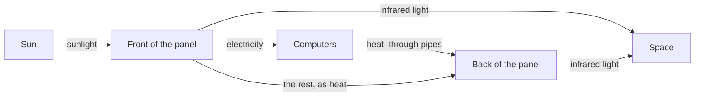

# Data centres in space

Some companies want to put their computers in orbit. Up there the sun shines almost all the time. There's no land to buy, no wait for a connection to the grid and no water for cooling. But every kilogram must be launched, and nobody can go up to fix a part that breaks.

So does it cost less? This page works it out in the open. It starts from [Andrew McCalip's calculator](https://andrewmccalip.com/space-datacenters) and uses most of his numbers.

> [!TIP] Every number with dashes under it is yours to change
> Drag it to the left or the right, and each number after it follows. Hold ⇧ to make each step ten times as big, and press ⌘Z to take a drag back. To see how a number is worked out, click its line and press ⌘E.

## The job

Say we want !`compute = 1GW` of computers to run for !`life = 20yr`. That's !`hours = life / 1hr` hours, so the computers use !`energy = convert(TWh, compute * life)` of electricity.

The computers themselves cost the same in orbit and on the ground, so the sums leave them out. They count what the computers need: power, a way to get rid of their heat, and a building or a spacecraft to hold them.

## Sunlight that doesn't set

Above the air, sunlight brings 1361 watts to each square metre. A satellite that circles over the line between day and night is in the sun !`sun = 100`% of the time. This is a dawn–dusk orbit.

Two things wear the fleet down:

- Radiation takes !`fade = 2.5`% of the power of the solar cells each year.[^1]
- Chips break, and nobody can swap them. McCalip takes !`fail = 9`% a year, the rate that Meta saw for its GPUs, the chips that do the work of AI.

Over the !`years = round(Int, life / 1yr)` years, the cells give !`cells = round(100 * sum((1 - fade / 100)^y for y in 0:years-1) / years, digits=1)`% of their first power on average, and !`works = round(100 * sum((1 - fail / 100)^y for y in 0:years-1) / years, digits=1)`% of the chips still work. So the fleet must start bigger than the job:

$$
\text{panels} = \frac{\text{computers}}{\text{sun} \times \text{cells} \times \text{works}}
$$

The fleet needs solar panels that make !`panels = round(compute / (sun / 100 * cells / 100 * works / 100) / 1MW) * 1MW` when they're new. That's !`round(Int, 100 * (panels / compute - 1))`% more than the computers use.

## Where the heat goes



Every watt that a panel takes in must leave again, and in space it can only leave as light. The front of the panel takes in !`absorb = 0.92` of the sunlight that hits it, which is !`heat = round(Int, 1361 * absorb)` watts on each square metre. It turns !`eff = 22`% of that into electricity. The computers turn the electricity back into heat, and pipes take that heat to the back of the panel. So the panel must shed all of what it took in.

A surface sheds heat as infrared light. How much it sheds depends on its temperature T, and on its emissivity ε, a number from 0 to 1 that says how well it glows:

$$
\frac{\text{heat}}{\text{area}} = (\varepsilon_{\text{front}} + \varepsilon_{\text{back}})\,\sigma\,T^4
$$

Here $\sigma = 5.67 \times 10^{-8}\,\text{W/m}^2\text{K}^4$ is the Stefan–Boltzmann constant. The glass on the front has an emissivity of !`e_front = 0.85`, and the white paint on the back has !`e_back = 0.90`. So the panel settles at !`panel_c = round(Int, (heat / (5.670e-8 * (e_front + e_back)))^(1/4) - 273.15)`°C.

Chips can run at up to !`chip_max = 85`°C. They're !`drop = 10`°C hotter than the panel that cools them, so the panel can be at most !`limit = chip_max - drop`°C. !`panel_c <= limit ? string("That leaves the panel ", limit - panel_c, " degrees to spare.") : string("The panel is ", panel_c - limit, " degrees too hot, so this design fails.")` Drag the emissivity of the back down to 0.5 to see a design fail.

The sums leave out the heat that comes up from the Earth. It warms the panel by a few degrees. McCalip's calculator counts it.

The panels of the whole fleet cover !`round(panels / 1W / (1361 * eff / 100) / 1e6, digits=1)` square kilometres.

## Weight

McCalip takes a Starlink V2 Mini satellite: about 27 kilowatts from 740 kilograms. That's !`spw = 36.5W/kg` for the whole satellite, with its panels, radiators, frame and electronics. So the fleet weighs !`fleet = round(panels / spw / 1ton, sigdigits=3)` tonnes, in !`ceil(Int, panels / 27kW)` satellites of that size.

A Starship is meant to carry 100 tonnes to orbit, so the fleet takes !`launches = ceil(Int, fleet / 100)` launches. That's one launch every !`round(Int, 365 * years / launches)` days for !`years` years.

## What orbit costs

The costs are in US dollars. Each sum keeps its unit, so a price for each watt times the watts comes to dollars.

- **Satellites.** McCalip prices a Starlink satellite at about !`per_watt = 22USD/W`, for each watt of its panels. The fleet costs !`build = per_watt * panels`.
- **Launches.** A Falcon 9 costs a customer roughly $3,000 a kilogram. SpaceX hopes that Starship will cost much less. Say !`per_kg = 500USD/kg`. The launches cost !`launch = per_kg * fleet * 1ton`.
- **Running it.** Ground stations and staff cost !`ops = 1`% of the price of the satellites each year. That's !`upkeep = build * ops / 100 * years`.
- **Design.** The first satellite of a new kind takes !`design = 1.0` billion USD of engineering.

In all, the data centre in orbit costs !`orbit = build + launch + upkeep + design * 1e9USD`.

## The same computers on the ground

McCalip compares it with a data centre that has its own gas power station beside it, as some new AI data centres do.

A data centre uses more power than its computers do, for cooling and for losses in its wiring. The ratio is its PUE, its power usage effectiveness. Here it's !`pue = 1.2`, so the power station must make !`station = compute * pue`. That's !`ceil(Int, station / 430MW)` big gas turbines of 430 megawatts each.

- **The power station** costs !`per_kw = 1800USD/kW`. That's !`plant = per_kw * station`.
- **The building.** For each watt of computers, the electrical gear costs !`elec = 5.25USD/W`, the cooling !`cool = 3.00USD/W`, the land and the shell !`shell = 2.50USD/W`, and the network and the fit-out !`fitout = 1.75USD/W`. That's !`building = (elec + cool + shell + fitout) * compute`.
- **Gas.** The turbines burn !`heat_rate = 6200` BTU of gas for each kilowatt-hour. A BTU is a British thermal unit. {==Gas costs $!`gas = 4.30` for a million BTU==}{>>Idea 4: show a number as it's typed. This sum is 4.30 and shows 4.3. A number that's worked out could also round to 3 significant figures by itself, so that no sum needs round(…, sigdigits=3).<<}, so each megawatt-hour takes $!`fuel_mwh = round(heat_rate * gas / 1000, digits=2)` of gas. The station runs !`uptime = 85`% of the time, so the gas for !`years` years costs !`fuel = fuel_mwh * 1USD/MWh * station * life * uptime / 100`.

In all, the data centre on the ground costs !`ground = plant + building + fuel`.

## Side by side

The two don't do the same work. The station on the ground stops !`100 - uptime`% of the time, for repairs and upkeep, and the computers stop with it. On the ground they get !`energy_ground = energy * uptime / 100`, not !`energy`. So the fair yardstick is what each megawatt-hour costs, for the electricity that reaches the computers.

| | What it costs | Each megawatt-hour |
|---|---|---|
| In orbit | !`orbit` | $!`per_orbit = round(Int, orbit / energy / (1USD/MWh))` |
| On the ground | !`ground` | $!`per_ground = round(Int, ground / energy_ground / (1USD/MWh))` |

```chart
kind: bars
title: What each megawatt-hour costs
show: Each megawatt-hour
```

In orbit, each megawatt-hour costs !`round(per_orbit / per_ground, digits=1)` times as much as on the ground. !`per_orbit > per_ground ? "The ground wins." : "Orbit wins."`

## What would have to change

For orbit to match the ground, the whole fleet can cost no more than !`target = ground / energy_ground * energy` over the !`years` years.

- If nothing else changes, launches would have to cost less than !`let x = (target - build - upkeep - design * 1e9USD) / (fleet * 1000); x > 0USD ? x : "nothing" end` for each kilogram.
- If launches stay at !`per_kg`, satellites would have to cost less than !`let x = (target - launch - design * 1e9USD) / panels / (1 + ops / 100 * years); x > 0USD/W ? round(convert(USD/W, x), digits=2) : "nothing" end`.
- Even if launches were free, satellites would have to cost less than !`round(convert(USD/W, (target - design * 1e9USD) / panels / (1 + ops / 100 * years)), digits=2)`.

Here the satellites cost !`build` and the launches !`launch`. Each bar shows its part of the two together:

- !`ProgressBar(value = build / (build + launch))` the satellites
- !`ProgressBar(value = launch / (build + launch))` the launches

!`build > launch ? "So cheaper satellites would help more than a cheaper rocket." : "So a cheaper rocket would help more than cheaper satellites."`

The sheet below tries every launch price from nothing to 2,000 USD a kilogram. It uses the numbers of the sums above, so a drag on one of them changes it too. The chart shows how many times the ground's cost orbit comes to at each price. Under 1, orbit wins. Point at the line to see the sheet at that price.

```sheet
Launch price = 0USD/kg to 2000USD/kg
Cost in orbit = build + launch price * fleet * 1ton + upkeep + design * 1e9USD
Times the ground = round(cost in orbit / energy / (ground / energy ground), digits=2)
```

```chart
kind: lines
title: How many times the ground's cost orbit comes to
show: Times the ground
```

## What the sums leave out

These would make orbit look worse:

- Sending the data down to Earth, and the time it takes to get there.
- Satellites that fail early, or that debris hits.
- Mass for the pipes and the radiators that the computers need, more than a Starlink satellite has.

These would make it look better:

- A gas price that goes up, or a price on carbon.
- Years spent waiting for a grid connection or a permit on the ground.
- Satellites that get cheaper as more of them are built.

McCalip's own verdict: "It's not obviously stupid, and it's not a sure thing."

> [!NOTE] Where these sums differ from McCalip's
> His calculator pays each year to build again the hardware that breaks. This page makes the fleet bigger at the start instead, the way it does for cells that fade. The totals come out close to his. His sums are in [math.js](https://github.com/andrewmccalip/thoughts/blob/main/static/js/math.js).

[^1]: 2.5% a year is McCalip's figure for silicon cells. His page gives no source for it. Silicon cells on eleven satellites in geostationary orbit lost 0.71% to 1.69% of their power each year: Lohmeyer, Aniceto, Cahoy and Carlton, "Solar array degradation on geostationary communications satellites", International Journal of Space Science and Engineering 5(1), 2018, [doi:10.1504/IJSPACESE.2018.090549](https://doi.org/10.1504/IJSPACESE.2018.090549). Those satellites were much higher than this fleet, so the rate here can be different.
