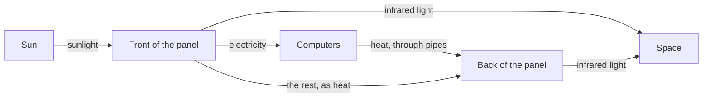
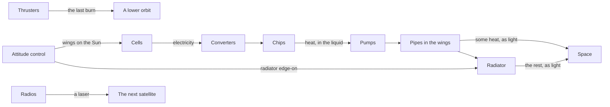

# Data centres in space

Say we launch a fleet with !`compute = 1GW` of computers. Let's see how much profit that would generate before reverting to inanimate matter.

The computers cost the same price in orbit and on the ground. Say that price is !`chip_price = 25USD/W` for each watt of computers, near the rack price further down. On each side that is !`chip_bill = chip_price * compute`. The sums also count what the computers need: power, a way to get rid of their heat, and a building or a spacecraft to hold them.

## Sunlight that doesn't set

Above the air, sunlight brings 1361 watts to each square metre. A satellite that circles over the line between day and night is in the sun !`sun = 98Percent` of the time. This is a dawn–dusk orbit.

It isn't 100% because the Earth's axis is tilted. For a few months of each year the orbit dips into shadow on each pass, for a small part of each orbit.[^3] The Moon hardly counts: it's in the way only during a solar eclipse.

Two things wear the fleet down, and nobody can go up to fix either of them.

### The solar cells

Radiation slowly wears down the power of the solar cells. Say they lose !`fade = 1.0Percent` of it each year.[^1] The share of their first power that the cells still give after $t$ years is

$$
\text{power}(t) = e^{-\text{fade}\,t}
$$

```sheet
Age = 0 to 100
Power of the cells = 100Percent * exp(-fade * age)
```

```chart
kind: lines
title: The power of the cells, in % of their first, by the fleet's age in years
show: Power of the cells
```

### The chips

Chips break too, and nobody can swap them. Once the early failures are past, data centres replace about !`fail = 0.6Percent` of their GPUs, the chips that do the work of AI, each year.[^2] A chip can fail more often as it gets older. Say the chance that a chip fails grows by !`ageing = 4Percent` each year. With 0, the chance stays the same. The share of the chips that still work after $t$ years is then

$$
\text{working}(t) = \exp\!\left(-\frac{a}{b}\left(e^{b t} - 1\right)\right)
$$

Here $a$ is the fail rate, and $b = \ln(1 + \text{ageing})$. This is the Gompertz model. When the ageing is 0, it's $e^{-a t}$.

```sheet
Age = 0 to 100
Chips that work = 100Percent * (ageing == 0Percent ? exp(-fail * age) : exp(-fail / log(1 + ageing) * ((1 + ageing)^age - 1)))
```

```chart
kind: lines
title: The chips that still work, in %, by the fleet's age in years
show: Chips that work
```

### The work that the fleet does

A chip with no power does no work, and power with no chip does none either. So each year the fleet does the work that the lower of the two lines allows. Added up until nothing is left, that's as much work as !`years = let d = float(fade), a = float(fail), g = float(ageing); round(0.05 * sum(min(exp(-d * t), g == 0 ? exp(-a * t) : exp(-a / log(1 + g) * ((1 + g)^t - 1))) for t in 0.025:0.05:2000), digits=1) end` years at full size:

$$
\text{years at full size} = \int_0^{\infty} \min\big(\text{power}(t),\ \text{working}(t)\big)\,dt
$$

So before the fleet is gone, its computers use !`energy = convert(TWh, compute * years * yr)` of electricity. That's the work that the fleet does.

The solar panels are just big enough to run every computer on the first day, so they make !`panels = round(convert(MW, compute / sun) / 1MW) * 1MW`. Smaller panels would leave some new chips with no power. Bigger panels would waste power at first, but later they'd make up for the cells' fade. That pays only while the line of the cells is under the line of the chips. !`crossover = let d = float(fade), a = float(fail), b = log(1 + float(ageing)); y = findfirst(t -> (b == 0 ? a * t : a / b * expm1(b * t)) >= d * t, 1:2000); a >= d ? 0 : y === nothing ? Inf : y end; crossover == 0 ? "The chips wear out at least as fast from the first day, so a bigger panel never pays." : crossover == Inf ? "The cells stay the limit for as far as these sums look." : string("With these numbers, the cells are the limit until year ", crossover, ". After that, dead chips hold the fleet back, and more power does nothing.")` So whether bigger panels are worth their launch depends on which line falls faster.

```chart
kind: lines
title: The cells and the chips, in %, by the fleet's age in years
from: The solar cells, The chips
show: Power of the cells, Chips that work
```

## Where the heat goes



Every watt that a panel takes in must leave again, and in space it can only leave as light. The front of the panel takes in !`absorb = 0.92` of the sunlight that hits it, which is !`heat = round(Int, 1361 * absorb)` watts on each square metre. The glass reflects the other !`round(Int, 100 * (1 - absorb))`% straight back into space. That light never turns into heat, so the sums leave it out. Of the light that the panel takes in, it turns !`eff = 22Percent` into electricity. The computers turn the electricity back into heat, and pipes take that heat to the back of the panel. So the panel must shed all of what it took in.

A surface sheds heat as infrared light. How much it sheds depends on its temperature T, and on its emissivity ε, a number from 0 to 1 that says how well it glows:

$$
\frac{\text{heat}}{\text{area}} = (\varepsilon_{\text{front}} + \varepsilon_{\text{back}})\,\sigma\,T^4
$$

Here $\sigma = 5.67 \times 10^{-8}\,\text{W/m}^2\text{K}^4$ is the Stefan–Boltzmann constant. The glass on the front has an emissivity of !`e_front = 0.85`, and the white paint on the back has !`e_back = 0.90`. So the panel settles at !`panel_c = round(Int, (heat / (5.670e-8 * (e_front + e_back)))^(1/4) - 273.15)`°C.

Chips can run at up to !`chip_max = 90`°C. Heat flows only from a hotter thing to a colder one, so the chips must be hotter than the panel that cools them. The heat goes from each chip through a metal plate into a liquid, and the liquid carries it through pipes to the panel. Each of those steps needs a difference in temperature to push the heat along. Together, they leave the chips about !`drop = 10`°C hotter than the panel. So the panel can be at most !`limit = chip_max - drop`°C. Bigger plates and faster liquid make the difference smaller, but they add weight. !`panel_c <= limit ? string("That leaves the panel ", limit - panel_c, " degrees to spare.") : string("The panel is ", panel_c - limit, " degrees too hot, so this design fails.")` Drag the emissivity of the back down to 0.5 to see a design fail.

### A radiator of its own

Most satellites don't cool their computers through the backs of their panels. They have a separate radiator, turned edge-on to the Sun, so that no sunlight falls on it. That changes the sums:

- The radiator sheds only the computers' heat. That's !`chip_heat = round(Int, heat * float(eff))` watts for each square metre of solar panel.
- No sunlight warms it, so it can be as hot as the chips allow, !`edge_c = limit`°C. Both of its faces shed heat, so each square metre sheds !`edge_w = round(Int, 2 * e_back * 5.670e-8 * (edge_c + 273.15)^4)` watts.
- So the radiator needs only !`edge_area = round(Int, 100 * chip_heat / edge_w)`% of the panels' area.
- The panel no longer takes the computers' heat, so it settles at !`round(Int, ((heat - chip_heat) / (5.670e-8 * (e_front + e_back)))^(1/4) - 273.15)`°C, not !`panel_c`°C. Cooler cells make a little more electricity.

SpaceX's Starmind AI1 is built this way. It has 110 square metres of radiators for 150 kilowatts, which is about 1,360 watts on each square metre.[^4] That's close to the sum above.

The separate radiator needs pipes over a small area, not over the back of every panel. It does need a frame of its own, and it must turn to stay edge-on to the Sun. Whether it saves weight depends on what each kind weighs for each square metre. The sums in this part don't weigh either one. The next section weighs that separate radiator. One face of it also sees the Earth, which warms it a little.

## The satellite

The fleet is many copies of one satellite. Each copy is built for !`sat = 150kW` of computers. The fleet needs !`nsat = ceil(Int, compute / sat)` copies. Each copy runs !`one = compute / nsat` of the computers.

The fleet's panels cover !`array_area = round(panels / 1W / (1361 * float(eff)))` square metres. Each copy has a body, wings of cells, and a radiator. The cells on one copy cover !`round(Int, array_area / nsat)` square metres. The radiator's area is worked out with the pipes, below.

Starmind AI1 is a satellite of about this power. Its wings span 70 metres, and it has 110 square metres of radiators for 150 kilowatts.[^4]



The chips sit in the body. The wings feed them. The pipes in the wings and the radiator cool them. Nobody goes up to repair a satellite.

## Weight and cost

The fleet's weight comes from five parts. The panels cover !`array_area` square metres. The computers use !`compute`.[^5] Each price below is for one satellite. Each figure is a guess, and you can drag it. The prices below leave out the chips. Their price is !`chip_bill`, added once on each side. Each part has to last the life of the fleet.

- **Solar cells.** Cells for space usually sit under a sheet of glass. Starpath's new Starlight Air cells are printed on a fabric, and they weigh only !`cells = 0.073` kg on each square metre. These cells have no glass on them. A cover of space glass, 150 µm thick, costs !`glass = 20000USD/m^2`.[^10] The sums put glass on !`glazed = 0Percent` of the cells. On one satellite the glass costs !`cost_glass = glass * glazed * array_area / nsat * 1m^2`. The kilograms leave the glass out. A sheet of 150 µm would add about 0.4 kg on each square metre. A silicon cell for the ground sells for about 30 cents a watt. A triple-junction cell made for space sells for $250 to $450 a watt.[^10] Nobody has published a price for these printed cells. At a large scale they should cost about the same as a cell for the ground. Say !`cell_price = 0.30USD/W` for each watt the panels make. On one satellite the cells cost !`cost_cells = cell_price * panels / nsat`.
- **What holds the cells out.** The cells are a fabric, so the wing only has to hold them in tension. For launch, they are wound on a drum. The drum's only job is to let that roll unwind. A thin pipe unrolls with them. The coolant from the chips runs through that pipe. The pressure holds the pipe straight, and that holds the cells in tension. If the pump stops, the wing goes slack. The pipe faces the sun, and the water in it is hot, so the pipe sheds heat as well as holding the wing. It sheds less than the edge-on radiator, because the sun falls on it. Say the pipe takes in !`pipe_absorb = 0.2` of the sunlight, and the water in it is at !`edge_c`°C. Each square metre of pipe then sheds !`pipe_w = round(Int, e_back * 5.670e-8 * (edge_c + 273.15)^4 - pipe_absorb * 1361 / 3.1416)` watts. Say the pipes are !`pipe_d = 20` mm across and !`pipe_gap = 50` cm apart. On each square metre of cells they shed !`pipe_shed = round(Int, pipe_w * 3.1416 * (pipe_d / 1000) / (pipe_gap / 100))` watts. That is !`pipe_share = chip_heat == 0 ? 0 : round(Int, 100 * pipe_shed / chip_heat)`% of the computers' heat. The separate radiator does the rest. It needs !`rad_use = max(0, round(Int, edge_area * (100 - pipe_share) / 100))`% of the panels. Without the pipes it would need !`edge_area`%. The sum leaves out the warmth from the Earth. Nobody has published a weight for a wing like this. A flown roll-out array makes 100 to 120 watts for each kilogram, cells and all. At the efficiency above, 110 watts a kilogram comes to about !`round(1361 * float(eff) / 110, digits=1)` kg on each square metre. Say the pipes and the water come to !`booms = 500g` on each square metre. The water is cheap. The drum is a plain roller. Say the pipes and the water cost !`boom_price = 20USD/kg`. On one satellite they cost !`cost_booms = boom_price * (booms / 1kg) * (1kg/m^2) * array_area / nsat * 1m^2`.
- **Radiators.** Musk says these are aluminum. A sheet pointed away from the Sun, he says, sheds about 1,300 watts on each square metre. SpaceX has not published a thickness or a mass.[^5] Aluminum weighs !`alu = 2700kg/m^3`. A sheet's mass is that density times its thickness. Say the sheet is !`sheet = 0.8mm` thick. That is the thickness of one deployable aluminum panel that still spread its heat. The metal then weighs !`sheet_kg = alu * sheet` on each square metre. A tube 6 mm across, with a wall of 0.5 mm, laid every 10 cm, weighs about 0.25 kg on each square metre. The water in it weighs about the same. Say the tubes and the water together weigh !`tubes = 0.5kg/m^2`. The radiator in the sums weighs !`radiator = (sheet_kg + tubes) / (1kg/m^2)` kg on each square metre. A separate shield against grit is not in that number. Flown radiators, with their honeycomb and heat pipes, weigh 2 to 8 kg on each square metre, and those of the ISS weigh 7.8. On one copy the separate radiator covers !`round(Int, array_area * rad_use / 100 / nsat)` square metres. The metal sells for !`alu_price = 2.50USD/kg` a kilogram. On one satellite the aluminum in the sheets comes to !`alu_price * sheet_kg * array_area * rad_use / 100 / nsat * 1m^2`. The finished radiator costs more than that metal. The tubes, the white paint and the joins are in the price. Say !`rad_price = 200USD/m^2`. On one satellite the radiators cost !`cost_rad = rad_price * array_area * rad_use / 100 / nsat * 1m^2`.
- **Computers.** A rack of 72 Nvidia GPUs weighs about 1,470 kg and uses about 132 kilowatts. That's 11 kg for each kilowatt, with its steel cabinet, fans and power supplies. A satellite needs no cabinet or fans, so say !`computers = 6` kg for each kilowatt.
- **The body.** This holds the computers. It is the frame, the converters, the pumps, the thrusters, the attitude control, and the radios. The shadow is a small part of the year, so the sums add no battery. The JPL study puts the body at 7 to 30 kg for each kilowatt, and that range includes a battery.[^5] On one satellite that is !`round(Int, 7 * one / 1kW)` to !`round(Int, 30 * one / 1kW)` kg.

On one satellite, say:

- The frame is !`frame = 2.5kg/kW *one`. It holds the computers, and it joins the wings and the radiator. It is sheet, like the aluminum in the radiators. Say it costs !`frame_price = 2.50USD/kg`. On one satellite the frame costs !`cost_frame = frame_price * frame`.
- The converters are !`converters = 1.2kg/kW * one`. They turn the cells' electricity into the voltage the chips take. On the ground, the same job sits in the building's electrical gear, further down. A commercial converter sells for well under a dollar a watt. Say !`conv_price = 0.50USD/W` for each watt of the computers. On one satellite the converters cost !`cost_conv = conv_price * one`.
- The pumps are !`pumps = 0.5kg/kW * one`. They push the cooling liquid from the chips to the radiator. The pump costs !`cost_pumps = 400USD`.
- The thrusters are !`thrusters = 1.5kg/kW * one`. They fly the last burn. The set costs !`cost_thrust = 120000USD`.
- The attitude control is !`pointing = 1kg/kW * one`. Wheels and sensors keep the solar panels facing the Sun, and the radiator edge-on to it. The set costs !`cost_point = 150000USD`.
- The radios are !`radios = 0.3kg/kW * one`. Each satellite has a laser to the next satellite, and a small radio to the ground. A Starlink satellite also carries a big antenna, to reach a dish. The laser and the radio cost !`cost_radios = 200000USD`.

Together the body weighs !`bus = frame + converters + pumps + thrusters + pointing + radios`. The split is a guess.

The thrusters, the attitude control, and the radios are a set price. A bigger satellite pays the same for those three, in these sums. A much bigger one would need a stronger wheel and a stronger thruster. Drag those three prices if you raise the computers on one satellite a long way.

Putting the parts together, and testing the satellite, costs !`fit = 10Percent` of the parts above. The parts on one satellite come to !`hardware = cost_cells + cost_booms + cost_rad + cost_glass + cost_conv + cost_frame + cost_pumps + cost_thrust + cost_point + cost_radios`. Joining and testing costs !`cost_fit = fit * hardware`.

One satellite costs !`sat_cost = hardware + cost_fit`. The !`nsat` copies cost !`build = sat_cost * nsat`.

| Part | Tonnes |
|---|---|
| Solar cells | !`round(Int, cells * array_area / 1000)` |
| What holds the cells out | !`round(Int, booms / 1kg * array_area / 1000)` |
| Radiators | !`round(Int, radiator * array_area * rad_use / 100 / 1000)` |
| Computers | !`round(Int, computers * compute / 1kW / 1000)` |
| The body | !`round(Int, bus / 1kg * nsat / 1000)` |

```chart
kind: pie
title: Where the fleet's weight goes
```

In all, the fleet weighs !`fleet = round((array_area * (cells + booms / 1kg + radiator * rad_use / 100) + computers * compute / 1kW + bus / 1kg * nsat) / 1000, sigdigits=3)` tonnes. That's !`round(panels / (fleet * 1ton) / (1W/kg), digits=1)` watts for each kilogram. One copy weighs !`sat_kg = round(Int, (cells * array_area + booms / 1kg * array_area + radiator * array_area * rad_use / 100) / nsat + computers * one / 1kW + bus / 1kg)` kg. The computers are !`round(Int, computers * one / 1kW)` kg of that.

The thin cells are the lightest part, so a lighter panel saves little. Most of the weight is in the computers and the body. Drag the cells, the computers, or any part of the body.

Musk now says a later Starship will carry more than !`ship = 200` tonnes to a low orbit.[^6] The fleet takes !`launches = ceil(Int, fleet / ship)` launches. SpaceX still quotes today's ship at 100 tonnes. The dawn–dusk orbit is harder to reach, so a launch may carry less.

| Part | Kilograms on one satellite | Cost on one satellite |
|---|---|---|
| Solar cells | !`round(Int, cells * array_area / nsat)` | !`cost_cells` |
| What holds the cells out | !`round(Int, booms / 1kg * array_area / nsat)` | !`cost_booms` |
| Radiators | !`round(Int, radiator * array_area * rad_use / 100 / nsat)` | !`cost_rad` |
| Glass on the cells | | !`cost_glass` |
| Converters | !`round(Int, converters / 1kg)` | !`cost_conv` |
| Frame | !`round(Int, frame / 1kg)` | !`cost_frame` |
| Pumps | !`round(Int, pumps / 1kg)` | !`cost_pumps` |
| Thrusters | !`round(Int, thrusters / 1kg)` | !`cost_thrust` |
| Attitude control | !`round(Int, pointing / 1kg)` | !`cost_point` |
| Radios | !`round(Int, radios / 1kg)` | !`cost_radios` |
| Joining and testing | | !`cost_fit` |

```chart
kind: pie
title: What one satellite costs
show: Cost on one satellite
```

This comes to !`round(convert(USD/W, build / panels), digits=2)` a watt. Philip Johnston, who runs Starcloud, says an AI satellite can cost less than $5 a watt, once the chips are left out.[^9] A big antenna is the main thing his satellite also leaves out.

## Keeping the height

The 98% sun above is what a dawn–dusk orbit gets near 1,000 km. Say the fleet flies at !`alt = 1000km`.

The panels face the sun. The flight is nearly along their edge, so over a year they show the air !`ram = 17Percent` of their area.[^7] The radiators can sit edge-on to the sun and to the flight, so the sums leave their faces out.

Say the air in a busy solar year weighs !`thick = 1` times what it weighs in an average year. The air at this height then weighs !`air = let h = alt / 1km; xs = [400.0, 500.0, 600.0, 800.0, 1000.0, 1200.0, 1400.0]; ys = [-11.6, -12.3, -13.0, -14.0, -14.7, -15.4, -16.0]; h2 = min(xs[end], max(xs[1], h)); i = findfirst(x -> x >= h2, xs); y = i == 1 ? ys[1] : ys[i - 1] + (ys[i] - ys[i - 1]) * (h2 - xs[i - 1]) / (xs[i] - xs[i - 1]); thick * 10.0^y * kg/m^3 end`.

About 1% of the chips are left after !`life = let a = float(fail), g = float(ageing), b = log(1 + g); round(g == 0 ? log(100) / a : log(1 + b / a * log(100)) / b, digits=1) end` years. By then the air has taken !`loss = let ρ = air / (1kg/m^3), A = array_area * float(ram), m = fleet * 1000, a_m = (6378 + alt / 1km) * 1000, v = sqrt(3.986e14 / a_m), acc = 0.5 * 2.2 * ρ * v^2 * A / m; round(acc * life * 365.25 * 86400, digits=1) end` metres a second, and the height has fallen !`fall = let a_m = (6378 + alt / 1km) * 1000, v = sqrt(3.986e14 / a_m); round(2 * a_m / v * loss / 1000, digits=1) end` km. !`fall < 100 ? "That is too little to need a reboost before the chips are gone." : "The fleet needs a reboost, or it leaves this height while chips are still working. The air thickens as it falls, so the real drop is larger than this."`

At the end, one burn lowers the near point of the orbit to !`peri = 80km`, and the air does the rest. That burn takes !`deorbit = let r1 = (6378 + alt / 1km) * 1000, rp = (6378 + peri / 1km) * 1000, μ = 3.986e14, a = (r1 + rp) / 2, vc = sqrt(μ / r1), va = sqrt(μ * (2 / r1 - 1 / a)); round(vc - va, digits=1) end` metres a second.

Say the thrusters give !`isp = 2000` seconds of push from each second of their fuel. The fuel for the deorbit burn weighs !`propellant = round(fleet * (exp(deorbit / (isp * 9.80665)) - 1), digits=1)` tonnes.

A lower orbit can fall on its own. Near 830 km the sun is about 97.5%, a little under the 98% above, and in an average year the fleet would reach the air in about 90 years. That is about when 1% of the chips are left. If the busy year above is 10 times as thick, that same orbit falls in about 9 years, while the chips are still working. One height cannot both last the full life of the chips and come down on its own in a reasonable amount of time, so the fleet needs a deorbit burn.

## What orbit costs

Five amounts, added once. The prices are in US dollars.

- **The satellites.** The !`nsat` copies cost !`build`. That is !`round(convert(USD/W, build / panels), digits=2)` for each watt the panels make. McCalip's Starlink figure is !`per_watt = 22USD/W` a watt.[^9]
- **The computers.** They cost !`chip_bill` on this side, and the same on the ground.
- **The launches.** A Falcon 9 costs a customer roughly $3,000 a kilogram. Say a Starship costs !`per_kg = 100USD/kg`. The fleet weighs !`fleet` tonnes. The launches cost !`launch = per_kg * fleet * ton`.
- **Keeping it running.** The fleet has two bills. The link is paid for the !`years` years of work at full size, because a chip that has failed sends nothing. The people are paid for !`life` years, until 1% of the chips are left.

  - **The link.** SpaceX already runs Starlink, so the fleet builds no ground stations. The radios are already in the body. Say the results average !`traffic = 1` gigabit a second, which is !`round(traffic * 86400 / 8 / 1000, digits=1)` terabytes a day. Starlink's price for extra data is !`per_gb = 0.25USD` for each gigabyte.[^8] A customer would pay !`list = traffic * 365.25 * 86400 / 8 * per_gb / 1yr` a year for that stream. This fleet buys no dish and no share of the constellation. Say the extra cost on the network that already runs is !`own = 10Percent` of that price. At 100% the fleet pays the customer's price. The link costs !`link = list * own * years * yr`.

  - **The people.** The satellites fly themselves, as Starlink's do. The people who schedule the same jobs on the ground are left out of both sides. The people who write the software are in the design, which is paid once. Say !`seats = 6` extra seats watch this fleet. A seat filled day and night takes !`cover = 5` people, for three shifts, weekends and leave. Each person costs !`pay = 300000USD/yr` a year, in pay and overhead. They cost !`people = seats * cover * pay * life * yr`.

  The two bills together cost !`upkeep = link + people`. That is !`round(float(upkeep / build) / float(1Percent), digits=1)` percent of what the satellites cost.
- **The design.** Engineering the first satellite of a new kind costs !`design = 100000000USD`. That is paid once.
- **Deorbit.** The fuel for the burn costs !`deorbit_cost = per_kg * propellant * ton`.

| Part | Cost |
|---|---|
| The satellites | !`build` |
| The computers | !`chip_bill` |
| The launches | !`launch` |
| Keeping it running | !`upkeep` |
| The design | !`design` |
| Deorbit | !`deorbit_cost` |
| Total | !`orbit = build + chip_bill + launch + upkeep + design + deorbit_cost` |

```chart
kind: pie
```

## The same computers on the ground

McCalip compares it with a data centre that has its own gas power station beside it, as some new AI data centres do.

A data centre uses more power than its computers do, for cooling and for losses in its wiring. The ratio is its PUE, its power usage effectiveness. Here it's !`pue = 1.2`, so the power station must make !`station = compute * pue`. That's !`ceil(Int, station / 430MW)` big gas turbines of 430 megawatts each.

- **The power station** costs !`per_kw = 1000USD/kW`. That's !`plant = per_kw * station`.
- **The building.** For each watt of computers, the electrical gear costs !`elec = 5.00USD/W`, the cooling !`cool = 3.00USD/W`, the land and the shell !`shell = 2.50USD/W`, and the network and the fit-out !`fitout = 1.75USD/W`. That's !`building = (elec + cool + shell + fitout) * compute`.
- **The computers.** They cost !`chip_bill` here too.
- **Gas.** The turbines burn !`heat_rate = 6200` BTU of gas for each kilowatt-hour. A BTU is a British thermal unit. Gas costs $!`gas = 4.30` for a million BTU, so each megawatt-hour takes $!`fuel_mwh = round(heat_rate * gas / 1000, digits=2)` of gas. The station lasts !`ground_life = 20yr` and runs !`uptime = 85Percent` of the time, so its gas costs !`fuel = fuel_mwh * 1USD/MWh * station * ground_life * uptime`.

In all, the data centre on the ground costs !`ground = plant + building + fuel + chip_bill`.

## What SpaceX pays

The sums above follow McCalip. He prices a data centre with its own combined-cycle gas plant, and he leaves out the chips. The building and the plant come to !`ground_capex = round(convert(USD/W, (plant + building) / compute), digits=2)` a watt of computers. The gas is on top of that.

SpaceX is the centre people compare against, and SpaceX has said what it pays. On 17 November 2026 Bret Johnsen, its finance chief, said the first couple of gigawatts cost in the low to mid $30s a watt. He put everyone else at $50 to $60 a watt.[^11]

His figure includes the chips. This page adds the computers at !`chip_price` a watt, on both sides. !`ground_capex` is still only the building and the plant, so it can sit next to the surveys that leave the chips out.

Epoch AI estimates a site's cost from permits and from photographs. Colossus 2, SpaceX's centre in Memphis, is $35.8 billion for 946 megawatts of computers. That is $38 a watt. Colossus 1, the first centre, comes out at about the same price a watt.[^12] Johnsen's range sits a little under those estimates.

A published price for one GB200 rack is about $3 million, at about 130 kilowatts. That is already near $25 a watt. Reports put a GB300 rack near $5 million, about $35 a watt for the rack alone.[^13] The chips can use up most of the $30 to $35. Johnsen has not published how he splits the chips from the building.

With the chips left out, the 2026 surveys land next to !`ground_capex`.

- Turner & Townsend puts an ordinary US data centre at $12.08 a watt to build. The most advanced AI halls cost $14 to $16 a watt.[^14]
- A guide that adds the land and the power gear, and still leaves out the chips, averages $17.60 a watt. Its range is $8.90 to $23.30.[^14]
- With the chips put back in, Bernstein and Morgan Stanley say about $35 billion for one gigawatt of GB200 racks. Epoch's own model says $38 billion. Barclays and Nvidia quote $50 billion to $60 billion.[^15]

So !`ground_capex` a watt is a fair price for the building, the cooling and the electrical gear. SpaceX has not published a building price on its own.

The plant in the sums is not the plant that feeds Colossus.

The sums burn !`heat_rate` BTU of gas for each kilowatt-hour, in turbines of 430 megawatts. A BTU is a British thermal unit. That heat rate belongs to a combined-cycle plant. A combined-cycle plant puts a steam turbine behind the gas turbine and uses the exhaust heat. The US Energy Information Administration's 2026 figure for one is about $1,000 to $1,100 a kilowatt, at 6,226 BTU. A simple-cycle turbine has no steam turbine. In the same tables it burns about 9,100 to 9,500 BTU.[^16]

Southaven, across the state line from Memphis, feeds Colossus. Its permit is 41 simple-cycle turbines: 17 Solar Titan 130s, 16 Solar Titan 350s, and 8 rebuilt jet engines of 50 megawatts. Together they are about 1,240 megawatts. The temporary turbines are to be gone by July 2027. The 41 stay.[^17]

Gas at !`gas` dollars for a million BTU is McCalip's 2025 forecast. Henry Hub is the US spot price for gas. It was $3.03 on 13 November 2026.[^18]

Price that plant at $1,800 a kilowatt, with gas at $3.20 and 9,400 BTU for each kilowatt-hour. It costs !`alt_ground = plant + building + (9400 * 3.20 / 1000) * 1USD/MWh * station * ground_life * uptime`. That is !`round((float(alt_ground / ground) - 1) / float(1Percent), digits=0)`% !`alt_ground > ground ? "more" : "less"` than the plant in the sums. The two changes nearly cancel. The building is the large part of the cost, and the surveys support it.

Johnsen said SpaceX is cheaper because it does the engineering, the building and the power itself. A supplier had quoted 18 to 24 months for turbine blades, so SpaceX is casting its own.[^11] The sums have no line for that wait.

One reading of his gap does not fit the surveys. From about $55 a watt down to about $32 is roughly $23 a watt. The surveys only have $12 to $18 a watt of building, once the chips are out. So either SpaceX's building is far cheaper than the surveys, or part of the gap is a lower price on the chips. A cheaper chip costs the same number of dollars on both sides. Each megawatt-hour still changes, because the two sides do different amounts of work.

## Side by side

The two don't do the same work. The fleet does !`energy` of work before it's gone. On the ground the computers stop when the station stops, !`100Percent - uptime` of the time, for repairs and upkeep. Over its !`round(Int, ground_life / 1yr)` years the station gives them !`energy_ground = convert(TWh, compute * ground_life * uptime)`. So the fair yardstick is what each megawatt-hour costs, for the electricity that reaches the computers.

| | What it costs | The work it does | Each megawatt-hour |
|---|---|---|---|
| In orbit | !`orbit` | !`energy` | $!`per_orbit = round(Int, orbit / energy / (1USD/MWh))` |
| On the ground | !`ground` | !`energy_ground` | $!`per_ground = round(Int, ground / energy_ground / (1USD/MWh))` |

```chart
from: Side by side
title: What each megawatt-hour costs
show: Each megawatt-hour
```

In orbit, each megawatt-hour costs !`round(per_orbit / per_ground, digits=1)` times as much as on the ground. !`per_orbit > per_ground ? "The ground wins." : "Orbit wins."`

## Why the same chips do more work

Both sides buy the chips once, at the same price. The station on the ground lasts !`ground_life`, and it is on for !`uptime` of that time. While it is on, the ground sum keeps the chips at full power. That is !`full_ground = round(float(ground_life / 1yr) * float(uptime), digits=1)` years at full size.

In orbit a dead chip stays dead, and the cells fade. Each year the fleet does only as much as the weaker of the cells and the chips. That still adds up to !`years` years at full size, which is !`work_ratio = round(years / full_ground, digits=1)` times the work on the ground.

The computers on the ground stop because their gas station stops. The price includes one station, and that station lasts !`ground_life`. When it stops, the computers stop with it. After those years, !`still = let a = float(fail), g = float(ageing), t = float(ground_life / 1yr); round(Int, 100 * (g == 0 ? exp(-a * t) : exp(-a / log(1 + g) * ((1 + g)^t - 1)))) end`% of the chips are still working.

The panels are already big enough to run every computer on the first day. The extra work comes from counting the fleet past this station.

> [!NOTE] Where these sums differ from McCalip's
> His calculator keeps the fleet at full size for a set number of years. It pays each year to build again the hardware that breaks. This page launches the fleet once, lets it wear down, and counts the work that it does before it's gone.

[^1]: 2.5% a year is McCalip's figure for silicon cells. His page gives no source for it. Silicon cells on eleven satellites in geostationary orbit lost 0.71% to 1.69% of their power each year: Lohmeyer, Aniceto, Cahoy and Carlton, "Solar array degradation on geostationary communications satellites", International Journal of Space Science and Engineering 5(1), 2018, [doi:10.1504/IJSPACESE.2018.090549](https://doi.org/10.1504/IJSPACESE.2018.090549). Those satellites were much higher than this fleet, so the rate here can be different.

[^2]: McCalip takes 9% a year, from Meta's report on how it trained Llama 3 ([Grattafiori and others, 2024](https://arxiv.org/abs/2407.21783), section 3.3.4). In 54 days on about 16,000 H100 GPUs, 148 interruptions came from faulty GPUs and 72 from their memory, which is about 9% a year. But an interruption isn't a dead chip. A restart or a swap fixes many of them, and Meta's cluster was new. Chips that are replaced for good are much rarer. On NCSA's Delta system, 4 of 448 A100 GPUs were replaced in 895 days, about 0.36% a year, and 2 of 608 H100 GPUs in 146 days, about 0.82% a year ([Cui and others, 2025](https://arxiv.org/abs/2503.11901), section 4.1). That's only six failures, so the rates are rough. Chips can also fail more often as they age. From 2016, the GPUs of Oak Ridge's Titan supercomputer started to fail, because a resistor on their boards corroded ([ORNL](https://www.ornl.gov/news/gpu-lifetimes-titan-supercomputer-survival-analysis-and-reliability/)).

[^3]: Pablo and others, "[The BRITE Constellation nanosatellite mission: testing, commissioning and operations](https://arxiv.org/abs/1608.00282)", Publications of the Astronomical Society of the Pacific 128, 2016. Its satellites dip into the shadow "between November and February, when the Earth’s northern hemisphere is most strongly tilted away from the Sun".

[^4]: SpaceX has published few of these figures itself, and the reports don't all agree. V3: [The Register](https://www.theregister.com/2025/07/16/starlink_network_update/), [Notebookcheck](https://www.notebookcheck.net/SpaceX-Starship-flight-14-launches-first-Starlink-V3-satellites-for-gigabit-downloads.1410436.0.html) (2 tonnes) and [SatNews](https://satnews.com/2026/07/13/spacex-advances-direct-to-device-constellation-matrix-with-starlink-v3-hardware/) (1,500 kilograms). AI1: [Notebookcheck](https://www.notebookcheck.net/SpaceX-lists-AI1-satellite-cooling-specs-for-Starmind-data-center-in-space.1340218.0.html), from SpaceX's Starmind page. The 70 kilowatts in each tonne, and the sceptic's 6 tonnes, are from [Graham Wallington](https://medium.com/@graham.wallington/why-spacexs-ai1-orbital-data-centre-doesn-t-add-up-a49d26eb0a48). Gen3: Musk on X, as [SatNews](https://satnews.com/2026/10/04/spacex-unveils-250-kw-starlink-gen3-ai-satellites-featuring-10-tbps-throughput-and-onboard-edge-compute/) reports it. V4: Musk at the Baron conference in November 2026, as [TeslaNorth](https://teslanorth.com/2026/11/06/starlink-v4-satellites-baron-2026/) reports it.

[^5]: Starlight Air: [Payload](https://payloadspace.com/exclusive-starpath-unveils-new-ultra-thin-space-solar-panels/), March 2026. Roll-out arrays: [Redwire's ROSA](https://rdw.com/product-archive/power/rosa/), 100 to 120 watts for each kilogram. Radiators: Musk on X, 3 November 2026, as [Wccftech](https://wccftech.com/elon-musk-defends-space-ai-satellites-asserts-they-will-emit-1300-m%C2%B2-in-heat-for-rapid-cooling/) reports it. He says an aluminum radiator pointed away from the Sun sheds about 1,300 watts on each square metre, and he gives no thickness. A deployable panel in an Air Force study used a sheet of 6061 aluminum 0.8 mm thick, which still spread the heat: [TFAWS 2024 PT-11](https://www.nasa.gov/wp-content/uploads/2024/11/tfaws_TFAWS2024-PT-11.pdf). That alloy weighs 2,700 kg on each cubic metre. The ISS photovoltaic radiators, [SAE 932151](https://papers.sae.org/publications/technical-papers/content/932151/), and [SAE 961456](https://saemobilus.sae.org/papers/unfurlable-space-based-heat-pipe-radiator-961456), put radiators of that time at 5 to 7 kg on each square metre. The shuttle's faces were 0.28 mm of aluminum, on a honeycomb ([Journal of Spacecraft and Rockets](https://arc.aiaa.org/doi/10.2514/1.A35030)). The JPL study: Turyshev, "[Orbital Data Centers: Spacecraft Constraints and Economic Viability](https://arxiv.org/abs/2604.27197)", 2026, which calls its figures illustrative. The rack: [HPE's data sheet](https://www.hpe.com/int/en/collaterals/collateral.a50009224enw.html) for the GB200 NVL72, 3,245 pounds and 132 kilowatts.

[^6]: Musk on X, 16 November 2026, replying to a post that put the load at 100 tons. He wrote that the propellant will cost less than $500,000 a flight, and that the load will exceed 200 tons ([the post](https://x.com/elonmusk/status/2122217639540134337)). SpaceX's prospectus of 20 May 2026 still expects today's Starship, V3, to carry 100 metric tons. It says a later one could reach 200, perhaps as soon as V4 ([the filing](https://www.sec.gov/Archives/edgar/data/1181412/000162828026036936/spaceexplorationtechnologi.htm)).

[^7]: The 17% is how much of a sun-facing panel faces the airflow over a year in a dawn–dusk orbit. The panel tracks the sun, and the sun sits nearly at right angles to the orbit. The air's weight is a round figure for a moderate solar year, about 2.5e-12 kg/m³ at 400 km and about 2e-15 kg/m³ at 1,000 km. A solar maximum can be about ten times thicker at 400 km, and more than that higher up. The drag sum uses a coefficient of 2.2.

[^10]: Richards and others, "The return of silicon solar cells to space", Acta Astronautica, November 2026, [ScienceDirect](https://www.sciencedirect.com/science/article/abs/pii/S0094576526003644). The review puts triple-junction space cells at $250 to $450 a watt. It puts mainstream silicon modules, in November 2025, at about 28 to 39 cents a watt. It puts space coverglass, 150 µm thick, at $15,000 to $20,000 a square metre. The quotes are from suppliers of the glass. The glass, not the silicon, is most of the cost of a silicon array of the usual kind.

[^9]: Philip Johnston of Starcloud, as reported in [The Sydney Morning Herald](https://www.smh.com.au/technology/data-centres-in-space-that-s-less-crazy-than-you-think-20260311-p5o9lq.html), 12 March 2026, from The Economist of 2 March 2026. He expects the satellite to cost less than $5 a watt once the chips are left out. The same piece gives McCalip's estimate of about $22 a watt for a current Starlink satellite, down from $32 for the first version.

[^8]: Starlink's US Local Priority plan sells an extra 500 GB for $125 a month, which is 25 cents a gigabyte. That is the price a customer pays for a dish and a share of the network. It is not SpaceX's extra cost for traffic on the network it already runs. The $125 figure is from Starlink's business plans as listed by [StarSurf](https://www.starsurf.com/starlink-for-business/) on 10 November 2026. The plans themselves are at [starlink.com/business/service-plans](https://starlink.com/business/service-plans).

[^11]: Bret Johnsen, SpaceX's finance chief, at the TomorrowX Summit in Austin on 17 November 2026. He said the first couple of gigawatts cost in the low to mid $30s a watt, against $50 to $60 for everyone else. [TMT Breakout](https://www.tmtbreakout.com/p/tmtb-tomorrowx-highlights-spacex) wrote up the session on 18 November 2026. The same lines were posted that day from the stage. He also said a supplier had quoted 18 to 24 months for turbine blades, and that SpaceX is casting its own. The $30s figure is the cost of putting the compute on the ground, chips included. He did not split out the building.

[^12]: Epoch AI's directory, [Colossus 2](https://epoch.ai/data/ai-data-centers/directory/colossus-2), updated 30 July 2026: $35.8 billion and 946 megawatts of computer power. [Colossus 1](https://epoch.ai/data/ai-data-centers/directory/colossus-1): $12.9 billion and 340 megawatts. Both come to about $38 a watt. The cost includes the chips. Epoch estimates it from public information. SpaceX has not published this split.

[^13]: Nvidia does not publish a rack price. A GB200 NVL72 is widely put at about $3 million. SemiAnalysis has put the same rack at about $3.1 million before extras and $3.9 million all in, at 120 to 132 kilowatts. A reported GB300 purchase order in 2026 was just under $5 million. Chris Zeoli, "[How Much Does an NVIDIA NVL72 Cost?](https://www.datagravity.dev/p/how-much-does-an-nvidia-nvl72-cost)", 31 August 2026, collects these. At 130 kilowatts, $3 million is $23 a watt and $5 million is $38 a watt.

[^14]: Turner & Townsend's data centre cost index, as [Quartz](https://qz.com/us-data-center-construction-costs-13-percent-turner-townsend-112026) reported it on 20 November 2026. The US average is $12.08 a watt. The most advanced AI halls cost $14 to $16. Cushman & Wakefield's 2026 development cost guide, as [Data Center Scouts](https://datacenterscouts.com/data-center-construction-cost/) reports it: $8.9 million to $23.3 million a megawatt, average $17.6 million. That guide includes the land and the power gear. It leaves out the chips.

[^15]: [Ynot Photonics](https://ynotphotonics.com/insights/what-a-gigawatt-of-ai-data-center-costs/), "What a gigawatt of AI data center actually costs", 8 July 2026, updated 19 October 2026, lines the estimates up. Bernstein and Morgan Stanley say about $35 billion for one gigawatt of GB200 racks. Morgan Stanley says $39 billion for GB300 and $49 billion for the Vera Rubin generation. Epoch's model of a typical centre says $38 billion. Barclays and Nvidia quote $50 billion to $60 billion. The houses do not all mean the same thing by one gigawatt. Some count the power at the computers, and some count it at the meter.

[^16]: US Energy Information Administration, assumptions for the Annual Energy Outlook 2026. A combined-cycle plant of 1,227 megawatts costs $1,032 a kilowatt in 2025 dollars, and it burns 6,226 BTU for each kilowatt-hour. An aeroderivative simple-cycle plant costs $2,275 a kilowatt and burns 9,447 BTU. The Sargent & Lundy study behind the 2025 outlook, in 2023 dollars, put a large combined-cycle plant at $868 a kilowatt. [GridLab's September 2025 review](https://gridlab.org/gas-turbine-cost-report/) of utility filings finds new combined-cycle plants at $2,000 a kilowatt and up. The page's $1,800 sits between the official combined-cycle figure and the price utilities are paying.

[^17]: The March 2026 air permit for MZX Tech, a SpaceX company, at Southaven, Mississippi. It allows 17 Solar Titan 130 turbines at 16.48 megawatts, 16 Solar Titan 350 turbines at 35 megawatts, and 8 ProEnergy 6000PE turbines at 50 megawatts. The 6000PE is a jet engine rebuilt as a generator. The permit board upheld the permit on 10 November 2026. An agreed order says the temporary turbines come out by July 2027. The plant is simple cycle. It has no steam turbine behind the gas turbine, which is why the heat rate is the higher one.

[^18]: Henry Hub spot price, weekly, from the US Energy Information Administration, as [FRED](https://fred.stlouisfed.org/series/WHHNGSP) publishes it. The reading for 13 November 2026 is $3.03 a million BTU. Front-month futures in the week of 23 November 2026 traded around $3.20 to $3.50. A data centre in Memphis pays a local pipeline price on top of Henry Hub. The sums do not add that.
