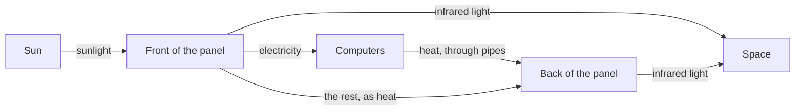

# Data centres in space

Say we launch a fleet with !`compute = 1GW` of computers. Nobody can go up to fix them, so the fleet wears down until nothing works. This page works out how much work the fleet does before then, and what each megawatt-hour of that work costs.

The computers themselves cost the same in orbit and on the ground, so the sums leave them out. They count what the computers need: power, a way to get rid of their heat, and a building or a spacecraft to hold them.

## Sunlight that doesn't set

Above the air, sunlight brings 1361 watts to each square metre. A satellite that circles over the line between day and night is in the sun !`sun = 98Percent` of the time. This is a dawn–dusk orbit.

It isn't 100% because the Earth's axis is tilted. For a few months of each year the orbit dips into shadow on each pass, for a small part of each orbit.[^3] The Moon hardly counts: it's in the way only during a solar eclipse.

Two things wear the fleet down, and nobody can go up to fix either of them.

### The solar cells

Radiation slowly wears down the power of the solar cells. Say they lose !`fade = 1.0Percent` of it each year.[^1] The share of their first power that the cells still give after $t$ years is

$$
\text{power}(t) = e^{-\text{fade}\,t}
$$

```sheet
Age = 0 to 100
Power of the cells = 100Percent * exp(-fade * age)
```

```chart
kind: lines
title: The power of the cells, in % of their first, by the fleet's age in years
show: Power of the cells
```

### The chips

Chips break too, and nobody can swap them. Once the early failures are past, data centres replace about !`fail = 0.6Percent` of their GPUs, the chips that do the work of AI, each year.[^2] A chip can fail more often as it gets older. Say the chance that a chip fails grows by !`ageing = 4Percent` each year. With 0, the chance stays the same. The share of the chips that still work after $t$ years is then

$$
\text{working}(t) = \exp\!\left(-\frac{a}{b}\left(e^{b t} - 1\right)\right)
$$

Here $a$ is the fail rate, and $b = \ln(1 + \text{ageing})$. This is the Gompertz model. When the ageing is 0, it's $e^{-a t}$.

```sheet
Age = 0 to 100
Chips that work = 100Percent * (ageing == 0Percent ? exp(-fail * age) : exp(-fail / log(1 + ageing) * ((1 + ageing)^age - 1)))
```

```chart
kind: lines
title: The chips that still work, in %, by the fleet's age in years
show: Chips that work
```

### The work that the fleet does

A chip with no power does no work, and power with no chip does none either. So each year the fleet does the work that the lower of the two lines allows. Added up until nothing is left, that's as much work as !`years = let d = float(fade), a = float(fail), g = float(ageing); round(0.05 * sum(min(exp(-d * t), g == 0 ? exp(-a * t) : exp(-a / log(1 + g) * ((1 + g)^t - 1))) for t in 0.025:0.05:2000), digits=1) end` years at full size:

$$
\text{years at full size} = \int_0^{\infty} \min\big(\text{power}(t),\ \text{working}(t)\big)\,dt
$$

So before the fleet is gone, its computers use !`energy = convert(TWh, compute * years * yr)` of electricity. That's the work that the fleet does.

The solar panels are just big enough to run every computer on the first day, so they make !`panels = round(convert(MW, compute / sun) / 1MW) * 1MW`. Smaller panels would leave some new chips with no power. Bigger panels would waste power at first, but later they'd make up for the cells' fade. That pays only while the line of the cells is under the line of the chips. !`crossover = let d = float(fade), a = float(fail), b = log(1 + float(ageing)); y = findfirst(t -> (b == 0 ? a * t : a / b * expm1(b * t)) >= d * t, 1:2000); a >= d ? 0 : y === nothing ? Inf : y end; crossover == 0 ? "The chips wear out at least as fast from the first day, so a bigger panel never pays." : crossover == Inf ? "The cells stay the limit for as far as these sums look." : string("With these numbers, the cells are the limit until year ", crossover, ". After that, dead chips hold the fleet back, and more power does nothing.")` So whether bigger panels are worth their launch depends on which line falls faster.

```chart
kind: lines
title: The cells and the chips, in %, by the fleet's age in years
from: The solar cells, The chips
show: Power of the cells, Chips that work
```

## Where the heat goes



Every watt that a panel takes in must leave again, and in space it can only leave as light. The front of the panel takes in !`absorb = 0.92` of the sunlight that hits it, which is !`heat = round(Int, 1361 * absorb)` watts on each square metre. The glass reflects the other !`round(Int, 100 * (1 - absorb))`% straight back into space. That light never turns into heat, so the sums leave it out. Of the light that the panel takes in, it turns !`eff = 22Percent` into electricity. The computers turn the electricity back into heat, and pipes take that heat to the back of the panel. So the panel must shed all of what it took in.

A surface sheds heat as infrared light. How much it sheds depends on its temperature T, and on its emissivity ε, a number from 0 to 1 that says how well it glows:

$$
\frac{\text{heat}}{\text{area}} = (\varepsilon_{\text{front}} + \varepsilon_{\text{back}})\,\sigma\,T^4
$$

Here $\sigma = 5.67 \times 10^{-8}\,\text{W/m}^2\text{K}^4$ is the Stefan–Boltzmann constant. The glass on the front has an emissivity of !`e_front = 0.85`, and the white paint on the back has !`e_back = 0.90`. So the panel settles at !`panel_c = round(Int, (heat / (5.670e-8 * (e_front + e_back)))^(1/4) - 273.15)`°C.

Chips can run at up to !`chip_max = 90`°C. Heat flows only from a hotter thing to a colder one, so the chips must be hotter than the panel that cools them. The heat goes from each chip through a metal plate into a liquid, and the liquid carries it through pipes to the panel. Each of those steps needs a difference in temperature to push the heat along. Together, they leave the chips about !`drop = 10`°C hotter than the panel. So the panel can be at most !`limit = chip_max - drop`°C. Bigger plates and faster liquid make the difference smaller, but they add weight. !`panel_c <= limit ? string("That leaves the panel ", limit - panel_c, " degrees to spare.") : string("The panel is ", panel_c - limit, " degrees too hot, so this design fails.")` Drag the emissivity of the back down to 0.5 to see a design fail.

### A radiator of its own

Most satellites don't cool their computers through the backs of their panels. They have a separate radiator, turned edge-on to the Sun, so that no sunlight falls on it. That changes the sums:

- The radiator sheds only the computers' heat. That's !`chip_heat = round(Int, heat * float(eff))` watts for each square metre of solar panel.
- No sunlight warms it, so it can be as hot as the chips allow, !`edge_c = limit`°C. Both of its faces shed heat, so each square metre sheds !`edge_w = round(Int, 2 * e_back * 5.670e-8 * (edge_c + 273.15)^4)` watts.
- So the radiator needs only !`edge_area = round(Int, 100 * chip_heat / edge_w)`% of the panels' area.
- The panel no longer takes the computers' heat, so it settles at !`round(Int, ((heat - chip_heat) / (5.670e-8 * (e_front + e_back)))^(1/4) - 273.15)`°C, not !`panel_c`°C. Cooler cells make a little more electricity.

SpaceX's Starmind AI1 is built this way. It has 110 square metres of radiators for 150 kilowatts, which is about 1,360 watts on each square metre.[^4] That's close to the sum above.

The separate radiator needs pipes over a small area, not over the back of every panel. It does need a frame of its own, and it must turn to stay edge-on to the Sun. Whether it saves weight depends on what each kind weighs for each square metre. The sums in this part don't weigh either one. The weight below is for the separate radiator. One face of it also sees the Earth, which warms it a little.

## Weight

The fleet's weight comes from five parts. Its panels cover !`array_area = round(panels / 1W / (1361 * float(eff)))` square metres, which is !`round(array_area / 1e6, digits=1)` square kilometres. Its computers use !`compute`.[^5]

- **Solar cells.** Cells for space usually sit under a sheet of glass. Starpath's new Starlight Air cells are printed on a fabric, and they weigh only !`cells = 0.073` kg on each square metre.
- **What holds the cells out.** These are the booms, the wires and the drum that unrolls the cells. Nobody has published their weight for cells like Starpath's. A whole roll-out array that has flown makes 100 to 120 watts for each kilogram, cells and all. At the efficiency above, 110 watts a kilogram comes to about !`round(1361 * float(eff) / 110, digits=1)` kg on each square metre. Say we can get that down to !`booms = 500g` on each square metre.
- **Radiators.** Musk says these are aluminum. A sheet pointed away from the Sun, he says, sheds about 1,300 watts on each square metre. SpaceX has not published a thickness or a mass.[^5] Aluminum weighs !`alu = 2700kg/m^3`. A sheet's mass is that density times its thickness. Say the sheet is !`sheet = 0.8mm` thick. That is the thickness of one deployable aluminum panel that still spread its heat. The metal then weighs !`sheet_kg = alu * sheet` on each square metre. A tube 6 mm across, with a wall of 0.5 mm, laid every 10 cm, weighs about 0.25 kg on each square metre. The water in it weighs about the same. Say the tubes and the water together weigh !`tubes = 0.5kg/m^2`. The radiator in the sums weighs !`radiator = (sheet_kg + tubes) / (1kg/m^2)` kg on each square metre. A separate shield against grit is not in that number. Flown radiators, with their honeycomb and heat pipes, weigh 2 to 8 kg on each square metre, and those of the ISS weigh 7.8. The radiators cover !`edge_area`% of the panels' area, as "A radiator of its own" works out.
- **Computers.** A rack of 72 Nvidia GPUs weighs about 1,470 kg and uses about 132 kilowatts. That's 11 kg for each kilowatt, with its steel cabinet, fans and power supplies. A satellite needs no cabinet or fans, so say !`computers = 6` kg for each kilowatt.
- **The rest of the satellite.** This is its frame, the pumps, the thrusters, the parts that point it, and the radios. The time in the shadow is a small part of the year, so the sums don't add a battery for it. The JPL study puts the rest of the satellite at 7 to 30 kg for each kilowatt, and that range includes a battery. Say !`bus = 7` kg.

| Part | Tonnes |
|---|---|
| Solar cells | !`round(Int, cells * array_area / 1000)` |
| What holds the cells out | !`round(Int, booms / 1kg * array_area / 1000)` |
| Radiators | !`round(Int, radiator * array_area * edge_area / 100 / 1000)` |
| Computers | !`round(Int, computers * compute / 1kW / 1000)` |
| The rest of the satellite | !`round(Int, bus * compute / 1kW / 1000)` |

```chart
kind: pie
title: Where the fleet's weight goes
```

In all, the fleet weighs !`fleet = round((array_area * (cells + booms / 1kg + radiator * edge_area / 100) + (computers + bus) * compute / 1kW) / 1000, sigdigits=3)` tonnes. That's !`round(panels / (fleet * 1ton) / (1W/kg), digits=1)` watts for each kilogram.

The thin cells are the lightest part, so a lighter panel saves little. Most of the weight is in the computers and the rest of the satellite. Drag the cells' weight up to see what the thin cells save, and drag the computers and the rest of the satellite to see what matters more.

Musk now says a later Starship will carry more than !`ship = 200` tonnes to a low orbit.[^6] The fleet takes !`launches = ceil(Int, fleet / ship)` launches. SpaceX still quotes today's ship at 100 tonnes. The dawn–dusk orbit is harder to reach, so a launch may carry less.

### Starlink satellites

McCalip takes a Starlink V2 Mini satellite: about 27 kilowatts from 740 kilograms. That's !`spw = 36.5W/kg` for the whole satellite, with its panels, radiators, frame and electronics. A fleet of those would weigh !`round(panels / spw / 1ton, sigdigits=3)` tonnes, in !`ceil(Int, panels / 27kW)` satellites.

SpaceX's newer satellites are much bigger, and each generation does about ten times as much as the one before it.[^4]

- **V3** first went up on a Starship in September 2026. It weighs about 1.5 to 2 tonnes and sends ten times the data of a V2 Mini. SpaceX hasn't said how much power it makes.
- **Starmind AI1** is SpaceX's first satellite that's built to compute. Its chips are to use 120 kilowatts, with peaks of 150. Its wings span 70 metres, and the first ones are to fly in 2027.
- **Gen3** is what Musk calls a satellite of 250 kilowatts, with a rack of 72 Nvidia Rubin GPUs on board.
- **V4** will do ten times as much as V3, Musk says. He hasn't given its power or its mass.

A bigger satellite doesn't make the fleet lighter, though. Only more watts in each kilogram does. SpaceX is said to aim for about 70 watts in each kilogram for AI1, about twice McCalip's figure. Then the fleet would weigh !`round(panels / (70W/kg) / 1ton, sigdigits=3)` tonnes.

## Keeping the height

The 98% sun above is what a dawn–dusk orbit gets near 1,000 km. Say the fleet flies at !`alt = 1000km`.

The panels face the sun. The flight is nearly along their edge, so over a year they show the air !`ram = 17Percent` of their area.[^7] The radiators can sit edge-on to the sun and to the flight, so the sums leave their faces out.

Say the air in a busy solar year weighs !`thick = 1` times what it weighs in an average year. The air at this height then weighs !`air = let h = alt / 1km; xs = [400.0, 500.0, 600.0, 800.0, 1000.0, 1200.0, 1400.0]; ys = [-11.6, -12.3, -13.0, -14.0, -14.7, -15.4, -16.0]; h2 = min(xs[end], max(xs[1], h)); i = findfirst(x -> x >= h2, xs); y = i == 1 ? ys[1] : ys[i - 1] + (ys[i] - ys[i - 1]) * (h2 - xs[i - 1]) / (xs[i] - xs[i - 1]); thick * 10.0^y * kg/m^3 end`.

About 1% of the chips are left after !`life = let a = float(fail), g = float(ageing), b = log(1 + g); round(g == 0 ? log(100) / a : log(1 + b / a * log(100)) / b, digits=1) end` years. By then the air has taken !`loss = let ρ = air / (1kg/m^3), A = array_area * float(ram), m = fleet * 1000, a_m = (6378 + alt / 1km) * 1000, v = sqrt(3.986e14 / a_m), acc = 0.5 * 2.2 * ρ * v^2 * A / m; round(acc * life * 365.25 * 86400, digits=1) end` metres a second, and the height has fallen !`fall = let a_m = (6378 + alt / 1km) * 1000, v = sqrt(3.986e14 / a_m); round(2 * a_m / v * loss / 1000, digits=1) end` km. !`fall < 100 ? "That is too little to need a reboost before the chips are gone." : "The fleet needs a reboost, or it leaves this height while chips are still working. The air thickens as it falls, so the real drop is larger than this."`

At the end, one burn lowers the near point of the orbit to !`peri = 80km`, and the air does the rest. That burn takes !`deorbit = let r1 = (6378 + alt / 1km) * 1000, rp = (6378 + peri / 1km) * 1000, μ = 3.986e14, a = (r1 + rp) / 2, vc = sqrt(μ / r1), va = sqrt(μ * (2 / r1 - 1 / a)); round(vc - va, digits=1) end` metres a second.

Say the thrusters give !`isp = 2000` seconds of push from each second of their fuel. The fuel for the deorbit burn weighs !`propellant = round(fleet * (exp(deorbit / (isp * 9.80665)) - 1), digits=1)` tonnes.

A lower orbit can fall on its own. Near 830 km the sun is about 97.5%, a little under the 98% above, and in an average year the fleet would reach the air in about 90 years. That is about when 1% of the chips are left. If the busy year above is 10 times as thick, that same orbit falls in about 9 years, while the chips are still working. One height cannot both last the full life of the chips and come down on its own in a reasonable amount of time, so the fleet needs a deorbit burn.

## What orbit costs

Five amounts, added once. The prices are in US dollars.

- **The satellites.** McCalip prices a Starlink satellite at !`per_watt = 22USD/W` for each watt its panels make. These panels make !`panels`. The satellites cost !`build = per_watt * panels`.
- **The launches.** A Falcon 9 costs a customer roughly $3,000 a kilogram. Say a Starship costs !`per_kg = 100USD/kg`. The fleet weighs !`fleet` tonnes. The launches cost !`launch = per_kg * fleet * ton`.
- **Keeping it running.** Ground stations and staff cost !`ops = 1Percent` of the satellites' price for each year the fleet is up. They are paid for !`life` years, until 1% of the chips are left. That is not the !`years` years of work at full size. This costs !`upkeep = build * ops * life`.
- **The design.** Engineering the first satellite of a new kind costs !`design = 100000000USD`. That is paid once.
- **Deorbit.** The fuel for the burn costs !`deorbit_cost = per_kg * propellant * ton`.

| Part | Cost |
|---|---|
| The satellites | !`build` |
| The launches | !`launch` |
| Keeping it running | !`upkeep` |
| The design | !`design` |
| Deorbit | !`deorbit_cost` |
| In all | !`orbit = build + launch + upkeep + design + deorbit_cost` |

```chart
kind: pie
```

## The same computers on the ground

McCalip compares it with a data centre that has its own gas power station beside it, as some new AI data centres do.

A data centre uses more power than its computers do, for cooling and for losses in its wiring. The ratio is its PUE, its power usage effectiveness. Here it's !`pue = 1.2`, so the power station must make !`station = compute * pue`. That's !`ceil(Int, station / 430MW)` big gas turbines of 430 megawatts each.

- **The power station** costs !`per_kw = 1800USD/kW`. That's !`plant = per_kw * station`.
- **The building.** For each watt of computers, the electrical gear costs !`elec = 5.25USD/W`, the cooling !`cool = 3.00USD/W`, the land and the shell !`shell = 2.50USD/W`, and the network and the fit-out !`fitout = 1.75USD/W`. That's !`building = (elec + cool + shell + fitout) * compute`.
- **Gas.** The turbines burn !`heat_rate = 6200` BTU of gas for each kilowatt-hour. A BTU is a British thermal unit. Gas costs $!`gas = 4.30` for a million BTU, so each megawatt-hour takes $!`fuel_mwh = round(heat_rate * gas / 1000, digits=2)` of gas. The station lasts !`ground_life = 20yr` and runs !`uptime = 85Percent` of the time, so its gas costs !`fuel = fuel_mwh * 1USD/MWh * station * ground_life * uptime`.

In all, the data centre on the ground costs !`ground = plant + building + fuel`.

## Side by side

The two don't do the same work. The fleet does !`energy` of work before it's gone. On the ground the computers stop when the station stops, !`100Percent - uptime` of the time, for repairs and upkeep. Over its !`round(Int, ground_life / 1yr)` years the station gives them !`energy_ground = convert(TWh, compute * ground_life * uptime)`. So the fair yardstick is what each megawatt-hour costs, for the electricity that reaches the computers.

| | What it costs | The work it does | Each megawatt-hour |
|---|---|---|---|
| In orbit | !`orbit` | !`energy` | $!`per_orbit = round(Int, orbit / energy / (1USD/MWh))` |
| On the ground | !`ground` | !`energy_ground` | $!`per_ground = round(Int, ground / energy_ground / (1USD/MWh))` |

```chart
from: Side by side
title: What each megawatt-hour costs
show: Each megawatt-hour
```

In orbit, each megawatt-hour costs !`round(per_orbit / per_ground, digits=1)` times as much as on the ground. !`per_orbit > per_ground ? "The ground wins." : "Orbit wins."`

## What would have to change

At the ground's price for each megawatt-hour, the fleet's work is worth !`target = ground / energy_ground * energy`. For orbit to match the ground, the whole fleet can cost no more than that.

- If nothing else changes, launches would have to cost less than !`let x = (target - build - upkeep - design) / ((fleet + propellant) * ton); x > 0USD/kg ? x : "nothing. The other costs already pass the ground" end`.
- If launches stay at !`per_kg`, satellites would have to cost less than !`let x = (target - launch - deorbit_cost - design) / panels / (1 + ops * life); x > 0USD/W ? round(convert(USD/W, x), digits=2) : "nothing. The other costs already pass the ground" end`.
- Even if launches were free, satellites would have to cost less than !`let x = (target - design) / panels / (1 + ops * life); x > 0USD/W ? round(convert(USD/W, x), digits=2) : "nothing. The other costs already pass the ground" end`.

Here the satellites cost !`build` and the launches !`launch`. Each bar shows its part of the two together:

!`ProgressBar(value = build / (build + launch))` the satellites
!`ProgressBar(value = launch / (build + launch))` the launches

!`build > launch ? "So cheaper satellites would help more than a cheaper rocket." : "So a cheaper rocket would help more than cheaper satellites."`

The sheet below tries every launch price from nothing to 2,000 USD a kilogram. It uses the numbers of the sums above, so a drag on one of them changes it too. The chart shows how many times the ground's cost orbit comes to at each price. Under 1, orbit wins. Point at the line to see the sheet at that price.

```sheet
Launch price = 0USD/kg to 2000USD/kg
Cost in orbit = build + launch price * (fleet + propellant) * 1ton + upkeep + design
Times the ground = round(cost in orbit / energy / (ground / energy ground), digits=2)
```

```chart
kind: lines
title: How many times the ground's cost orbit comes to
show: Times the ground
```

## What the sums leave out

These would make orbit look worse:

- Sending the data down to Earth, and the time it takes to get there.
- Satellites that fail early, or that debris hits.
- Pipes or radiators that weigh more than the kilograms in the weight section.

These would make it look better:

- A gas price that goes up, or a price on carbon.
- Years spent waiting for a grid connection or a permit on the ground.
- Satellites that get cheaper as more of them are built.

McCalip's own verdict: "It's not obviously stupid, and it's not a sure thing."

> [!NOTE] Where these sums differ from McCalip's
> His calculator keeps the fleet at full size for a set number of years. It pays each year to build again the hardware that breaks. This page launches the fleet once, lets it wear down, and counts the work that it does before it's gone. His sums are in [math.js](https://github.com/andrewmccalip/thoughts/blob/main/static/js/math.js).

[^1]: 2.5% a year is McCalip's figure for silicon cells. His page gives no source for it. Silicon cells on eleven satellites in geostationary orbit lost 0.71% to 1.69% of their power each year: Lohmeyer, Aniceto, Cahoy and Carlton, "Solar array degradation on geostationary communications satellites", International Journal of Space Science and Engineering 5(1), 2018, [doi:10.1504/IJSPACESE.2018.090549](https://doi.org/10.1504/IJSPACESE.2018.090549). Those satellites were much higher than this fleet, so the rate here can be different.

[^2]: McCalip takes 9% a year, from Meta's report on how it trained Llama 3 ([Grattafiori and others, 2024](https://arxiv.org/abs/2407.21783), section 3.3.4). In 54 days on about 16,000 H100 GPUs, 148 interruptions came from faulty GPUs and 72 from their memory, which is about 9% a year. But an interruption isn't a dead chip. A restart or a swap fixes many of them, and Meta's cluster was new. Chips that are replaced for good are much rarer. On NCSA's Delta system, 4 of 448 A100 GPUs were replaced in 895 days, about 0.36% a year, and 2 of 608 H100 GPUs in 146 days, about 0.82% a year ([Cui and others, 2025](https://arxiv.org/abs/2503.11901), section 4.1). That's only six failures, so the rates are rough. Chips can also fail more often as they age. From 2016, the GPUs of Oak Ridge's Titan supercomputer started to fail, because a resistor on their boards corroded ([ORNL](https://www.ornl.gov/news/gpu-lifetimes-titan-supercomputer-survival-analysis-and-reliability/)).

[^3]: Pablo and others, "[The BRITE Constellation nanosatellite mission: testing, commissioning and operations](https://arxiv.org/abs/1608.00282)", Publications of the Astronomical Society of the Pacific 128, 2016. Its satellites dip into the shadow "between November and February, when the Earth’s northern hemisphere is most strongly tilted away from the Sun".

[^4]: SpaceX has published few of these figures itself, and the reports don't all agree. V3: [The Register](https://www.theregister.com/2025/07/16/starlink_network_update/), [Notebookcheck](https://www.notebookcheck.net/SpaceX-Starship-flight-14-launches-first-Starlink-V3-satellites-for-gigabit-downloads.1410436.0.html) (2 tonnes) and [SatNews](https://satnews.com/2026/07/13/spacex-advances-direct-to-device-constellation-matrix-with-starlink-v3-hardware/) (1,500 kilograms). AI1: [Notebookcheck](https://www.notebookcheck.net/SpaceX-lists-AI1-satellite-cooling-specs-for-Starmind-data-center-in-space.1340218.0.html), from SpaceX's Starmind page. The 70 kilowatts in each tonne, and the sceptic's 6 tonnes, are from [Graham Wallington](https://medium.com/@graham.wallington/why-spacexs-ai1-orbital-data-centre-doesn-t-add-up-a49d26eb0a48). Gen3: Musk on X, as [SatNews](https://satnews.com/2026/10/04/spacex-unveils-250-kw-starlink-gen3-ai-satellites-featuring-10-tbps-throughput-and-onboard-edge-compute/) reports it. V4: Musk at the Baron conference in November 2026, as [TeslaNorth](https://teslanorth.com/2026/11/06/starlink-v4-satellites-baron-2026/) reports it.

[^5]: Starlight Air: [Payload](https://payloadspace.com/exclusive-starpath-unveils-new-ultra-thin-space-solar-panels/), March 2026. Roll-out arrays: [Redwire's ROSA](https://rdw.com/product-archive/power/rosa/), 100 to 120 watts for each kilogram. Radiators: Musk on X, 3 November 2026, as [Wccftech](https://wccftech.com/elon-musk-defends-space-ai-satellites-asserts-they-will-emit-1300-m%C2%B2-in-heat-for-rapid-cooling/) reports it. He says an aluminum radiator pointed away from the Sun sheds about 1,300 watts on each square metre, and he gives no thickness. A deployable panel in an Air Force study used a sheet of 6061 aluminum 0.8 mm thick, which still spread the heat: [TFAWS 2024 PT-11](https://www.nasa.gov/wp-content/uploads/2024/11/tfaws_TFAWS2024-PT-11.pdf). That alloy weighs 2,700 kg on each cubic metre. The ISS photovoltaic radiators, [SAE 932151](https://papers.sae.org/publications/technical-papers/content/932151/), and [SAE 961456](https://saemobilus.sae.org/papers/unfurlable-space-based-heat-pipe-radiator-961456), put radiators of that time at 5 to 7 kg on each square metre. The shuttle's faces were 0.28 mm of aluminum, on a honeycomb ([Journal of Spacecraft and Rockets](https://arc.aiaa.org/doi/10.2514/1.A35030)). The JPL study: Turyshev, "[Orbital Data Centers: Spacecraft Constraints and Economic Viability](https://arxiv.org/abs/2604.27197)", 2026, which calls its figures illustrative. The rack: [HPE's data sheet](https://www.hpe.com/int/en/collaterals/collateral.a50009224enw.html) for the GB200 NVL72, 3,245 pounds and 132 kilowatts.

[^6]: Musk on X, 16 November 2026, replying to a post that put the load at 100 tons. He wrote that the propellant will cost less than $500,000 a flight, and that the load will exceed 200 tons ([the post](https://x.com/elonmusk/status/2122217639540134337)). SpaceX's prospectus of 20 May 2026 still expects today's Starship, V3, to carry 100 metric tons. It says a later one could reach 200, perhaps as soon as V4 ([the filing](https://www.sec.gov/Archives/edgar/data/1181412/000162828026036936/spaceexplorationtechnologi.htm)).

[^7]: The 17% is how much of a sun-facing panel faces the airflow over a year in a dawn–dusk orbit. The panel tracks the sun, and the sun sits nearly at right angles to the orbit. The air's weight is a round figure for a moderate solar year, about 2.5e-12 kg/m³ at 400 km and about 2e-15 kg/m³ at 1,000 km. A solar maximum can be about ten times thicker at 400 km, and more than that higher up. The drag sum uses a coefficient of 2.2.
