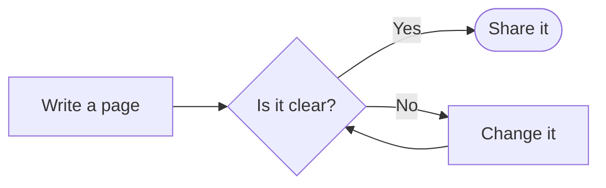
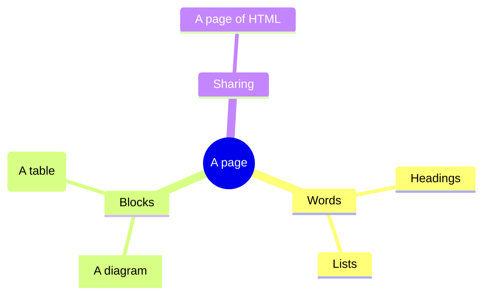
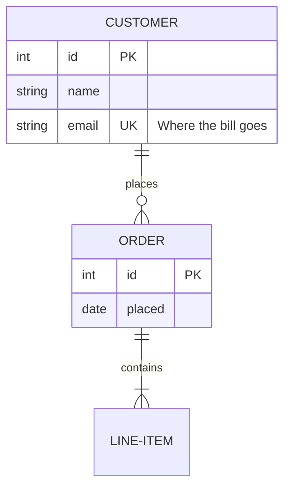
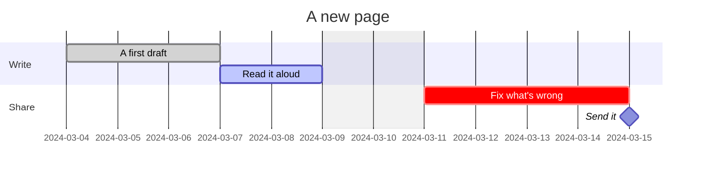
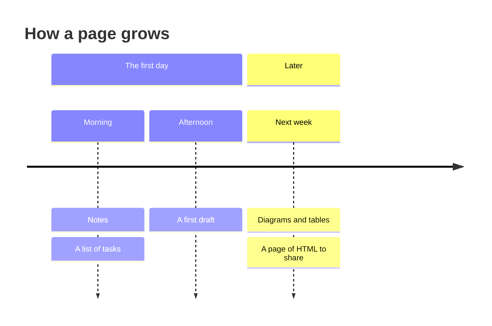

# Ladder

Ladder is a Markdown editor made with UI.jl. This page is a Markdown file. Each line is drawn the way it will read, and the markup characters stay out of sight. A line keeps that look while you type in it. To change its markup, **click the line and press ⌘E**, or click the ladder at the top right. As in the game of snakes and ladders, a ladder means that you are up and a snake means that you are down. The click takes you down a level: the part of the page with the caret shows its markup, and a snake takes the ladder's place. In a line of text, only the run that the caret is in shows it, like bold words, a link or inline code, so the rest of the line keeps its look. ⌘E again, or a click on the snake, takes you back up. Hold the mouse over the ladder and it opens into a slider, with the snake at one end and the ladder at the other. Press ⌘S to write your changes to the file.

This page shows everything that Ladder does, with an example of each. The block at the top of the page is front matter: lines at the very top of a file that say things about it.

These pages have more examples. Hold ⌘ and click a link to go there. To come back, press ⌘⌥←.

- [components.md](components.md) has each component that a live block can show: buttons, menus, sliders, players for sound and video, and 3D models.
- [julia.md](julia.md) runs Julia code where it is.
- [schedule.md](schedule.md) plans a job, with the days of each task.
- [counter.md](counter.md) defines a new kind of block, and says in words what each part of its code does.
- [space-data-centres.md](space-data-centres.md) works out whether a data centre in orbit costs less than one on the ground. Its numbers are sums in a line of text, so a drag on one changes every sum after it.
- [settings.md](settings/settings.md) has the colours, the font and the size of the text. ⌘, opens it too.

## Text

You can write in **bold**, in *italic* or in ***both***. Use backticks for `code`, and square brackets for [a link](https://github.com/jkroso/UI.jl). Hold ⌘ and click a link to open it. A name like snake_case_name keeps its underscores.

Two square brackets around a page's name make a wiki link, as in Obsidian: [[schedule]] links to the page schedule.md. Ladder finds the page wherever it is in the project, so the link still works when the page moves to another folder. The project is the nearest folder above the page that has a `.git` or `.obsidian` folder in it. To show other words, write them after a |, like [[schedule|the plan of a driveway]]. [[schedule#Tasks]] goes to a heading of the page, and [[#Tables]] to a heading of this page. A link to a page that isn't there yet opens a new empty page, and Ladder makes its file when you write in it. While you type a name after [[, a list under it shows the pages whose names fit. Press ↑ and ↓ to choose one, and Return or Tab to finish the link. Esc hides the list.

Hold ⌘, move the mouse to a link to a page, like [[schedule#Tasks]], and rest it there. A card under the link shows the start of that page, so you can read it without leaving this one. A link to a heading shows the part under that heading. To turn the card off, press ⌘, and untick "Show a page when I hold ⌘ over its link".

> A line that starts with > is a quote.
> It can run over several lines.

> [!NOTE]
> A quote whose first line is `> [!NOTE]` is a callout. GitHub shows these lines the same way.

> [!WARNING] Wet paint
> The other kinds are `[!TIP]`, `[!IMPORTANT]`, `[!WARNING]` and `[!CAUTION]`. Words after the kind are the callout's title.

Two equals signs on each side of some words, like ==these words==, put a highlighter's colour behind them. Two per cent signs on each side make a comment, which the page hides. This sentence has one at its end.%%You found the comment.%% To see it, put the caret in this paragraph and press ⌘E. The comment shows in a lighter colour than the words round it. Both marks come from Obsidian.

A comment can also have lines of its own. Start a line with `%%`, and end a line under it with `%%`. The page gives those lines no room, and the caret steps over them. There's one under this paragraph. To read it, press ⌘E and move the caret down onto it.

%%
This comment has lines of its own. Nothing in it is part of the page.
%%

A comment stays out of the page's HTML, its word count and the spelling check.

A comment can show beside the text too, as one does in Word or Google Docs. Write it as CriticMarkup does: the words that it's about between `{==` and `==}`, and the comment after them between `{>>` and `<<}`, like `{==these words==}{>>Is this right?<<}`. The words get a highlighter's colour, and the comment shows as a card at the right of the text, level with them. When the window is narrow, the text gets narrower to make room for the cards. Move the mouse over a card to mark its words. Click a card to change its comment, and press ⌘E when you're done. To add a comment, select some words and press ⌘⌥M. The page [space-data-centres.md](space-data-centres.md) has eight comments, each an idea for Ladder.

A word that the Mac's dictionary doesn't have, like teh, gets a line of red dots under it. Right-click the word to choose the word you meant. Press ⌘F to search the page.

A line can point to a footnote[^note]. The footnote is a line of its own, anywhere in the file, and the page gives each footnote a number. Hold ⌘ and click the number to go to the footnote. To read it without going there, rest the mouse on the number: a card under it shows the footnote.

[^note]: This is the footnote. Its line starts with the same name in square brackets, and a colon.

A line that holds only a picture, like ``, shows the picture. Drop a picture on the page from the Finder to add one. Any other file that you drop goes in as a path that you can click. ⌘V does the same with files that you copied in the Finder: a picture, a video, a sound, a PDF or any other file. It also pastes a picture that you copied as itself, like a screenshot. Ladder keeps the picture as a file in a hidden folder called `.media`, beside the page.

A line that holds only a video file shows a player for it, like ``. To play only part of the video, add the seconds where the part starts and stops to the end of the file's name. `` starts at 1:01 and stops at 1:26. Leave out the second number to play on to the end. To read what was said in the video, move the mouse over it, and click the button under the one that makes it fill the window. The first time, macOS writes down what's said in the file. A line that plays part of a file shows what was said in that part. A button in the drop-down copies the words.

To play a video or a sound faster or slower, move the mouse over its player, and click the small 1× circle on the player's bottom edge. The circle also shows while the file plays. Each click goes to the next speed: 1½×, 2×, ½×, then 1× again. Once you've clicked a player, < and > change the speed by a quarter at a time, the space bar plays and stops, and ← and → go back and on by 5 seconds.

Markdown can have HTML on lines of its own, and the page shows it as a browser does, in the page's own font and colours. The heading under this paragraph is written as `<h3 style="text-align: center">`. To see its HTML, press ⌘E and move the caret onto it. A picture in HTML, like ``, is named from the page's folder. HTML in a line of text, like `<b>`, shows as it's written, and no script in the HTML runs.

<h3 style="text-align: center">A heading in the middle of the page</h3>

## Parts of other pages

A wiki link with a ! before it, on a line of its own, shows a part of another page. This part is the list of tasks from the page schedule.md:

![[schedule#Tasks]]

That part isn't a copy. It's the lines of schedule.md. Click in it and type, and schedule.md changes too. A change in schedule.md shows here at once. ⌘S saves both pages. While the mouse is over the part, a line goes round it. The button on that line, with the other page's name, opens that page at the part. Esc takes the caret back to this page, and so do ↑ on the part's first line and ↓ on its last line. Ted Nelson called this a transclusion. Notion calls it a synced block.

What comes after the # says which part shows:

- `![[schedule]]` shows the whole page.
- `![[schedule#Tasks]]` shows the heading Tasks and the lines under it, up to the next heading that's as big.
- `![[schedule#list 2]]` shows the second list of the page. The kinds are paragraph, heading, list, quote, table, code and picture, and the language of a block, like board or canvas. Without a number, it's the first one.
- `![[schedule#^tasks]]` shows the block with the name tasks. The name is at the end of the block's last line, like `^tasks`, as Obsidian writes it. The page doesn't show the name. To get a link like this, put the caret in a block, press ⌘⇧P and run Copy Link To Block. Ladder gives the block a name if it has none, and copies the link.

A board, a chart or another live block in a part shows what it shows in its own page. You can't change it in the part. To change it, click the button with the page's name.

Copy a whole block of a page and paste it into another page, and Ladder pastes a part of the first page, not a copy of its lines. A block is whole when the caret is on it as a whole, when a click with ⌘ and ⌥ down chose it, or when the selection runs from its start to its end. A heading with the lines under it is one block, and so is an item of a list with the lines under it. If the block has no name, Ladder gives it one, like `^sand-the-walls`. To paste a copy of the lines, press ⌘⇧V. A paste in the page that the block came from is a copy, and so is a paste of a block that you cut.

## Lists

1. Press Return at the end of this line. The next number is typed for you.
2. Press Return on an empty item to end the list.
3. Press Tab to move an item in, and shift-Tab to move it back out.

- A long item wraps onto the next line, and the text of that line starts under the text of the first line, not under the bullet.
  - Items can sit inside other items.
- Select some words and press ⌘B or ⌘I.

- [x] An item that starts with `- [x]` has a box with a tick in it.
- [ ] Click the box of an item like this one to tick it.

A to-do item that ends with words like `every week` or `every 3 months` repeats. Tick it, and a new item goes under it, on the next day that it's due:

- [ ] Test the smoke alarms 2026-12-01 every 3 months

The words can be `every day`, `every 2 weeks`, `every month`, `every year`, `daily`, `weekly`, `monthly`, `yearly`, `every Monday` or `every weekday`. They count only at the end of the item, or just before its day, so "Write the daily report" doesn't repeat. An item with no day repeats from the day that you tick it. An item that you tick late skips the days that it missed. The ticked item stays, so the page keeps the days that the work was done. Take the tick away again, and the new item goes too.

After those words, a limit says when it stops: `for 3 days`, `for a week`, `for 6 months`, `4 times` or `once`. Each new item has what's left of the limit, so `Water the slab every day for 3 days` adds an item with `for 2 days`, then one with `for 1 day`. A tick of that one adds nothing.

On a page with a `schedule` block, an item that repeats has a bar for each time that it's due. Another task can wait for one of those times, and one time can wait for another task.

## Tables

| Keys | What they do |
|------|--------------|
| ⌘N | Opens a new window on this folder. The page shows the folder, so you can choose a file there. |
| ⌘O | Finds a file in this folder by name |
| ⌘P | Finds a project by name and opens it in the window. A project is a folder that you made a favourite, or a git repository in your home folder. The one that git last wrote in comes first, after your favourites. |
| ⌘⇧P | Opens the command palette. It lists the commands that have a use where you are. Type a command's name and press Return to run it. While you choose a Theme or a Text Size with ↑ or ↓, the page shows each choice at once, and Esc puts it back. |
| ⌘⌥← and ⌘⌥→ | Go back to the line or the file that showed before, and forward again |
| ⌘F | Searches the page from the top bar, with the words you selected. In a file of code, it opens a bar that finds text, and Return goes to the next place that has it. |
| ⌘E | Shows the markup of the part of the page that the caret is in, or hides it again |
| ⌘⌥P | Prints the page, or saves it as a PDF |
| ⌘⇧E | Saves the page as a page of HTML, for a website |
| ⌘Return | Sends the page to an agent that waits for it |
| ⌘, | Opens the settings in a window of their own. Press it again to close that window. |
| ⌘T | Opens a new tab and the file finder. The file that you choose shows in the new tab. |
| ⌘⇧T | Makes a new terminal in the folder of the file that shows, and shows it |
| ⌘1 to ⌘9 | Show the first tab to the ninth tab in the sidebar |
| ⌘W | Closes the file's tab and shows the tab under it. On the last tab, it shows the file's folder. On a folder, it shows the tab that showed last, or with no tabs it closes the folder. In a window with no file, it closes the window. |
| ⌘\ | Shows and hides the list of files |
| ⌘⇧\ | Gives the list of files the keyboard. Press esc to go back to the text. |
| ⌘⇧. | Shows the hidden and ignored files in the list of files, or leaves them out again |
| ⌘Z and ⌘⇧Z | Undo and redo |
| ⌥← and ⌥→ | Move the caret a word at a time |
| ⌘+ and ⌘- | Make the text bigger and smaller. ⌘0 puts it back to the size it started at. |

Click a cell and type. Tab goes to the next cell and Return goes down a row. Both add a row when they reach the end of the table.

## Tables from a file

A line that holds only a CSV file, written as a picture is, shows the file as a table. The line under this one is ``.


A `chart` block under the line draws the file's numbers. This one draws the Price column:

```chart
show: Price
title: The price of each item
```

The numbers are the file's, so you can't type in this table. Change the file in another app, and the table shows the new numbers. A long file shows its first 30 rows, and a click on the line under them shows the rest. Click the table to see its line as it's written. A `chart` block under the line draws the file's numbers. So does a chart with the line `from: costs.csv`. Drop a CSV file on the page to add a line like this one.

## Code

```julia
# Only the lines on screen are built
describe(d::Document) = begin
  e = editor(d)
  title = "Lines $(first(e.shown)) to $(last(e.shown))"
  Column(fixed(e.width), spacer(28px), map(describe, e.layout[e.shown])...)
end
```

The line that opens a code block names its language, and the code is coloured to match. Try changing `julia` to `python`.

Julia code runs where it is. Put the caret in a line of the block under this and press ⌘Return. The page runs the line, and shows what it comes to in a box after the line. ⇧Return runs the line and goes to the next one. A box with an arrow has more to show: click it. A box goes when you change its code, and Escape takes every box away.

```julia
width = 2.4
area = width * 3.6
grid = [row * column for row in 1:3, column in 1:4]
```

A block in the language `check` holds a line of Julia for each thing that must be true. It shows a dot for each line: green for a line that passes, and red for one that fails. Put the mouse on a dot to see its line. Click the dots to see each line with a tick or a cross, and what a line that fails found. The last line under this fails on purpose.

```check
2 + 2 == 4
sqrt(16) ≈ 4
length("ladder") < 6
```

The lines can use the names that the page's code made. Run the three lines of the block above, then click the dots. Click "Add a check" at the end of the list, type `area ≈ 8.64`, and press Return. Click a check to change it where it is: Return runs it again, and Esc leaves it as it was. A check that you leave empty goes. The checks run again each time the page's code runs, and when you open them. Click the top of the open block to see only the dots again. Hold ⌥ and click the checks to see all their lines as Julia code.

A function that the page's code makes is a command too, once the code has run, when its arguments have types: like `invoice(client::String, hours::Number)`. Press ⌘⇧P and type its name. The palette asks for each argument, and what the function gives back shows under the top bar.

The page [julia.md](julia.md) has more code to run: an expression of several lines, what code prints, the names that a block offers as you type, and the box of a function.

## Live blocks

A code block in the language `ui` holds Julia code. The page runs the code and shows what it makes: a node from any Julia module, or any other value as text.

```ui
@use "./widgets.jl" Counter
Counter()
```

```ui
@use "./widgets.jl" Meter
Meter(done=0.7)
```

A block can use UI.jl's components and layout with no line that loads them: `Slider`, `STLViewer`, `Column`, `px` and the rest. A file path is `fs"notes.md"` and a colour is `colorant"tomato"`. The two blocks above load `widgets.jl` because it's a file of this folder.

A file path shows as a breadcrumb. Click its last name to list what's in the folder, and click a file in the list to make it the path. Under a file is what's in it: a picture, its text, which you can scroll through, a 3D model that you can drag to turn, a player for a sound or a video, the pages of a PDF, a CSV file as a table, or the picture that the Finder shows for a file like a Word file. Click `knot.stl` to see a model.

To show the file or the folder in the window, put the mouse over the path and click the square button at its right end. A click on a name or a file in the list with ⌘ held opens that one.

```ui
fs"."
```

The caret doesn't go into a block like this one. Move it down the page with ↓, and it goes onto the block as a whole: a line shows round the block. From there:

- Return gives the block the keyboard. In a form, the first field takes it, and Tab goes to the next field. Esc gives the keyboard back to the page.
- ↑ and ↓ go on to the line before the block and the line after it.
- ⌫ takes the block away.
- ⌘E shows the block's code, so you can change it. ⌘E again shows what the code makes.

A click on the block with ⌥ held shows its code too.

Code can run in a line of text too. Write a `!` and then the code between backticks, like \!`fs"."`. This page is in the folder !`fs"."` and its colours are !`page_theme()`. A number works too: 12 × 2.4 is !`12 * 2.4`. Press ⌘E and click a line to see its code. [Sums in a line of text](#sums-in-a-line-of-text) has more.

The page [components.md](components.md) has a live block for each of UI.jl's components: checkboxes, switches, a slider, a menu, a colour picker, a viewer for 3D models, players for sound and video, diagrams, a text field, a tree and an inspector. It shows shadows too. Hold ⌘ and click the link to open it.

## Blocks of your own

A file can define a kind of block. The block below is in the language `progress`, which Ladder doesn't know. The file `progress.jl` in this page's folder has a function called `progress`. Ladder gives that function the lines of the block, and shows what it makes.

```progress
done: 0.7
label: Framing
```

Click in the bar, or drag in it, to say how much is done. The bar asks Ladder for a write, the file's function `written` gives the new lines, and Ladder writes them into the block: press ⌘E to see them. ⌘Z takes the change back. A block that doesn't ask is still written when you save the page.

The line that opens a block can name the file after the language, so one file can define many kinds of block: `progress ./widgets.jl`. It can name a repository on GitHub too, like `progress github.com/sam/blocks`. Ladder asks you before it runs the code of a repository for the first time. A Markdown page can define a kind of block too: Ladder runs the code of the page's `julia` blocks. The page [counter.md](counter.md) defines one, and says in words what each part of its code does.

Open [progress.jl](progress.jl) to see how a kind of block is written in a Julia file. When you save a change to that file, Ladder loads it again, and the block above changes with it.

## The code of a thing

A function draws each thing in this window: a block, a button, a row of the list of files. To find that function, hold ⌘ and ⌥ and move the mouse. A blue line goes round the thing under the mouse. A label on the line has the name of the thing's kind, and the file and the line of its function. Click, and the blue line stays round the thing, with buttons on its top edge. Click Show Code, and a window opens beside this one with the function in it. Click the agent's logo after it to ask the agent for a change to the thing, or a question about it. The next section says how. To take the line away, press Esc or click anywhere else.

To move a block of the page, hold ⌘ and ⌥ and click it. A handle of six dots is at the top left of its blue line. Drag the handle up or down the page. A blue line across the page shows the gap where the block will go. Let go, and the block moves there. ⌘Z puts it back, and Esc stops the drag. A paragraph, a heading, a whole list, a table, a block of code and a block like a board each have the handle. A link or bold words in a paragraph don't.

To put two blocks side by side, drag the handle over the left or the right quarter of the other block. A blue line down its side shows where the block will go. Let go, and the two blocks are [columns](#columns): Ladder writes a `columns` block over them. Drag a block to the side of a column to add a column there. Drag a column out of its group to take it away, and the group's number goes down. A heading takes the blocks under it into its column. Where a column can't go, no blue line shows. An example is the right of a heading's column, because that column would take the block in.

Try it on the bar of the block above. The window shows `progress.jl`, with the caret on the function `describe`. Change a colour or a size there, and press ⌘Return in the function. The bar is drawn the new way at once. ⌘S writes the change to the file.

It works on Ladder's own parts too, like the file's name in the middle of the top bar. Most of those are in one very long file. The window shows the whole of it, with the function at the top, and ⌘Return and ⌘S work there as they do in any file. The app that you installed writes its own files again each time it starts, so a change to one of its own parts lasts until you quit. To keep the change, put the caret in the function and run the command Keep This Change. It adds the function to your startup page, whose code runs each time Ladder starts.

In a line of text, the blue line goes round a link, **bold words** or `inline code` on its own. Its function is the one that gives it its look, like the colour of a link. Over plain words, the line goes round the whole paragraph.

The command Show Code does the same. Press ⌘⇧P and run it: a blue A goes round what the caret is on, and Return shows its code. To see the code of something else, click it.

## Ask an agent about one thing

You can ask Claude Code to change one thing of the window, or ask it a question about the thing. The thing can be a block, a part of a block like the bar of the `progress` block above, a part of Ladder like the count of words, or a block of Julia code. Ladder starts Claude Code, and gives it your words and the place of the function that draws the thing. This needs Claude Code on your Mac. To use Codex, Gemini or Grok instead, choose it under Agent in Settings.

To ask for a change:

1. If the caret can go on the thing, put it there.
2. Press ⌘⇧P, type Ask For Change, and press Return.
3. Look for the blue line with the letter A. It goes round the thing that Claude Code gets.
4. If the A is round the wrong thing, click the thing that you mean. The A moves to it.
5. Type what you want, like `make this bar thinner`, and press Return.

Claude Code changes the function, and the thing is drawn the new way. While it works, a label on the thing says what it's doing, like `Reading progress.jl`. The label then says what changed.

To start from the thing itself, hold ⌘ and ⌥, click it, and click the agent's logo on its blue line. That runs Ask Agent, which takes a change or a question. The A is already round the thing, so type what you want and press Return. A change shows as below, and an answer shows in a card beside the thing.

To ask about some words, select them, right-click them and choose Ask Claude…. The menu names the agent that Settings chose, or the one that shares the page. A box goes round the words, with a field under them. Type a change or a question, and press Return. The box stays round the words while the agent works, and its label says how the request goes. With nothing selected, the box goes round the line that the caret is on. Click the label to open the field again, with your questions, the answers and what the agent is doing. The Close button under the field closes only the field. The × at the end of the label takes the box away, with its answers. If Ladder started an agent for the request, the × stops it. Esc, a click on the page and another field leave the field as it is, with what you typed.

An answer to a question shows under the words, with a field under it to ask more. When you ask more, the field hides while the agent works, and shows again with the new answer under the first. When an agent works on the page with you, it answers there too.

While the agent works on a request, a ring turns in its label and the box pulses. A request that you make while the agent still works waits in a queue. Its label says its place, like "Number 1 in the queue". Click that label to change the request. A field opens under the words with the request in it. Change it and press Return, and it keeps its place. Take Back takes the request out, and Close leaves it as it was. Each request starts when the one before it ends. The field of a request and its answers always cover the labels and boxes of other requests.

Before you press Return, you can choose more:

- To give Claude Code the part that holds the thing, press ⌥↑. ⌥↓ goes back. In a file of code, ⌥↑ on a block gives the whole file.
- To give it more than one thing, hold ⇧ and click another. It's B, in orange, so your words can say `make A look like B`. Hold ⇧ and click it again to take it out.

After you press Return:

- To stop Claude Code while it works, click the × at the end of the label. You can also run Stop Agent. A click on the rest of the label opens a field under the thing, with what you asked and what Claude Code is doing. Esc doesn't stop it, because Esc is easy to press by mistake. What it changed before it stopped stays in the file, but Ladder doesn't run it, because it can be half done.
- Click the label after the change to see what Claude Code changed. The page lists each change since Ladder started, the newest first. Each part has a Reject button that takes it out again, and Reject all takes out the whole change.
- The command Undo Change puts back all of the newest change. Run it again to put back the one before.

To ask a question in place of a change, run Ask About, and choose the thing in the same way. Or hold ⌘ and ⌥, click the thing, and click the agent's logo on its blue line. Type a question like `why is this bar red?` and press Return. Claude Code reads the code and changes nothing. Its answer shows in a card beside the thing. Click Ask More on the card for another question about the same thing, or Change It to ask for a change to it. Claude Code gets your earlier questions and its answers with your new words. Click the card to close it. Esc and a click anywhere else leave it open, so that you don't lose an answer before you read it.

In a file of code, Fix It and Ask For Checks give Claude Code one check or one function. The next section says how.

## A file of code

Ladder opens a Julia file as code that you change, however long the file is. These help you find your way in one. Try them in [progress.jl](progress.jl).

- Press ⌘⇧P and run Go To. It lists the file's functions, and each section that a comment like `# --- name ---` starts. As ↓ goes down the list, the window shows each place. Type a few letters and press Return.
- Hold ⌘ and move the mouse over a name. A name that has a place to go to is marked, as a link is. Click it, and the caret goes to where the name is defined. A function with several methods goes to the first. A name from another file shows in a window beside this one. The command Go To Definition does the same for the name at the caret.
- Hold ⌘ and click a name where the code makes it, or run Find Uses. The palette lists each place that uses the name, with the other Julia files of a git folder too. As ↓ goes down the list, the window shows each place, and Esc puts the window back. Return goes to the place.
- After Go To, Go To Definition or Find Uses takes you to another line, ⌘⌥← takes you back to the line where you were. ⌘⌥→ goes to the other line again.
- Hold ⌘, move the mouse to a marked name, and rest it there for a moment. A card shows its documentation and its first lines. The card shows only after the mouse moves, so a ⌘ for a key like ⌘S shows no card.
- Press ⌘⇧P and run Rename In Code to give the name at the caret another name. It changes the name wherever it means the same thing, and not in strings or comments. In a git folder, a name of the whole file changes in the folder's other Julia files too. ⌘Z takes all of it back.
- Click the number of a line, in a file that git keeps. Ladder shows the commit that last changed the line: its day, who made it, its first line, and what the file had there before.
- Press ⌘⇧P and run Run All. Ladder runs all the file's code from the top, and shows what each piece comes to in a box after it. A piece that fails doesn't stop the pieces under it. Then the window goes to the first piece that failed.
- Write a check above a function, as a comment like `# check: share("70%") == 0.7`. Ladder runs it, and a dot at the end of the line is green when it's true. A red dot has the two values that it compared, or why it stopped. The checks run again each time code runs, as with ⌘Return. In a file that Ladder didn't load, press ⌘Return in the function first. The top bar says how many checks pass. Click it to go to the next one that fails. To write a check quickly, put the caret on a call like `share("70%")` and run Add Check. It writes the check over the function, with the value that the call has now.
- A function with checks over it runs again by itself a second after you stop typing, and its dots change. This happens once ⌘Return has run code of the file, or in a file that Ladder loaded. Other code runs only when you run it.
- Put the caret on a check, or move the mouse over it, and buttons show beside it. Show Steps runs the check again, and writes what each line of the function came to at the end of the line. It shows the values that the function was given, how many times a line in a loop ran, and why the function stopped. Esc takes the values away. A check that fails has Fix It too. Fix It asks Claude Code to make the check pass. Claude Code changes the function, or changes the check when the check is wrong, and says which.
- Run Ask For Checks in a function to have Claude Code write checks of it. It works out the value that each call should give from what the function is for, not from what it does now. So a check can find a fault that's already there.

To change a block of the file's code in words, like one function, put the caret in it and run Ask For Change. Click another block to change that one instead. Type what you want and press Return. Claude Code changes the block, and the window shows the new lines.

## Sheets

A code block in the language `sheet` works things out. Each row has a name and a Julia expression. An expression can use the names of the rows above it, and numbers can have units.

```sheet
Wall length = 12m
Wall height = 2.4m
Area = wall length * wall height
Coats = 2
Coverage = 16m^2 / litre
Litres = area * coats / coverage
Tins = ceil(litres / 4litre)
```

Click a cell and type. Tab goes to the next cell and Return starts a row. To see the sheet as lines of code, hold ⌥ and click it.

A row that is one number, like the wall's length, changes with a drag. Put the mouse on the `12m` at the right end of its row, and drag to the right or to the left. The rows under it follow while the mouse moves. Near where the drag starts, each step of the number is small. The further the mouse goes, the faster the steps come, so a long drag makes a big change. Hold ⇧ to make each step ten times as big.

The keyboard can do the same to any number in the page. Put the caret in the number, or at either end of it, and press ⌃↑ to make it a step bigger or ⌃↓ to make it a step smaller. A step is one of its last digit, so 12 goes to 13 and 2.40 to 2.41. The unit stays as it is, so the caret can be after the m of 12m. The same keys change true to false, and false to true. Any other word gets capitals: ⌃↑ makes word into Word, then WORD, and ⌃↓ takes it back down. One ⌘Z takes back all the presses that came one after another.

A sheet can work a row out backwards. Start the row's expression with a `?`, and write the answer that you want after a second `=` in a row under it. This sheet finds the wall that 6 litres of paint cover. The value after the `?` is where the sheet starts to look, and it gives the row its unit. A line in the accent colour goes round the value that the sheet found.

```sheet
Wall length = ? 12m
Wall height = 2.4m
Area = wall length * wall height
Litres = area * 2 / (16m^2 / litre) = 6litre
```

A row can be every value from one to another: write `to` between the two. Each row under it shows what it comes to at the two ends. A chart of the sheet draws the rows that change, with a point for each value on the way. Move the mouse over a point of the chart, and the sheet shows that value and what the other rows come to there.

```sheet
Side of a tile = 0.2m to 0.6m
Floor area = 36m^2
Tiles = floor area / (side of a tile * side of a tile)
```

```chart
kind: lines
```

A row can use the names of other blocks of the page, the way that it uses the name of a row above it:

- a row of a sheet that's over this one in the page
- a measure of a takeoff, like `kitchen floor tiles`, which is its amount in metres or square metres
- a task of a time log, like `framing`, which is the hours that the log has for it

So `Tiles = kitchen floor tiles / 0.36m^2` follows the outline that's drawn on the plan.

## Sums in a line of text

A sum can go in a line of text too. Write a `!` and then the sum between backticks, and the line shows what the sum comes to. Press ⌘E and click a line to see its sums.

A wall that is !`l = 16m` long and !`h = 2.4m` high has an area of !`wall_area = l * h`. Two coats of paint that covers !`per_litre = 16m²` a litre take !`wall_area * 2 / (per_litre / litre)`. A car that goes 150km in 2 hours travels at !`150km / 2hr`, which is !`convert(m/s, 150km / 2hr)`. A person who is 5 feet 10 inches tall is !`convert(cm, 5ft + 10inch)` tall.

The numbers have units from Units.jl: lengths like `m`, `km`, `ft` and `inch`, times like `s`, `minute` and `hr`, masses like `kg`, volumes like `litre`, power like `kW` and `GW`, and energy like `kWh` and `TWh`. Money has units too, like `USD`, `AUD` and `EUR`. A solar farm of !`farm_size = 2GW` at !`watt_price = 1.2USD/W` costs !`farm_cost = farm_size * watt_price`. An amount of a million or more shows in words. A sheet has the same units.

A sum can give words too, and they wrap with the words round them, like this: !`farm_cost > 2e9USD ? "the farm costs more than two billion dollars, so it needs more than one company to pay for it" : "the farm costs two billion dollars or less, so one company can pay for it"`. Drag the size of the farm to see the words change.

A sum can make a component too, like UI.jl's ProgressBar: !`ProgressBar(value = farm_size / 5GW)`. A component that uses the page's numbers is made again when they change, so the bar follows a drag on the size of the farm. One that uses none of them, like a switch, keeps its state.

A sum that is one number has a line of dashes under what it shows, like the 16m and the 2.4m above. Drag it to the right or to the left to change the number. The sums that use its name follow while the mouse moves, so the area and the paint above change with the wall. The further the mouse goes, the faster the number changes. Hold ⇧ to make each step ten times as big. ⌘Z takes a drag back.

A sum can use the rows of every sheet of the page, with a `_` for each space in a row's name: \!`wall_length` shows !`wall_length`, from the sheets above.

It works the other way too. A sheet under a sum can use the name that the sum gives, with a space for each `_`. Drag the size of the farm above, and the sheet follows.

```sheet
Farms = 3
Cost of them all = farms * farm cost
```

A chart of a table draws what the sums in its cells show:

| Farm | Cost |
|---|---|
| This farm | !`farm_cost` |
| A farm twice as big | !`farm_cost * 2` |

```chart
title: What the farms cost
```

The page [space-data-centres.md](space-data-centres.md) is an explanation that you explore this way. Its sums work out what a data centre in orbit costs, and its words change with the numbers.

## Spreadsheets

A code block in the language `spreadsheet` is a grid of cells. Each column has a letter and each row has a number, so `B2` is the second cell of the second row. A cell that starts with `=` is a formula: a Julia expression that can use the other cells by name. `D2:D4` is every cell from D2 to D4.

```spreadsheet
| Wall  | Length | Height | Area         |
| North | 12m    | 2.4m   | = B2 * C2    |
| East  | 8m     | 2.4m   | = B3 * C3    |
| South | 12m    | 2.4m   | = B4 * C4    |
| Total |        |        | = sum(D2:D4) |
```

Click a cell and type. A cell shows what its formula comes to, and it shows the formula while the caret is in it. Tab goes to the next cell and Return goes down a row. The bar over the grid adds and removes a row or a column, and each formula still names the same cells after that. To see the spreadsheet as lines of code, hold ⌥ and click it.

## Diagrams

A code block in the language `mermaid` shows a diagram. Its first line says what kind of diagram it is. The lines after that say what's in it: this one has four boxes, and each `-->` is an arrow from one box to the next.



Ladder draws nine kinds of diagram: `flowchart`, `sequenceDiagram`, `stateDiagram-v2`, `classDiagram`, `pie`, `mindmap`, `erDiagram`, `gantt` and `timeline`. They're written in the language of [Mermaid](https://mermaid.js.org), so a diagram from another app shows here too. A kind that Ladder can't draw yet shows as its code. To see the code of a diagram, hold ⌥ and click it.

A diagram that's too small to read can fill the window. Move the mouse over it, and click the button that shows beside its top right corner, or pinch outwards on it. Then pinch, or scroll with ⌘ held, to make it bigger, and drag it to see the rest. Esc puts the page back. A picture and a page of a PDF file do the same, and a model and a video fill the window too.

You can change a diagram while it fills the window. Click a box, a line or another part to select it. Click it again, or press Return, to type its words where they are. The first buttons under the diagram are the tools for the part that's selected. For a box of a flowchart they add a box after it, draw a line from it to the box that you click next, change its shape and take it away. With nothing selected, they are the tools for the whole diagram, like the one that adds a box. While the mouse is over a box, a point shows on its edge. Drag the point onto another box to draw a line to it. ⌫ takes the selected part away, and ⌘Z takes back the last change. Ladder writes each change in the code of the block and draws the diagram again. It chooses where each box goes, so you can't drag a box to another place. With a part selected, Esc selects nothing, and Esc again puts the page back.

The first five kinds can be changed that way. The four kinds below fill the window too, and you change them in their code.

A mind map has one idea in the middle. Each line under it is an idea that belongs to the nearest line above it that starts further left. Words in `[ ]`, `( )` or `(( ))` are in a box, a round box or a circle.



An entity relationship diagram shows what a database keeps. Each box is a table, with a row for each thing that it knows. The signs at the two ends of a line say how many there are: `||` is exactly one, `o{` is none or more and `|{` is one or more.



A Gantt chart shows tasks as bars on a line of days. A task starts on a date, or `after` the task with that id, and it's as long as its length says. With `excludes weekends`, a task that goes over a weekend ends two days later. A `schedule` block does the same for the to-do items of the page, and you can drag its bars.



A timeline shows periods from left to right, each with what happened in it. A line is a period, then a colon before each event.



## Maths

A formula is written in TeX between dollar signs. In a line of text, $e^{i\pi} + 1 = 0$ is a formula, and so is the area of a circle, $A = \pi r^2$. A dollar sign with a number after it, like $5, is a dollar sign.

A formula on lines of its own goes between a line of `$$` and another. It's in the middle of the page, and its fractions and its sum signs are bigger:

$$
x = \frac{-b \pm \sqrt{b^2 - 4ac}}{2a}
$$

$$
\sum_{n=1}^{\infty} \frac{1}{n^2} = \frac{\pi^2}{6}
\qquad
\int_0^\infty e^{-x^2}\,dx = \frac{\sqrt{\pi}}{2}
$$

Lines that end in `\\` go under each other, and an `&` in each line says where the lines line up:

$$
(a + b)^2 &= (a + b)(a + b) \\
&= a^2 + 2ab + b^2
$$

Ladder reads the TeX that LaTeX reads: fractions and roots, Greek letters, the signs of maths, brackets that grow with `\left` and `\right`, a matrix, the cases of a function and so on.

$$
A = \begin{pmatrix} a & b \\ c & d \end{pmatrix}
\qquad
|x| = \begin{cases} x & \text{if } x \ge 0 \\ -x & \text{otherwise} \end{cases}
$$

To change a formula in a line of text, put the caret in the line and press ⌘E: the line shows its TeX. To change a formula on lines of its own, hold ⌥ and click it, or move the caret onto it and press Return. A command that Ladder doesn't know shows as its name, in colour. In a page of HTML, each formula is MathML, which a browser shows as maths.

## A cover picture

A page can have a picture across its top, as a page in Notion does. Put a line like `cover: photos/1 footings.png` in the front matter: the lines between two lines of `---` at the very top of the file. The picture is as wide as the page's text, and its middle shows. The other lines of the front matter show under it. The picture can be a file, named from the page's folder, or an address on the web. To change it, hold ⌥ and click the picture, and the front matter shows its lines. A page that you save as HTML has the picture at its top too.

## Link cards

Write the address of a web page as you would a picture's, on a line of its own, and the line shows the page as a card, with the page's title, its description and its picture:


Hold ⌘ and click the card to open the page in your browser. To change the address, click the card: the line shows as it's written. Ladder gets each page once and keeps what the card shows, so the card is there the next time with no network.

An address that ends as a picture's does, like ``, shows the picture. So does an address that turns out to be a picture when Ladder gets it. A web address by itself, like https://julialang.org, is text.

## Pages from a web server

Ladder shows a page of Markdown that a web server sends, as a browser shows a page of HTML. Press ⌘L, type or paste the page's address, like `example.com/notes.md`, and press Return. ⌘L is the key of the command Navigate. You can also type the address straight after ⌘⇧P, where Navigate is first in the list while you type an address, or after ⌘O. Ladder tells the server that it wants Markdown. So a server that keeps each page as both Markdown and HTML sends Ladder the Markdown, from the same address that gives a browser the HTML.

Navigate goes to a file or a folder of your Mac too. Type its path, like `~/Desktop` or `/Users`, and the window shows it, as a link to it does. A path that doesn't start with `/` or `~` is from the folder of the page that shows.

A server that has no Markdown sends HTML, and Ladder shows the page that the HTML makes, with its own engine, as it shows an HTML file. Its scripts run, and you scroll it, click it and type in it. Press ⌘E to see its HTML, and ⌘E again for the page.

Ladder keeps each page that it gets in your browser folder, `~/Browser`, at its place on its site. So `example.com/notes/plans.md` is the file `~/Browser/example.com/notes/plans.md`, and the page of the folder `example.com/notes/` is `notes/index.md` there. Each picture of the page goes there too, and each file that a `view` block of the page shows. Being in the browser folder is what makes a file act as a page of the web, so a file of it that you open from the sidebar or the Finder acts the same.

The top bar shows the path from the site's name, like `example.com › notes › plans.md`. The page's links and pictures are from its address. Click a link, and Ladder asks the server for it. Markdown and HTML show in the window, and anything else, like a PDF file, opens in your browser. When the server has no such page, words under the top bar say so, and the window keeps its page. ⌘⌥← goes back to the page before.

Somebody else wrote the page, so Ladder runs its code only for a site that you allow. Until then, a sum, a sheet, a chart or a live block in it shows as its code. The first time that a site sends a page with code, Ladder asks you whether to run it, and keeps your answer for the site. The commands Run Site Code and Stop Site Code change it. When the code runs, the page shows its sums, sheets and charts as a page of your Mac does, and a `view` block shows the file that it names beside the page on the site. An email never runs its code. A link or a picture of a page from a server never shows a file of your Mac. The scripts of a page of HTML run, as a browser runs them, and they get no file of your Mac either.

A folder on the server can change how the pages in it show, with a page called `.ladder`, as a folder on your Mac can. Ladder asks for the `.ladder` page of each folder that a page is in. Its code runs only for a site that you allow, with the same answer. When the code runs, a blog's pages look on the web as they look on your Mac. The page of a folder of the blog lists what the folder holds, as it does on your Mac, in place of the table that the server sends. The server doesn't say how big each file is, so that list has no column of sizes.

You can change the page. Click where you want the caret, and type. A click on a link still opens it. ⌘S writes your changes to the page's file in the browser folder, and never to the server.

When you go to a page that the browser folder has already, the file shows at once, and Ladder asks the server for the page. If you haven't changed the file, what the server sends takes its place. If you have, your changes stay, and Ladder asks you whether to show what the site has now, when it has something new. The command Reload Page asks the server again, and asks you first if you changed the page.

In a page of your own, a click on a link to an address that ends in `.md` shows that page in Ladder. Any other web address opens in your browser.

## Views of other files

A code block in the language `view` shows another file in your page, as the file is. Write the file's name in it, like `plan.pdf` for a file beside your page, or its path, like `~/Desktop/notes.md`. The name of a folder works too, and so does the address of a page of the web.

```view
plan.pdf
```

What shows depends on the kind of file:

- An HTML file and a page of the web show their page, and you use it where it is: see the next part.
- A Markdown page shows as it reads.
- A picture, a model, a sound, a video, a PDF file, a CSV file, a zip and a file of text show as they do under a path.
- A SolidCraft design shows alone, without its editor: see [SolidCraft designs](#solidcraft-designs).
- A terminal's file shows its last lines: see [Terminals](#terminals).
- A folder shows its files and folders. Click one to go to it.
- A Julia file with a function called `view` shows what that function makes: see [A view that code makes](#a-view-that-code-makes).

While the mouse is over the block, two buttons show beside its top right corner. The first makes what the block shows fill the window: a page, a model, a video, a picture or a PDF file. Your page is still the file that's open, and Esc puts it back. A view that would show no more that way, like a table or a folder, doesn't have this button. The second button goes to the file. The window shows the file, as it does when you click a link to it, and ⌘⌥← comes back to your page. A click on the block with ⌘ held does the same.

A line like `aspect: 16:9` under the file's name sets the shape of a page, a model, a SolidCraft design or a video: its width to its height. The view is as wide as your page's text, so it keeps that shape at any width of the window. `aspect: 2` is the same as `aspect: 2:1`. Without the line, a page of the web is as tall as what it shows, up to a limit, and a model or a design is 260 pixels tall.

```view
costs.csv
```

## Pages of the web

A `view` block shows a page of the web too. Write the page's address in it, like `https://julialang.org`, or the name of an HTML file beside your page. Ladder draws the page itself and runs its scripts. You use the page where it is: click its links and buttons, drag in it, and type in its fields. Esc gives the keyboard back to your page. The wheel scrolls your page past it. Scroll with ⌘ held to scroll the web page. A pinch goes to the web page too, so a map or a model in it can zoom.

When a link takes the block to another page, the block's line changes to that page's address. ⌘Z takes it back, and the page with it. The button beside the block's top right corner goes to the page that shows. A page of Markdown or of HTML on a web server shows in the window, and anything else opens in your browser. An HTML file shows its page in the window.

A block that starts with a tag holds the page itself, like this one:

```view
<body style="margin:16px; font:15px/22px system-ui">
<h3 style="margin:0 0 8px">A page that's written here</h3>
<p style="margin:0 0 10px">Click the field, type your name, and press the button.</p>
<input id="name" placeholder="Your name" style="font-size:14px; width:180px">
<button id="hello" style="font-size:14px">Say hello</button>
<p id="out" style="margin:10px 0 0; color:#2a78d6"></p>
<p style="margin:10px 0 0"><a href="https://julialang.org">Go to julialang.org</a></p>
<script>
  document.getElementById('hello').addEventListener('click', () => {
    document.getElementById('out').textContent = 'Hello, ' + (document.getElementById('name').value || 'you') + '.'
  })
</script>
</body>
```

The scripts of the page can read the document's sums. `ladder.sums` has the value of each sum in a line of text that gives a name, as a number in SI units: metres, kilograms, seconds and watts. A percentage is a share, so 98% is 0.98, and money is a number of its currency. `ladder.shown` has the text that the document shows for each sum. The page hears the event `sums` each time they change, so it draws again while you drag a number. This block follows the wall in "Sums in a line of text":

```view
<body style="margin:16px; font:15px/22px system-ui">
<p id="wall" style="margin:0">The wall's sums haven't come yet.</p>
<script>
  addEventListener('sums', () => {
    const area = ladder.sums.wall_area
    document.getElementById('wall').textContent = 'The wall is ' + ladder.shown.wall_area + '. That is ' + Math.round(area / 0.09) + ' tiles of 30 cm by 30 cm.'
  })
</script>
</body>
```

A block in the language `web` is a `view` block too: `web` is the name that it had before.

## A view that code makes

A `view` block can name a Julia file that makes what the block shows. The file has a function called `view`. Ladder gives that function your page's sums, and shows what it makes. When the function gives the bytes of a .glb file, the block shows them as a 3D model. A node draws itself, and any other value shows as text.

The sums come as they do to a web page's scripts. Each sum that gives a name is there under that name, as a number in SI units, so `sums["l"]` is 16.0 for a wall of 16m. Ladder calls the function again each time the sums change. So the model follows a number while you drag it, and it stays turned as you left it. This block follows the wall in "Sums in a line of text". The blue post beside the wall is as tall as a person.

```view
wall.jl
aspect: 5:2
```

The first button beside the block makes the model fill the window, where any scroll brings it nearer. The second goes to [wall.jl](wall.jl), which is about 60 lines of code. When you save a change to the file, the block shows what the new code makes. A slow function doesn't hold the window up: the block shows what the function made last until the new one comes.

The page [space-data-centres.md](space-data-centres.md) shows its satellite this way too, from the file `satellite.jl` beside it, with the Sun and the Earth round it.

## SolidCraft designs

A SolidCraft design is a file whose name ends in `.sc`. Ladder shows it in two ways. A `view` block shows the design alone, and the file's own page is an editor that's laid out as SolidCraft's window is. Ladder doesn't make a design's steps itself. It uses the program that's inside SolidCraft.app, so both ways need SolidCraft on your Mac.

```view
bracket.sc
aspect: 16:9
```

This block shows the design in the file `bracket.sc`, which is beside this page. Here the design is only shown, and nothing that you do changes the file:

- Drag to turn the design. Drag with ⇧ held, or with the middle button, to move it. Drag with ⇧ and the middle button to turn it.
- Pinch, or scroll with ⌘ held, to bring it nearer.
- Click twice to see all of it again.

A design takes numbers from your page too. The two holes in the bracket's base are !`hole = 6mm` across. Drag that number, and the holes in the view follow it. The design has a parameter called `hole`, and each parameter of a design takes the value of the sum on the page that has its name. A number with no unit is in SI units, so it's metres for a length and radians for an angle. The file keeps its own numbers. When SolidCraft can't make a step with the page's numbers, the view says which step.

To change the design, move the mouse over the block and click the second button beside its top right corner. The window goes to the file, where the design has its editor, and ⌘⌥← comes back to this page. When you save a change there, this block shows the changed design.

In the editor, the design fills the window. A toolbar is at the top, a browser is at the left, and the history of the design's steps is along the bottom.

- **The view.** The mouse works as it does in Fusion 360. Drag with the middle button to move the design, and hold ⇧ too to turn it. Roll the wheel, or pinch, to bring it nearer, towards the mouse. Hold ⇧ and roll the wheel to turn it. Hold ⇧ and click the middle button on the design, and a turn goes round that point until you click the middle button twice. Two clicks of the middle button show all of the design. On a trackpad, two fingers bring the design nearer, as the wheel does, and turn it with ⇧ held. A drag with the left button still turns the design, and with ⇧ held moves it. The three balls at the top right show the design's axes. Click one to look along that axis.
- **Selecting.** The mouse lights the face or the edge that it's over. Click to select it, and hold ⇧ to select one more.
- **Commands.** The toolbar has SolidCraft's commands, like Extrude, Fillet and Hole. A command opens a form at the right. You type its lengths there, and click the faces, the edges or the regions of a sketch that it takes. When the form has what the command needs, the design shows what the command would make. What it adds is in the accent colour. What it takes away is red, inside a body that shows faintly. Ladder works this out itself, so it changes as you type. It's the piece alone, not yet joined to the body or cut out of it. For a command that Ladder can't work out, SolidCraft's program tries the command, and the design shows the result in a tint a moment later. OK runs the command. The letters E, F and H start Extrude, Fillet and Hole.
- **Lengths are Julia code.** A length, an angle or a count is Julia code, like `4.5cm + 2mm*1.5`, in the colours of a code block. Units like mm, cm, inch, deg and ° are there, and so is each parameter of the design by its name, like `d1`. Press ⌘Return in a field to see what its code comes to, under the field. Select part of the code first to run only that part. When SolidCraft reads the code as Julia does, the file keeps the code, and the step follows the parameters that it names. When SolidCraft reads it in another way, the file gets the number, and the parameter's comment keeps the code. The field then shows the code again.
- **Parameters.** The Parameters button shows the design's parameters in a sheet, the same as a `sheet` block. Each row has a parameter's name, its code, and what that comes to. Your own parameters come first, then the lengths of the steps, like `d1`. A row can use any parameter, even one under it. When the caret leaves a row, the design takes what you typed in it. Type a new name to rename a parameter: the code that used the old name follows. To add a parameter, press Return at the end of a row, and type its name and code. To delete one, take its row away.
- **Sketches.** Two clicks on a sketch, in the browser or in the history, open it. The toolbar then has the sketch's tools. The letters L, R, C and D start a line, a rectangle, a circle and a dimension. A tool takes clicks in the sketch, and goes to a point that's near. With no tool, drag a point or a curve to move it as far as its constraints allow. Two clicks on a dimension change its length. Finish Sketch, in the panel at the right, closes the sketch.
- **The browser.** It lists the origin, the bodies, the sketches and the construction planes. The eye at the end of a line shows or hides what the line names.
- **The history.** Each step of the design is there, in order. Two clicks on a step open its form, so that you can change its lengths.
- **Colours.** A body shows the colour that it has in SolidCraft: its own, or the colour of its material.
- **Saving.** ⌘Z takes back the last change, and ⇧⌘Z does it again. ⌘S writes the file. Until then, a change isn't in the file. So a window asks before it closes with changes that aren't saved.

## Takeoffs

A code block in the language `takeoff` shows a plan that you measure from: a page of a PDF file, or a picture. Drop the file on the block, or click the block to choose it. This one has the plan of a small house, with its power points and lights counted, a run of cable measured and the kitchen floor measured.

```takeoff
plan: plan.pdf
page: 1
scale: 1:100

count | Double power point
  164.2,483.5 164.2,268.1 308.7,449.5 235.0,242.6 331.4,494.9 436.3,494.9 382.4,364.5 331.4,245.4 436.3,245.4 459.0,494.9
  586.5,426.9 586.5,353.1 461.8,324.8 529.8,245.4 586.5,245.4
count | Ceiling light
  235.0,415.5 382.4,475.0 382.4,324.8 521.3,469.4 481.7,307.8 558.2,307.8
length | Cable to the kitchen | +10%
  161.3,500.6 314.4,500.6 314.4,398.5 382.4,398.5
area | Kitchen floor tiles
  322.9,503.4 444.8,503.4 444.8,356.0 322.9,356.0
```

The buttons at the top left are the tools. With the arrow, click a mark or a line to select it, drag a corner to move it, and press Delete to take it away. The next three tools count, measure a length and measure an area for the measure that's chosen in the list. A count takes a mark for each click. A length and an area take a corner for each click. A Done button shows beside the last corner: click it, or press Return, to end the line or the outline. The ruler sets the scale from a length that you know: click its two ends and type how long it is.

On a PDF plan, a corner snaps to the plan's lines: to the end of a line, to the place where two lines cross, or to the nearest point of a line. A small mark shows where the corner will go. It snaps to the corners of what's already measured too. The magnet turns snapping off, and so does ⌘ while you hold it. A plan that's a picture or a scan has no lines to snap to.

The tool after the area tool cuts a shape out of an area, like a window out of a wall. Draw the outline of the shape over the area. The area's amount is then without the part of the cut-out that's inside it. A cut-out shows as dashes. Select it, move its corners or take it away like any outline. In the block's lines, it's a line that starts with `cut` under the outline that it's cut from.

Turn the mouse wheel, or pinch on the trackpad, to make the plan bigger or smaller round the mouse. Two fingers on the trackpad move the plan, and with ⌘ held they make it bigger or smaller. In the page, the wheel and two fingers scroll the page until you click the plan. A plan that's bigger than its view moves when you drag it. The button with four arrows makes the block fill the window, and Esc puts it back in the page. While it fills the window, ⌘E shows the lines of the block as text, and ⌘E again shows the plan again.

Under the plan is the table of measures. **Add a measure** starts a new one and asks what it measures: type a few words that describe it, like "Double power point". Its item is defined later, in Centient. Click a measure to choose it and the tool that draws for it. Click the words of the measure that's chosen to change them. A new measure is what the tool you choose makes it: a count, a length or an area. The `+0%` adds a share for waste. Click the unit after an amount to choose another, like millimetres or feet. The price and the quote's line are in that unit too.

The headings of the table sort and search it. Click **Amount** or **Cost** to sort from low to high, again for high to low, and once more for the order that the block is written in. Click **Item** for a menu with two orders and a field that searches the column. Return keeps the search, and Esc puts back the one before.

If [Centient](https://centient.com.au) is on your Mac, a second button shows under the table. **Add from catalogue** starts a measure for a specific item of Centient's catalogue. Search for the item and choose it. The table then shows the item's name, the catalogue that it's from, its price and what the measure costs. The search looks in your own items first. Press ⌥ in the empty field, or click the foot of the list, for the suppliers whose catalogues Centient holds. Choose one, and the search goes on in its catalogue. The item's unit chooses the tool: a length for an item sold by the metre, an area for one sold by the square metre, and a count for the rest. Click the item of the measure that's chosen to choose another. The columns for the price and the cost show only while a measure has an item.

Choose the customer at the bottom left, and **Make quote in Centient** makes a quote there with a line for each measure. A measure with an item is priced from the catalogue. A measure with only words is a line of those words, which you match to an item and price in Centient. Centient doesn't have to be open.

Every change goes into the block's lines, so the file holds the whole takeoff. To see the lines, hold ⌥ and click the block.

## Schedules

A code block in the language `schedule` plans the page's to-do items. Each item is a task, and the block shows each task as a bar on a line of days. Drag the end of a bar to say how long the task takes, and drag from the circle after a bar to the task that waits for it. On a page with a schedule, the mouse over a to-do item shows the task's days at the end of its line. The page [schedule.md](schedule.md) has one to try.

## Charts

A code block in the language `chart` draws the numbers of a table. It draws the table, the spreadsheet or the sheet that's nearest above it.

| Month | Sales | Costs |
|---|---|---|
| July | $4,200 | $2,900 |
| August | $5,100 | $3,100 |
| September | $4,800 | $3,600 |
| October | $6,300 | $3,900 |

```chart
title: Sales and costs
```

The first button at its top makes it bars, lines or a pie. The button after the table's name ticks the columns that it draws. Change a number in the table, and the chart changes with it. Move the mouse over a bar to see its number. The buttons show while the mouse is on the chart, and at other times the title has the whole bar.

A line in the block can say more. `show: Sales` draws only that column. `by: Month` names the column whose words go under the bars. `from: Spreadsheets` draws the first table under that heading. A chart can hold its own rows too, with a `|` between the cells. To see the block's lines, hold ⌥ and click the chart.

A chart can draw several tables in one. Name them in its `from` line, with commas between them. Or click the chart's table button, hold ⌘, and click each table that you want. The numbers of rows with the same name go in the same place, so the two tables below draw two lines over the same months:

### Last year

| Month | Sales last year |
|---|---|
| July | $3,900 |
| August | $4,400 |
| September | $4,100 |
| October | $5,000 |

```chart
kind: lines
title: Sales, this year and last
from: Charts, Last year
show: Sales, Sales last year
```

## Boards

A code block in the language `board` shows this page's to-do items as cards in columns. Drag a card to another column. A card that you drop on the last column ticks its item, and a card that you drag out of that column takes the tick away. Click a card twice to go to its item.

```board
Click the box of an item like this one to tick it. | Doing
```

The block's lines hold the column of each card. A line like `columns: Later, This week, Done` at their top names other columns.

A board can show a whole folder. With a line like `in: jobs` at its top, the block shows the to-do items of every page in the folder `jobs` beside this page, and in the folders inside it. `in: .` is this page's own folder. Each card has the name of its page under its words. Drop a card on the last column, and Ladder ticks the item in its own page. Click a card twice to open that page at the item.

## One thing in many blocks

One thing can show in many blocks of a page. A to-do item is a line of the text, a card of a board, a bar of a schedule, a thing of a calendar's day and the rows of a time log. Move the mouse over it in one of them, and each of the others marks it. Try it with the card of the board above: the item's line of the text gets a soft box behind it.

A row of a table is marked with its bar of a chart in the same way. So is a contact with its pin on a map. Blocks know a thing by its name, so a task of a time log that's called what a to-do item is called is that item.

## Galleries

A code block in the language `gallery` shows the files of a folder as a grid of small squares. This one shows the folder `photos` beside this page. Click a picture, and it fills the window. Press ← and → there to see the others, or click the arrows in the bar under it. The bar says which picture shows, like “2 of 6”. Press Esc to come back. The button at the top right of the gallery changes the size of the squares.

```gallery
in: photos
```

A gallery shows every kind of file, and folders too. This one lists a PDF file, a video, a 3D model, a table and a folder. A PDF file, a video and a 3D model fill the window when you click them, as a picture does, and ← and → go from one to the next. In a PDF file, ↑ and ↓ turn the pages. A click on any other file or on a folder opens it.

```gallery
plan.pdf
knot.mp4
knot.stl
costs.csv
photos
```

An empty block shows what's in the page's own folder. `sort: newest` puts the newest file first, and `size: small` or `size: large` sets the size. Any other line is the path of one file or folder, so a block can list what it shows by hand. Drop a file on the gallery from the Finder, and Ladder copies it into the folder.

## Calendars

A code block in the language `calendar` shows a month, with the things of this page that have a day. Each line of the block like `2026-11-25 | Concrete pour` is an event. A to-do item with a day in its text, like `- [ ] Order the tiles 2026-11-25`, shows on that day with its box. On a page with a schedule, each task shows on the days that it runs.

```calendar
month: 2026-11

2026-11-18 | Drag this to another day
2026-11-25 | Concrete pour
2026-11-27 | Council inspection
```

The arrows go to the month before and the month after, and **Today** goes back to the month of today. Drag an event or a to-do item to another day, and Ladder writes the new day into its line. Click an empty part of a day twice to add an event: type its words and press Return. Click a thing twice to go to its line.

A calendar shows the hours of the page's time logs too. Each day of a log has the tasks of that day, with the hours of each, after a small clock.

A calendar can show a whole folder, as a board can. With a line like `in: jobs` in the block, the to-do items are those of every page in the folder `jobs` beside this page. `in: .` is this page's own folder. Tick an item or drag it to another day, and Ladder writes the tick or the new day into the item's own page. Click an item twice to open that page.

## The day of a page

A page shows itself as it stands on one day. That day is today, until the page has a code block in the language `day`. The block is a line of days with a slider on it. Drag the slider, click a day, or click the line and press ← and →.

```day
```

Each block that would ask for today asks for the page's day:

- A calendar shows the month of that day, with a circle round the day.
- A time log adds up the hours to that day, when the day is past. A chart of the log draws those hours.
- A schedule draws its line of today on that day, and shows the tasks that the plan has finished by then as done. The box of each of those tasks in the list of to-do items has a tick too. A click on a box does nothing until the page shows today again.
- A board of a page with a schedule puts each card where the plan has its task on that day: to do, doing or done. Its cards stay where they are until the page shows today again.

In a folder that git keeps, the text shows its past too. On a day before today, Ladder asks git for the page as its last commit of that day had it:

- The box of a to-do item has a tick only if the item was ticked on that day. A click on a box does nothing until the page shows today again.
- A line that wasn't on the page on that day is fainter, with a grey bar beside it. So is a line that read another way.
- A board on a page with no schedule puts each card where its item was on that day.

The slider goes back to the day of the page's first commit. On a page that git doesn't keep, a day before today shows the plan's ticks in the boxes, as a day to come does. **Today** takes the day out of the block, so the page follows the real day again. The page [schedule.md](schedule.md) has a slider to try with a schedule and a board.

## Columns

A code block in the language `columns` holds a number. That many of the blocks after it show side by side. They are still lines of this page: click in a column and type.

```columns
3
```

Each block after the `columns` block is a column. This paragraph is the first of three.

- A list is a block too.
- So is a table.

| Part | Cost |
|---|---|
| Pipe | $420 |
| Fittings | $95 |

The `columns` block takes no room in the page, and the caret steps over it. To change its number, press ⌘E and then ↑ from the first column. The block shows its lines while the caret is on them. Press ⌘E again when the number is right. In a narrow window, the blocks show one under another.

A heading takes the blocks under it into its column, up to the next heading of its level. Two numbers, like `3 2`, are the share of the width of each column. The language `column` means the same as `columns`.

```column
3 2
```

### Copper pipe

Lasts **longer**.

- Three days of work

### Plastic pipe

Cheaper.

- Two days of work

## Sketches

A code block in the language `sketch` is a drawing. You draw in it where it is, with its tools at the top. Choose a tool, and drag in the sketch to draw with it: by hand, a line, an arrow, a box or an oval. For words, click where they go, type them there and press Return. Click words twice with the first tool to change them. The dots choose a colour. With the first tool, click a shape to select it, drag it to move it, and press Delete to take it away. The shape that's selected glows. Drag one of its circles to move a corner, and use the numbers at the top to make its line thicker, its corners rounder or its words bigger: click a number to type another, or use the buttons beside it. Esc chooses the first tool, and Esc with that tool gives the keyboard back to your page. For more room, click the button beside the sketch's top right corner, and it fills the window. There, Esc with the first tool puts the sketch back in the page, and so does the last button at the top. To see the lines that make the drawing, press ⌘E or click the ladder while the sketch fills the window. Those lines then fill the window as text. ⌘E again makes the drawing fill the window again, and Esc puts the lines back in the page.

```sketch
box 60,50 330,190
text 70,38 Bathroom
oval blue 90,80 180,150
text blue 100,174 Basin
box 230,70 310,170
text 240,125 Shower
arrow red 450,80 336,110
text red 458,84 The door opens in
```

Each shape is a line of the block, so ⌘Z takes back the last thing you drew.

## Canvases

A code block in the language `canvas` is a board of cards that you put anywhere, as in the app Muse. In the page it shows the whole board, small, with its tools at the top, and you change it there. Click twice on an empty place to write a note. Return starts a new line in it, and Esc ends the typing. Press Tab for a new note to the right of the one you're in, joined to it by a line, as in a mind map. ⇧Return makes a note under it. Drag a card to move it, and drag the circle on its corner to make it wider. The circle beside its right side draws a line from it to another card. A pinch makes the board bigger or smaller. In the page, two fingers scroll your page, and with ⌘ held they make the board bigger or smaller. The button beside the board's top right corner makes it fill the window. There, two fingers on the trackpad move round the board.

```canvas
text size 28 0,0 The bathroom
note 0,60 Tiles to the ceiling
note 425.8,-27.9 Grey tiles on the walls
note -165.6,252.9 White grout
join 2 3
join 2 4
```

Paste a picture, a web address or a wiki link like `[[Ideas]]` onto the board, and it becomes a card. You can drop pictures and pages from the Finder onto it too. A card of a page shows the page's own board, when it has one. Click the card twice to go into that board, and Back comes out again. The text tool writes words straight on the board, with no card round them, and the pen draws by hand. Each card is a line of the block, so ⌘Z takes back the last change.

## Signatures

A code block in the language `signature` is a place to sign the page. Press in the box and drag, with the mouse or the trackpad, to draw your signature. Each stroke is a line of the block, so ⌘Z takes back the last one. The first stroke writes the day and the time, and the block then says who signed and when. While the mouse is over a signed block, a Clear button under the box takes the signature away.

```signature
name: Sam Lee
```

Without the `name:` line, a field under the box takes the name.

## Contacts

A code block in the language `contact` is the card of a person or a company. The first line is the name, and each other line is a label, a colon and a value. Click a row to use it: an email address starts a new email, and a web address opens in the browser. While the mouse is over a row, a button at its right end copies its value. Click words twice to change them where they are.

```contact
Mei Tanaka
role: Site manager
company: Harbour Builders
email: mei@example.com
mobile: 0400 555 010
address: 4 Wharf Road, Newcastle NSW 2300
web: example.com/harbour
note: Calls back after 3 pm.

Harbour Builders
kind: company
email: office@example.com
phone: (02) 5550 0100
ABN: 12 345 678 901
```

A block can hold several contacts, with an empty line between one and the next. `kind: company` says that a contact is a company. While the mouse is over a card, the + at its top right adds a detail, and the button beside it adds the contact to the Contacts app. A button under the last card adds a contact. Drag a contact from the Contacts app onto the page, or drop a vCard file, to make a block of contacts.

Under its details, a card lists the to-do items that name the contact and aren't ticked yet. It looks in this page, and in every page of this page's folder and of the folders in it. A person is named by the whole name, or by the first name alone. Click an item to go to it in its own page.

- [ ] Ask Mei when the tiles come

## Maps

A code block in the language `map` shows the map of a place, with a pin on the place. Write an address in it, or a latitude and a longitude like `-33.8593, 151.2132`.

```map
1 Macquarie Street, Sydney NSW 2000
```

The − and the + on the map show more and less of what's round the place. Drag the map to move it. Click the map to put the pin where you clicked: it moves at once. ⌘Z takes back a drag or a click. **Open in Maps** opens the Maps app at the place. The address under the map is the one that Apple has for the place. Check that the pin is where you mean.

The block keeps what you do as lines. A drag writes the middle of the map, like `centre: -33.86120, 151.21010`. A click writes the latitude and the longitude of the pin as the place. After a drag, a third button beside the − puts the place back in the middle.

A map shows the other places of its page too. The address of each contact of the page has a pin in blue, and so has an `address` line of the page's front matter. Move the mouse over a blue pin to see whose place it is, and click it to go to its line. A map with no place of its own shows all of those places, as close as shows them all.

Apple's maps make the picture, so the first one needs the network. Ladder keeps it on your Mac, and the map shows at once the next time. To see the block's lines, hold ⌥ and click the map.

## Find

A code block in the language `find` looks through every page in this page's folder, and in the folders inside it. It lists the lines that you ask for, under the name of each page.

A new block lists each to-do item that isn't ticked. The one below lists the items of two pages: this one and [schedule.md](schedule.md).

```find
```

Click an item's words to go to it in its own page. Click its box to tick it there. The ticked item stays in the list, in grey, until you leave this page. Click its box again to take the tick away.

The top of the list changes what it lists:

- Type words in the field, and the list keeps only the lines that have every one of them.
- Click the button beside the field to choose the kind of thing to list. A list of the kinds opens under the button. Type in its field to make that list shorter, then click a kind, or pick one with the arrow keys and press Return.
- If the page has folders beside it, a second button chooses the folder to look in, in the same way.

The kinds are the kinds of line, like to-do items, headings, bullet points, links and pictures, and the kinds of block, like takeoffs, schedules, sketches and code blocks. A block shows in the list as the heading that it's under.

Each change goes into the block's lines, so the page's file keeps it. The next block lists each heading that has the word email. Its lines are `what: headings` and `with: email`. To see them, hold ⌥ and click the list.

```find
what: headings
with: email
```

## Filters

A code block in the language `filter` shows only the rows of a table that meet some conditions. The table can be a CSV file, a JSON file, or a table of the page above the block. The block below shows the orders in [orders.json](orders.json) that are over $100, largest first:

```filter
from: orders.json
where: total > 100
sort: total, largest first
```

In a JSON file, each thing in the list is a row, and each of its keys is a column. A key of an object inside a thing is a column too, with a dot: `customer.city`. When the list isn't the file's whole value, Ladder uses the first list of objects in it. A line like `at: data.orders` names the list.

Each `where` line is a condition. A row shows only when it meets every condition:

- `status is shipped, packed`: the cell is one of the values. `is not` is the opposite.
- `customer.name has an`: the cell has those letters in it. `has no` is the opposite.
- `total > 100`: `>`, `<`, `>=` and `<=` compare numbers, like $1,200 or 45%, and dates written as 2026-11-21.
- `items is empty` and `items is not empty`
- `customer.city starts with Ham`, and `ends with`

Capitals don't count. A `show` line names the columns to show, and a `sort` line names the column that puts the rows in order.

The top of the block changes what it shows, so you needn't see its lines:

- Type a condition in the field, and press Return.
- Click the × of a condition to take it away.
- Click a heading of the table to open its menu. The menu sorts the rows by that column, ticks the values to show, or keeps the rows that have some words in that column. It can also hide the column.
- Click Save to write the rows that show into a new file.

Each change goes into the block's lines, so ⌘Z takes it back. To see the lines, hold ⌥ and click the block. A chart under a filter draws the rows that the filter shows. This filter shows the items of [costs.csv](costs.csv) that come from The yard:

```filter
from: costs.csv
where: Supplier is The yard
```

The name at the top of a filter is a button. A click on it lists the tables of the page above the filter. Each is called by the heading over it, like Costs, or Costs 2 for the second table under that heading. Click one to filter its rows, or click Choose a file… to pick a file from a list of folders. A load block, a save block and a chart have the same button.

## Saving rows

A code block in the language `save` writes the rows of the table above it into a file. Nothing is written until you click its button. This block saves the rows that the filter above it shows:

```save
to: yard costs.csv
```

The end of the file's name says how the rows are written: `.csv`, `.tsv` or `.json`. A line like `as: json` says it instead. Each click writes the file again, with the rows as they are then. Without a `to` line, the block lists the folders beside the page, with a field for the file's name: click a folder to go into it, type the name, and click Save. The Choose button of a save block with a file opens that list again.

When `to` is a web address, like `to: https://example.com/api/costs`, the button sends the rows to that server as JSON. Two more lines say how:

- `key: costs-api` names a password in your Keychain. Ladder sends it with the rows. The page holds only the name, so you can share the page and keep the key private. When the Keychain has no key with that name, the block's Add Key button asks for it.
- `method: PUT` says how the server is asked: POST, PUT or PATCH. Without the line, it's POST.

The line under the top of the block says what a click will do. After a click, it says when the rows went and what the server said.

## Forms

A code block in the language `form` shows a field for each column of the table above it. Type in the fields and press Return, or click Add, and the form adds a row to the table.

| Client | Due | Status | Price | Paid |
|---|---|---|---|---|
| Smith | 2026-11-25 | Quote | $4,200 | No |
| Jones | 2026-12-02 | Booked | $950 | Yes |
| Brown | 2026-12-09 | Quote | $1,300 | No |
| Lee | 2026-12-16 | Booked | $2,150 | No |
| Jake | 2026-11-25 | Booked | $200 | Yes |

```form
title: New job
```

Each field is what its column holds:

- Due holds days, so its field has a month under it while you type there. Click a day, or press ↓ and ↑ for the day after and the day before. With ⌥ they go a week. Words like `fri`, `25 nov` and `tomorrow` name a day too, and the words beside the field say which day that is.
- Price holds dollars, so `700` goes in the row as `$700`. A column of times, like 14:30, takes `2pm` the same way.
- Paid holds Yes and No, so its field is a box to tick. Space ticks it too.
- Status holds two words that come again and again, so its field is a chooser with those words. Click a word, or press ← and →. A chooser has no more than six words, and its column has two cells or more for each of them.

A field takes only what its column holds. When Due has words that name no day, the form says so and adds no row.

A line of the block with a column's name says what the field takes, when the cells don't: `Due: day`, `Start: time`, `Price: number`, `Paid: yes/no`, or `Status: Quote, Booked, Done` for the words of a chooser. `Client: words` makes a field to type in, when a column of names has got a chooser. A line like `title: New job` is the words at the top of the form. A line like `to: Jobs` adds the rows to the first table under the heading Jobs. Tab goes to the next field, and ⇧Tab to the one before. One ⌘Z takes a row away again.

## Loading rows

A code block in the language `load` shows the rows of a file or of a server as a table. A filter, a chart or a save block under it uses those rows. This block shows the costs in [costs.csv](costs.csv), and loads them again when the file changes:

```load
from: costs.csv
```

When `from` is a web address, like `from: https://example.com/api/orders`, Ladder asks that server for the rows when the page opens. The Refresh button asks again. The server can send JSON, CSV or TSV. Two more lines can help:

- `key: orders-api` names a password in your Keychain, as a save block's `key` does.
- `at: data.orders` names the list in a JSON answer, as a filter's `at` does.

Ladder keeps a copy of the last rows that each server sent. The block shows that copy while it waits, and when the server can't be reached. The line under the top of the block says when the rows came.

Click a heading of the table to sort the rows, hide a column, or show only some values, as in a filter.

To choose a file, use Insert > Load. The block that it adds lists the folders and the CSV, TSV and JSON files beside the page. Click a folder to go into it, or a name at the top to go back up. Click a file, and the block loads it. Later, the Choose button at the top of the block opens the list again.

## Time logs

A code block in the language `timelog` keeps the hours that you work on each task. Type a task in the field at its top and click Start. The block adds a line for now, and the row counts up. Click Stop when you stop. With an empty field, Start goes on with the task of the last line.

```timelog
rate: 85

2026-11-17 07:30-12:00 | Framing
2026-11-17 12:30-15:45 | Framing
2026-11-18 08:10-11:40 | Roofing
```

Under the rows are the total, and the hours of each task. The line `rate: 85` is the dollars for each hour, so the totals show money too. A line like `round: 15` rounds each stretch to the nearest 15 minutes when the hours are added up. Click a time or a task in a row to change it there, and press Return. A `chart` block under a log draws the hours of each task. To see the block's lines, hold ⌥ and click the log.

On a page with a time log, each to-do item has a clock. Move the mouse over a to-do item, and a small button shows at the end of its line, with the hours that the log has for the item. Click it to start the log's clock on the item, and click it again to stop the clock. A tick in the item's box stops the clock too. A schedule of the page shows the hours of each task beside the task's name.

## Recordings

To record from your Mac's microphone, right-click the page and choose Insert › Recording. Ladder starts to record at once, into a new file in the hidden folder `.media` beside this page. Bars show how loud the sound is, and you can type while it records. Click the red button to stop. The first time, macOS asks whether Ladder may use the microphone.

A line that holds only a sound file shows a player for it. The line is written as a picture is, like ``. Move the mouse over the player and click Transcribe under it, and macOS writes down what's said in the file. The words go into a paragraph under the player, and you can change them as you would any text. macOS does this on your Mac, so the sound stays there. It needs macOS 26 or later.


## Work with an agent

An agent like Claude Code can write a page and show it to you here: a plan with a diagram, a table of options, a list of boxes to tick. While the agent waits for you, its logo shows at the top right: Claude's for Claude Code, and Grok's for Grok. An agent that Ladder has no logo of shows as a bell. It's a button called "Nudge Claude". Change the page any way you like: tick a box, change a number, type a question on a new line. Then click the button, or press ⌘Return. Ladder saves the page and gives the agent the lines that you changed.

To start an agent on the file that the window shows, press ⌘⇧P and run Collaborate. A terminal opens, with the agent that Settings chose in it. The agent reads the file and waits for it. When its logo shows at the top right, change the page and click the logo, as above. You can talk to the agent in the terminal too. The terminal is Kero when Kero is open. Without Kero, it's the Mac's app for `.command` files, which is Terminal unless you chose another.

To ask an agent about one part of the window, no agent has to wait. Run Ask For Change or Ask About, and Ladder starts Claude Code with that part and your words. [Ask an agent about one thing](#ask-an-agent-about-one-thing) says how.

When an agent works on the page with you, Ask For Change and Ask Agent ask that agent, not a new one, because it knows what the page is for. It answers a question in its own window, not in a card. It gets your words, the part that you marked and the lines that you changed. If it's still working on what you sent before, it gets them when it waits for the page again. Until then, click the label to change your words or take them back.

An agent can ask a question in a block of its own. Click an answer, or type one in the field, and then send the page. A round mark means that you choose one answer, and a square box means that you choose as many as you like.

```ask
Which should the agent do first?
( ) Write the tests
( ) Fix the bug
[ ] Tell me when it's done
```

An agent can show you its changes to a file too. Accept makes a change in its file, and Reject leaves the file as it is. A click on Accepted, or on Reject, takes an accepted change out of the file again. When you send the page, the agent reads your choices. If a file has other lines now than the agent's diff expects, Ladder doesn't change it, and a red line under the change says why. The file of the changes below isn't on your Mac, so try it with a change from an agent.

The lines have the colours of their code. Where a new line is another version of an old line, a darker mark shows the words that are different. The two buttons at the top of the block choose how the lines show: the new lines under the old lines, or the old lines at the left and the new lines at the right. A window that's too narrow for two columns shows the new lines under the old.

Click a line of a change to say something about it. A field opens under the line. Type your comment, and press Return. The comment stays under its line, and the agent reads it with your choices. Click a comment to change it. To take it away, click it and then click the bin beside the field. The second change below has a comment.

```changes
--- a/greet.jl
+++ b/greet.jl
@@ -1,3 +1,4 @@
 greet(name) = begin
-  println("Hello ", name)
+  isempty(name) && return
+  println("Hello, ", name, "!")
 end
@@ -8,3 +9,3 @@
 farewell(name) = begin
-  println("Bye ", name)
+  println("Goodbye, ", name, ".")
 end
# Comment on change 2, line 3: +  println("Goodbye, ", name, ".")
# Say "See you soon" here. It's friendlier.
```

The agent can change the page while you read it. What you're typing stays, and the agent's changes show around it. A bar shows for a few seconds beside each line that the agent changed. If you missed them, click the button at the top right that shows what changed in the file since the last commit. A button with an eye shows beside it. Click the eye, and a bar shows beside every line that the agent changed since you last sent the page, until you click it again. In the list of files, a dot marks a page that an agent waits for. While the list is hidden, the dot shows beside the button that opens it. [Ladder's page on GitHub](https://github.com/jkroso/Ladder#use-it-with-an-agent) says how to set up an agent.

## From the terminal

Ladder has a command for the terminal, called `ladder`. `ladder show plan.md` opens a file or a folder in Ladder. What another command prints can go to Ladder through a pipe:

```
git log | ladder
curl -s https://api.github.com/repos/jkroso/Ladder | ladder
```

Ladder shows what the command printed as a file of its own. JSON shows as a tree, CSV as a table that sorts and filters, Markdown as a page, and anything else as text. `--as csv` says what the output is when Ladder guesses wrong: `csv`, `json`, `md` or `txt`. `--name` names the file.

The command is the file `bin/ladder` in Ladder's own folder, `~/Library/Application Support/Ladder`. To run it by its name, add this line to the file `~/.zshrc`, and open a new terminal window:

```
export PATH="$HOME/Library/Application Support/Ladder/bin:$PATH"
```

## Terminals

A file whose name ends in `.vt` is a terminal. Open one, and a shell runs in the window, in the folder that the file is in. To make one, right-click a folder in the sidebar and choose New Terminal. Or press ⌘⇧T, which makes one in the folder of the file that shows.

The file keeps what the terminal shows: its text, with its colours. So when you open the file again, you see what the terminal last showed. No shell runs then until you press Return. Kero keeps each of its sessions in a file of this kind, and Ladder shows those files too.

- **Keys.** While a shell runs, the keys are the shell's. Keys with ⌘ are still Ladder's, but four of them are the terminal's. ⌘C copies the text that's selected, and ⌘V pastes. ⌘A selects everything. ⌘K forgets the lines above the cursor's line.
- **Going back.** The wheel goes back through the lines that scrolled away. So do ⇧PageUp and ⇧PageDown.
- **Selecting.** Drag to select text. Two clicks select a word, and three select a line.
- **Programs that fill the terminal**, like vim, work as they do in a terminal app. A program that asks for the mouse gets the clicks and the wheel. Hold ⇧ to select text there.
- **The shell runs on** while the window shows other files. It ends when you type `exit`, and when the window closes.
- **Levels.** ⌘E shows the file's text, with the codes that colour it.

A `view` block shows the last lines of a terminal's file. It starts no shell:

```view
session.vt
```

## Slides

Press ⌃⌘⇧P to show this page as slides, for when you show a plan to someone. The window shows one part of the page at a time, with bigger text and nothing else of the app. A slide starts at each heading of level 1 or 2. A line across the page, which you write as `---`, starts one too. A right-click on the page has Show as Slides in its menu too.

Press → or Space to go to the next slide, and ← to go back. A click on the right half of the window goes on, and a click on the left half goes back. A click still ticks a to-do item and opens a link. Press esc to see the page again.

## A page as an app

The command Show As App opens the page in a window that has only the page: no sidebar, no caret, and nothing in the top bar. Drag the top bar to move the window. The blocks work as they do here, and what a block changes is saved at once. So a page with a board, a chart or a few sliders is a small tool that you leave open. Run the command in that window to change the page again.

## Files, menus and settings

The button at the top left shows the sidebar. At its top are the files that are open, as tabs. Each file that you open gets a tab at the bottom of them, and it stays there until you close it with ⌘W. Click a tab to show its file again, or press ⌘1 for the first tab, ⌘2 for the second, and so on. Hold ⌘ for a moment, and each tab shows its keys. Press ⌘T for a new tab: the file finder opens, and the file that you choose shows in that tab. Hold the mouse over a tab, and click the × at its right to close it, or click it with the middle button of the mouse. A tab with changes that aren't saved has a dot. A tab shows git's letter for its file too, as the list of files does, like M for a file with changes. A terminal's tab has a ring that turns while a command runs in it. Right-click a tab for its file's menu. When two tabs have the same name, each shows the name of its folder after it.

Under the tabs, the sidebar shows the files in this folder. Under the file that shows, the list has the file's headings and its components, such as a slider, a sheet or a spreadsheet. When another file shows, the list closes the old file and opens the new one. Click the icon beside a file to open or close it. Click a heading or a component to go to it. Press ⌘⇧\ to use the list with the keyboard: ↑ and ↓ move through it, → and ← show and hide what's under an item, and Return opens a file or goes to a heading.

A file that isn't text shows as what it is, and it has the whole window under the top bar. A picture and a page of a PDF file fit the window. Pinch, or hold ⌘ and scroll, to make one bigger, and drag to move it. ← and → turn the pages of a PDF file. Put the mouse at the foot of the window for buttons that do the same. A video has black round its picture, and its controls lie over the foot of the picture while the mouse moves. F makes it fill the screen. A 3D model turns as you drag it.

Over the list are the names of the folders on the way to it. Click a name to open that folder in the page: its own page, like a desktop's, or else a table of its folders and files. The table has the size of each folder and file, and when it changed. Its icon shows its kind. The one that changed last is at the top. A folder's size is of every file in it, however deep, and its time is when anything in it last changed. Click a column's heading for its menu, to choose an order or to show fewer rows. In the menu of the heading over the icons, tick the kinds to show, as the Finder names them. In the Name menu, type words that a name has. In the Size menu, type the two ends, like 10 MB and 2 GB. In the Modified menu, type them as the column writes times, like 3 days ago, or as days, like 1 Nov 2026. Tab goes from one end to the other. A funnel marks a column that shows fewer rows, and Show All over the rows shows every row again. Return closes the menu, and esc puts back what the column had. Press ⌘⇧H to open your home folder from any page. To make a folder a favourite, right-click it in the list and choose Add to Favourites. Then press ⌘⇧P and choose Go To Favourite to open it from any page. Click a folder in the table to open it, and a file to see it. While another page shows, click the last name to open its folder again.

Hold the mouse over the file's name at the top of the window, and the name grows into its path, like `~ › Desktop › Canon › Quotes.md`. Click a folder in the path to open it in the page. Click a › for a list of what's in the folder before it, and type to narrow the list. Rest the mouse on a folder in the list, and a list of what's in that folder opens beside it. Click a file to show it, or a folder to open it. Click the file's name in the path to pin the path open. It moves to the middle of the bar and loses its border and shadow, as part of the bar. It stays while the mouse is elsewhere and while you go from folder to folder. Click the name again to let the path close. Ladder remembers the pin: each window has it, and it's still pinned the next time you open the app. So you can go anywhere from the top of the window, with the sidebar hidden.

After the file's name, the top bar shows where the caret is: the headings over it, and the component that it's on, like `welcome.md › H2 › Sheet`. When the caret is in inline code, a link or bold words, the bar ends with that too, like `welcome.md › H2 › Code`. A heading shows as its mark, like H2, to keep the bar short. Click a heading in the path to go to it.

In the path, click the › after the file's name, or after a heading, to search what's in the file or under the heading. ⌘F opens the search of the whole file, with the words you selected in it. At first the search lists the headings and the components there. Click one to go to it. Type words, choose kinds of thing with the Kinds button, or do both. With kinds and no words, the search lists every thing of those kinds, like every to-do item that isn't ticked, or every sketch. Each kind that you choose shows as a chip in the search. Click a chip to take it away.

The button at the right of the search chooses where to look: a heading of the path, the whole file, or a folder on the way to the file, with the folders in it. In a folder, the kind Pages finds a page by its name. ↑ and ↓ pick a row, and Return or a click shows it. Tab opens the list of kinds, and Esc closes the search.

The list leaves out hidden files and folders, the ones whose names start with a dot, like `.media`. To list them too, click the eye beside the button at the top left, or press ⌘⇧. as you do in the Finder. Click the eye again to leave them out.

To leave out a file or a folder that you never look at, like `~/Movies`, right-click it and choose Ignore. Ladder remembers it, and treats it as a hidden file from then on: the lists of a folder leave it out, and the searches don't look in it. The eye shows the files that you ignore too, fainter than the others. Right-click one and choose Stop Ignoring to show it again. [Settings](settings/settings.md#ignored-files) lists all of them.

Click a file in the list that isn't Markdown to see it in the page. Ladder shows such a file and never changes it, so the top bar has a lock. Hold the mouse over the lock and it says "Read only". A file of code shows its text, which you can select, copy and search. A picture, a model, a sound, a video, a PDF and a CSV file each show as what they are. A JSON file shows as a tree of its values. A file of text, a CSV file and a JSON file have a ladder in the top bar. Hold the mouse over the ladder and it opens into a slider with a stop for each of the file's levels: its bits, its bytes in hexadecimal, its text, and over those the table of a CSV file or the tree of a JSON file. A file of Julia code, which you can change, has a ladder too. Its levels are of what the code comes to when you run it with ⌘Return. At the top, the box after the code shows its value. Go down a level and the box shows the code as Julia infers it, then its LLVM code, then its assembly. A `julia` code block of a page has the same levels, while the caret is in it. Any other file is a binary file, and a button shows its bytes in hexadecimal. The button at the top right opens the file in the app that your Mac uses for it.

A Markdown page or a file of code that your Mac marks as read-only shows as it always does. Ladder doesn't change it, and the top bar has a lock. A click on a link in it opens the link, with no key held. Take the mark off in the Finder's Get Info window, and you can write in the page again.

Right-click a file or a folder in the list to rename it, duplicate it, copy its path, show it in the Finder or move it to the Trash. A folder goes to the Trash with everything in it. A folder's menu also makes a new page or a new folder in it, and opens it in a new window. A file's menu also opens it in a new window or in the Mac's app for it. Its Copy Link item copies a wiki link to the file, like `[[schedule]]`. Right-click under the list to make a new page or folder in the folder that the list shows. Right-click the file's name at the top of the window for the file's menu.

When you rename a file or a folder, or move it to another folder, Ladder changes the links to it in the other pages of the project, as Obsidian does. So `[[Ideas]]` becomes `[[Thoughts]]`, and `[see](Ideas.md)` becomes `[see](Thoughts.md)`. A link keeps its words after the | and its heading after the #. Ladder doesn't change a link in a code block. A note under the top bar says how many links changed.

A folder can show as a desktop: an icon for each folder and file in it, on your Mac's wallpaper. The icons have the size and the order that the Finder gives the icons of your Mac's desktop. To make a folder a desktop, put a file called `.ladder` in it that ends with this block, and click the folder in the list.

````markdown
```julia
Ladder.DesktopDirectory
```
````

Click an icon to choose it, and click it twice to open it in the page, as the Finder opens a folder in its window. ← goes back to the desktop. Hold ⌘ to choose more than one, or drag from the wallpaper to choose the icons in a box. Right-click the wallpaper to choose how the icons are laid out, as you do on the Mac. Sort By keeps them in an order. With None or Snap to Grid, you drag each icon to where you want it, and Ladder keeps its place. Clean Up puts the icons back in the grid. Drop an icon on a folder to move it into that folder. Right-click an icon for the menu of its file. Ladder's layout is its own: macOS doesn't let another app move the icons of the Mac's desktop, so those stay where they are.

Ladder knows some folders by itself, and shows each in its own way:

- **A folder that git keeps**, which is a folder with a `.git` in it. In the list, each file with changes since the last commit has a letter after its name: M for changed lines, A for a file that the next commit adds, U for a file that git doesn't keep yet, and R for a new name. A folder with such a file in it has a dot. Click the repository's name at the top of the list to see its page: the table of the folders and files in it, as any folder has, each with its letter. Git's panel at the right of the window has the branch, the files with changes, and the last commits. The last commits come from every branch, with the tree that they make at their left: each branch has a lane and a colour, and a line goes down from each commit to the commit that it was made on. A branch's name or a tag is over the commit that it points to, and a ring marks the commit that's checked out. Click a file in either place to see it. Tick the box at the left of a changed file in git's panel to put it in the next commit, and click Commit at the right of the Changes heading to commit the ticked files. With no file ticked, the button says Commit all, and commits every changed file. The agent that Settings chose writes the message, as for the Commit button in the top bar. Click Push at the right of the branch's name to send the branch's new commits to the branch that it follows, like origin/main, and Pull to bring that branch's new commits here. Each button has the number of commits that it would send or bring after its word. When each has commits that the other hasn't, an arrow at the right of Pull shows the ways to join them: merge, which adds a commit that joins the two, or rebase, which makes your commits again after the other branch's. When both change the same lines of a file, Ladder undoes the merge or the rebase, and says which files those are. The command palette (⌘⇧P) has Push and Pull too, wherever the file or the folder that shows is in a repository, and Merge and Rebase while the two branches have gone apart. The button at the right end of the top bar hides git's panel, and shows it again. While a file that shows has changes since the last commit, the top bar has two more buttons. The first shows what changed in the file itself: the lines that are new or changed have a green background, and the lines that went show in red under the line before them. You can go on typing, and the marks follow. Click Put back at the right of a change to put the last commit's lines back, and press ⌘Z to take that back. Click the button again to hide the marks. The second commits the file, with a message that the agent that Settings chose writes in a few seconds. Claude Code writes it unless you chose another, like Grok. The arrow beside it opens a list of the ways to commit: this file, part of this file (tick the changes, then click the button), or every file that changed. Turn on Write the message myself in that list, and each way asks for your words. In a folder that holds repositories, each one has its branch after its name. Ladder changes a repository only when you commit, tick a file, pull or push.
- **A folder of notes**, which is a folder with an `.obsidian` in it. Under the text of each page, "Linked from" lists the pages that link to it. Click the line over the list to see the folder's own page: the pages that changed last, the names that pages link to and that no page has yet, and the pages that no page links to. Click a name with no page to start that page.
- **Downloads.** The newest file is first, in the groups of days that the Finder has. A file that a browser saved has the site that it came from after its name.
- **Pictures.** The pictures show as a grid, the newest first, with the month over each group. The folders in it come first. Type in the field over the grid to leave only the pictures that have what you typed, in their names or in the words that they show, like the text of a screenshot. Your Mac reads the words of each picture the first time that you type there, which takes a part of a second for each picture. When photos say where they were taken, as a phone's photos do, a map over the grid has a dot for each one. Click a dot to go to its photo. The folder that your Mac saves screenshots to, and a folder called Screenshots in Pictures, show their pictures by the day.
- **News**, the folder News in your home folder: a newspaper that agents write for you. See below.
- **The Trash.** Your home folder lists it. Each thing has the folder that it was in. Choose one and press ⌘⌫, or right-click it and choose Put Back, to move it back there. Ladder never empties the Trash. The Finder does that.

In Downloads, Pictures and the Trash, click a line or a picture to choose it, and click it twice to show it. Hold ⌘ or ⇧ to choose more. The arrow keys go from one to the next, Return shows what's chosen, and ⌘⌫ moves it to the Trash. Right-click for the menu of the file.

To show another folder in one of these ways, open a file of the folder, press ⌘⇧P and choose Show Folder As. Choose the kind from the list: Desktop, Notes, Blog, Downloads, Pictures, Screenshots or News. Ladder writes the file `.ladder` in the folder, and the window shows the folder in its new way. Plain takes that file away, and the folder is as the Finder has it again.

Other people can write a kind of folder and keep it on GitHub. To use one, type its address in place of a kind from the list, like `github.com/jkroso/Media.lad`, which shows a folder of films as a page of posters. Ladder gets the code from GitHub the first time.

A folder that shows as a **Blog** puts itself on the web, and its pages look as its site does. Each page in the folder is a post. A folder inside the blog is a section of it. A post's front matter can have a `title`, a `date` like 2026-11-20, and `draft: true` for a post that stays out of the site. Front matter between lines of `+++`, like `complete = false`, works too. Without a date, a post has the day that its file was made.

Click the blog or one of its sections in the sidebar, and the page shows it as its site does. At the top is the folder's `Readme.md`, or the blog's `index.md`. Under it is a list of the folder's files and folders: what each is about, how big it is, and when it was made and last saved. The list leaves out hidden files, and the names that the folder's `.gitignore` or `.canonignore` lists. A section with its own `index.md` shows only that page, with no list, as its site does. A Readme isn't a post. The front page's front matter can say where the site is, like `site: https://me.example.com`. A folder's page doesn't show its front matter, as its site doesn't. Press ↑ on the page's first line, and the front matter shows. Press Return to change it.

Every page in a blog is set in Literata, on the site's cream paper, as wide as the site's text. A book review shows its title, its stars and its year at the top. A book review is a page in a folder of reviews: a folder whose `.ladder` page has `Ladder.BookReviewDirectory` in a julia block. A file that ends in `.review` is a review too.

The top bar of a page in a blog has three buttons:

- **Publish** makes each post a page of HTML in the folder `docs`, with a first page that lists the posts, and copies the pictures that the posts show. If git keeps the folder and it has a remote called `origin`, Ladder then commits the folder `docs` and pushes it. It commits nothing else, so a draft stays on your Mac.
- **Open Site** shows the page that's in the window on the site, in your browser.
- **New Post** starts a page in the folder that shows.

GitHub serves the site when the repository's settings say so: under Settings, then Pages, choose the branch `main` and the folder `/docs`. You do that once.

A blog can make its site and send it with a script of its own. Put the script in the blog's folder at `.bin/publish`. Then **Publish** runs that script, and Ladder writes no `docs`. After the script has done its work once, the list says which posts were made or changed since. The posts of such a blog are also its book reviews, the files that end in `.review`, and its pages of Julia code, the files that end in `.dom.jl`.

A folder that shows as **News** is a newspaper that agents write for you. Press ⌘⇧P and choose Open News to make the folder News in your home folder and show it. In the folder, write a page for each kind of news that you want, like `AI.md`. Say in your own words what to look for, and what to leave out. The page's name is the name of its section in the paper. A page called Readme is for your own notes.

Once a day, when the folder's front page shows, the agent that [Settings](settings/settings.md#news) chose reads each page, searches the web and writes the day's articles. Click Get the News to ask again now, and Stop to stop the agents. The front page says what each agent is doing, and what went wrong. Each day's articles go in a folder named by the day, like `2026-11-25`.

The front page looks like a newspaper's: the folder's name at the top, then the most important story with its first paragraphs, the next stories beside it, and the rest in columns. The earlier days follow, with their headlines. Click a story to read its article. Ladder deletes each article after a week. Settings can keep the news for longer, or for ever. To keep one article, move it out of its day's folder.

### News from another agent

Another agent can write the articles, like one that runs on a server. In [Settings](settings/settings.md#news), choose "Ladder starts no agent". Then Ladder never starts an agent for the news, and the front page shows what the other agent writes. Give that agent the folder's pages, and ask it to write each article as a Markdown file in the folder of its day, like `2026-11-25/A rocket lands on its tower.md`:

```markdown
---
title: A rocket lands on its tower
section: Space
summary: The tower's arms caught the booster as it fell.
importance: 7
date: 2026-11-25T07:30
by: Grok
---

The article's paragraphs.

## Sources

- [example.com](https://example.com/rocket)
```

The title and the section are what make the file an article, and the section is the name of one of the folder's pages. The summary shows under the headline. The importance, from 1 to 10, puts the stories in order: the most important is the lead story. Without one, a story has 5. The date is when the agent wrote it, and Ladder deletes the article a week after that. Without a date, the article has noon of its folder's day.

You can write the file `.ladder` yourself too. It ends with a block like the one for a desktop, with `Ladder.NotesDirectory`, `Ladder.BlogDirectory`, `Ladder.DownloadsDirectory`, `Ladder.PicturesDirectory`, `Ladder.ScreenshotsDirectory` or `Ladder.NewsDirectory`. Show Folder As leaves a file that you wrote as it is.

A zip file shows what it holds, without being unpacked: its folders and files, each file with its size and when it changed. Click a folder to open it, and click a file to see that one file. Ladder doesn't change a file that it shows from a zip file. Click Unpack to unpack the whole file beside itself, as two clicks in the Finder do.

A SolidCraft design, a file whose name ends in `.sc`, opens in an editor of its own: see [SolidCraft designs](#solidcraft-designs).

A file whose name ends in `.vt` opens as a terminal: see [Terminals](#terminals).

Right-click the page to cut, copy or paste. The menu's Insert item adds a new block where you clicked: a heading, a list, a to-do item, a table, a sheet, a spreadsheet, a diagram, a takeoff, a schedule, a chart, a board, a calendar, a sketch, a canvas, a live block and more.

A file can start with front matter: lines like `title: Notes` between two lines of `---`. Ladder shows it as a block of its own, as at the top of this page. To see how many words a page has, press ⌘⇧P and run Word Count. It leaves out the front matter and the comments, and it also says how many characters the page has and how long it takes to read.

Press ⌘, to open [the settings](settings/settings.md) in a window of their own: the colours, the font and its weight, the size of the text and the width of the page. A button there makes Ladder the app that opens your Markdown files. Links at the top of that page go to the other pages of the settings. [Code editor](settings/code-editor.md) has the settings for code: its font, its weight, its size, its indent, its line numbers and whether a long line wraps. [Key bindings](settings/key-bindings.md) has the keys of each command. There you can choose the keys of VS Code, Sublime Text or Emacs, or click a command and press the keys you want for it.

The Ladder app updates itself. It gets a newer version while you work, and the new version takes the place of this one when you quit. A box at the end of the settings turns that off.

When you open Ladder again, it opens where you were when you quit: the file or the folder that the front window showed, with the caret and the scroll where they were, and with the tabs that it had open. If you closed the file and its folder with ⌘W, it opens that folder. The first time, it opens your [startup page](settings/startup.md). It opens that page too if the file or the folder is gone, or if Ladder stopped before you quit it.
