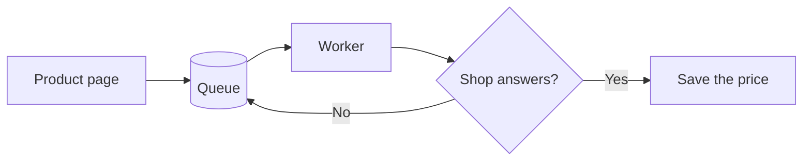
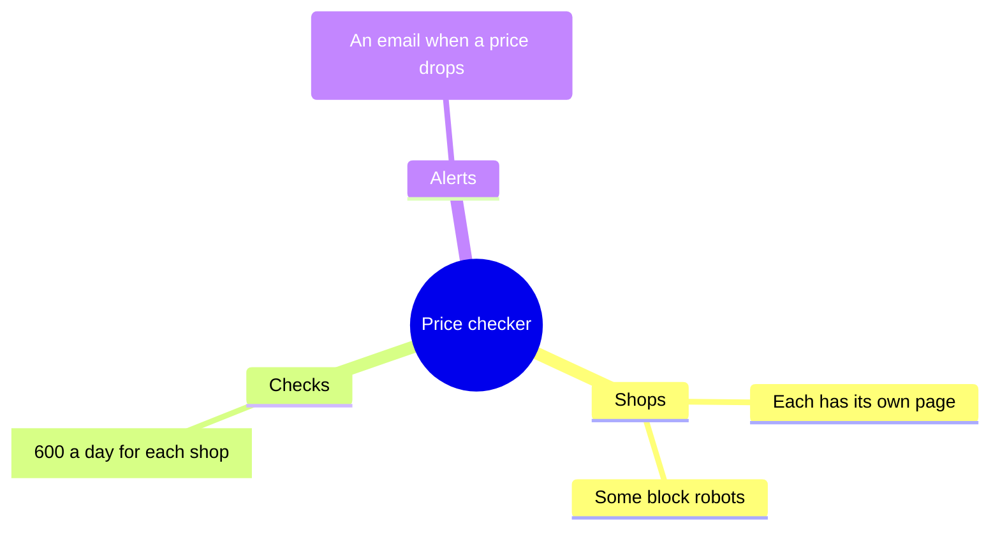
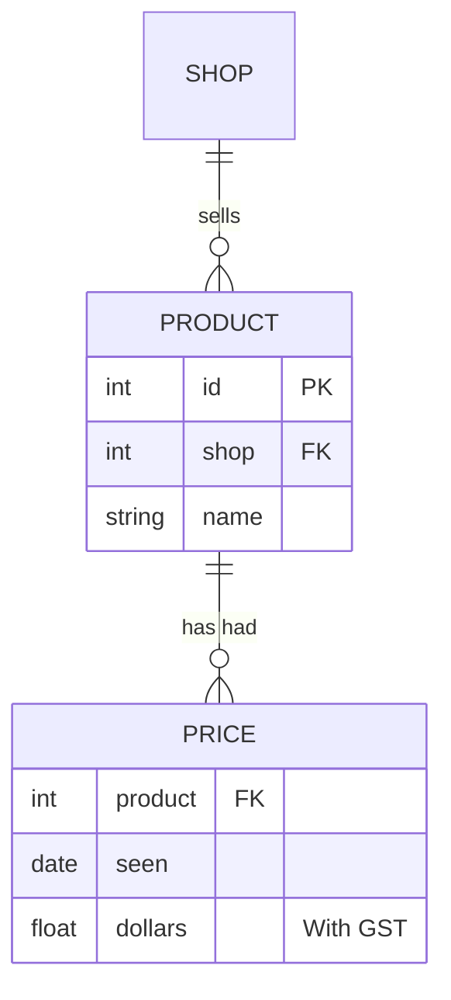
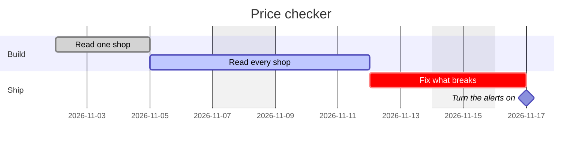
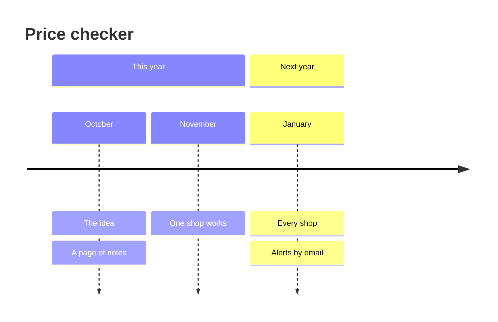

# Show a page in Ladder

Ladder is a Markdown app on the user's Mac. It draws a Markdown file as a page: a `mermaid` code block is a diagram, a table is a table, `- [ ]` is a box that the user can tick. The user can type anywhere on the page. A button at the top right of Ladder sends you the lines that the user changed. It shows your logo: Claude's, Grok's, Codex's or Gemini's.

So a page does two jobs. It shows the user more than the terminal can. And it is the form that the user answers on.

## The steps

1. Write the page as a Markdown file. Its name must end in `.md`. Put it where the user says. If the user names no place, put it in a `.ladder` folder in the project.
2. Run `ladder show <file>`. Ladder opens the page in front of the other windows.
3. Run `ladder wait <file>` in the background. Do not poll, and do not run it in the foreground, because the user can take any length of time. When the command stops, you get its output in a new turn.
   - In Claude Code, use the Bash tool with `run_in_background: true`.
   - In Grok, run `ladder wait <file> --as Grok` with `run_terminal_command` and `block_until_ms: 0`.
   - Another agent adds its own name in the same way, like `--as Codex`, so that the button shows its logo.
4. Tell the user, in one or two sentences, what is on the page and what you need from them. Tell them to click your logo at the top right of Ladder, or press ⌘Return, when they are done. Then end your turn.
5. When `ladder wait` stops, its output is what the user changed. Read it, and do what it asks.
6. If you change the page, edit the file. Ladder shows your change in less than a second, so do not run `ladder show` again.
7. If the work on the page goes on, run `ladder wait <file>` in the background again. If the work is done, do not, unless the user asked for a change with Ask Agent (see below). The Nudge button shows in Ladder only while a `ladder wait` runs.

If the user answers in the terminal and not on the page, do what they say. A `ladder wait` that still runs does no harm.

## What `ladder wait` prints

```
The user sent /Users/sam/shop/.ladder/plan.md from Ladder.

What the user changed since your last version of the file (- is your line, + is the user's):

@@ -17,7 +17,8 @@
 ## Choose one

 - [ ] Use the queue that Postgres has
-- [ ] Add Redis
+- [x] Add Redis
+Can it run on the server we have?
 - [ ] Keep it in memory
```

How to read it:

- It lists only the user's changes. A change that you made to the file is not in it.
- A box that changed from `[ ]` to `[x]` is a choice that the user made. So is an answer of an `ask` block that changed from `( )` to `(x)`.
- A new line that starts with `>` in an `ask` block is what the user typed as their answer.
- A new value in a slider's line or a colour's line of an `ask` block, like `Size: 64px (16px to 96px)`, is what the user set.
- `[accepted]` or `[rejected]` at the end of an `@@` line of a `changes` block is the user's choice for that change. Ladder has already made each accepted change in its file.
- Two new lines that start with `#` at the end of a `changes` block are the user's comment on one line of the diff. The first starts with `# Comment on change 2, line 3:` and has that line of the diff after it. The second has the user's words.
- A new line that talks to you, like the question above, is a note. Do what it asks, or answer it, and then take the note out of the page.
- `{==some words==}{>>a comment<<}` is a comment in the margin: Ladder shows the comment as a card beside those words. A new one is a note about those words. Do what it asks, or answer it. Then take out the comment and the four marks, and keep the words.
- Words between two `%%` marks, or lines between a line of `%%` and another, are hidden in the page. The user can keep notes for themselves there. Read a new one as a note only if it talks to you, and leave the others as they are.
- Any other changed text is the user's own wording. Keep it. Do not put your wording back.
- "The user changed nothing in it" means that the user read the page and has nothing to add. If the page asked for approval, that is approval.
- If the output ends with "The user selected this text", the user's note or their words in the terminal are about that text.

### A change that the user asks for

While you wait, the user can also ask you for a change in their own words. They select words and right-click them, or click your logo beside a block, or use the command Ask Agent. Then `ladder wait` prints this:

```
The user asked you for a change from Ladder, on the page /Users/sam/shop/.ladder/plan.md.

The user's words: make this shorter

The user marked this thing in the window as A:

A: A Paragraph of the page, on line 12:

    The queue keeps each check until a worker takes it, ...

Ladder draws it with the code in the file /Applications/Ladder.app/.../main.jl, lines 1200 to 1230.
```

- The words can name each thing by its letter, like "make A look like B".
- A thing can also be words that the user selected, with their line, or a comment in the margin of the page. For a comment, do what it says, and then take the comment out of the page as above.
- Ladder gives you one request at a time. The user's next requests wait in Ladder until you run `ladder wait` again.
- A thing on the page has its lines. Change those lines of the page, unless the words ask for a change to how Ladder draws it.
- A block of code has its file and its lines. Change that code.
- What the user changed in the page comes after the things, as it does when they send the page.
- Ladder knows that you have done the change when you run `ladder wait` again. So when you're done, run it again in the background, even if the work on the page is done.
- If the first line says "or asked you a question", the words can be a question, like "why is this number so big?". The output names a file for your answer, in Ladder's own folder. Write the answer to that file, in a few short sentences of Markdown, and change no other file. Ladder shows it under what the user marked, with a field to ask you more. Then run `ladder wait` again.

Exit code 3 means that Ladder is not installed, or that it is too old to send a page. Tell the user, and carry on in the terminal.

## Change the page while the user reads it

- Read the file again before you change it. The user's changes are in it after they send.
- Make small edits. Do not write the whole file again. The user can be typing in the page while you work, and Ladder puts your edit and their typing together.
- If you and the user change the same lines at the same time, Ladder keeps the user's lines. You see their lines the next time they send.

## What a page can have

| To show | Write |
|---------|-------|
| Headings, **bold**, *italic*, `code`, links, quotes, lists, a rule | Markdown, as usual. The headings are also the page's list of contents. |
| A note, a tip or a warning that stands out | A callout: a quote whose first line is `> [!NOTE]`, `> [!TIP]`, `> [!IMPORTANT]`, `> [!WARNING]` or `> [!CAUTION]`. Its text is on the lines under that one, each after a `>`. |
| A task | `- [ ] Text`. The user clicks the box. |
| A task that comes back, like every week | A task that ends with `every day`, `every 2 weeks`, `every month`, `every Monday`, `every weekday`, `weekly` and the like, after its day or before it: `- [ ] Test the smoke alarms 2026-12-01 every 3 months`. When the user ticks it, Ladder adds the next one under it. A limit after those words ends it: `for 3 days`, `for 6 months`, `4 times` or `once`. |
| A comment on some words, in the margin | `{==the words==}{>>the comment<<}`. The words get a highlighter's colour, and the comment shows as a card at the right of the text. |
| A note that the page hides | `%%the note%%` in a line, or lines between a line of `%%` and another. |
| A question with answers to choose, or a number or a colour for the user to set | An `ask` code block. See below. |
| Changes to a file, to accept or reject | A `changes` code block. See below. |
| Numbers as bars, lines or a pie | A `chart` code block. See below. |
| The page's tasks as cards in columns | A `board` code block. See below. |
| A place for a person to sign | A `signature` code block. See below. |
| The card of a person or a company | A `contact` code block. See below. |
| A month, with the things that have a day | A `calendar` code block. See below. |
| The map of a place | A `map` code block. See below. |
| The hours worked on each task | A `timelog` code block. See below. |
| Two or more things side by side, like options to compare | A `columns` code block before them. See below. |
| When each task is done, and what it waits for | A `schedule` code block. See below. |
| A table | A Markdown table. The user can type in its cells and add rows. |
| The rows of a CSV file | `` on a line of its own. The path starts at the page's folder. The user can't type in this table. See below. |
| A flow, a sequence, states, classes, shares, a mind map, the tables of a database, tasks with dates, a timeline | A `mermaid` code block. See below. |
| Code | A code block with its language. Ladder colours it. |
| Sums that the user can change | A `sheet` or a `spreadsheet` code block. See below. |
| Numbers in a sentence that the user drags, and sums that follow them | A sum in a line of text. See below. |
| Maths | TeX between dollar signs: `$x^2$` in a line of text, and on lines of its own between a line of `$$` and another. A dollar sign before a number, like `$5`, stays a dollar sign. |
| A picture | `` on a line of its own. The path starts at the page's folder. A web address works too. |
| A picture across the top of the page | `cover: picture.png` in the front matter: the lines between two lines of `---` at the very top of the file. |
| HTML that Markdown has no form for, like a heading in the middle of the page | HTML on lines of its own, with an empty line before and after it, like `<h2 style="text-align: center">Plans</h2>` or ``. Ladder draws it in the page's font and colours. A picture's path starts at the page's folder. No script runs. HTML inside a line of text shows as it's written. |
| A video or a sound | `` on a line of its own, as for a picture. `walk.mov#t=61,86` plays only from second 61 to second 86. |
| Several pictures or files as a grid | A `gallery` code block. See below. |
| A web page as a card, with its title, its description and its picture | `` on a line of its own. Ladder gets the page. An address that ends as a picture's does, like `.png`, shows the picture. A bare address stays text. |
| Another file, shown as it is | A `view` code block with the file's name in it, like `plan.pdf` beside the page, or its path. It shows a picture, a PDF file, a 3D model, a SolidCraft design (`.sc`, only shown: the button that goes to the file opens its editor. Each parameter of the design takes the value of the page's sum that has its name, in SI units, and the file keeps its own), a video, a CSV file, a Markdown page or the page of an HTML file. Beside the block, one button makes a page, a model, a video, a picture or a PDF file fill the window, and another goes to the file. A line like `aspect: 16:9` under the name sets the shape of a page, a model or a video. |
| A web page that the user can use in the page | A `view` code block with the address in it, the name of an HTML file, or a page of HTML that starts with a tag. Ladder draws the page and runs its scripts. Use it only when the user must see a page work. Its scripts can read the page's sums: see `sums.md`. |
| A 3D model, or anything else, that code makes from the page's sums | A `result` code block with Julia code in it, or the name of a Julia file beside the page. It shows what the last line comes to: the bytes of a .glb file as a 3D model, a UI.jl node as itself, and any other value as text. The code has the names of the page's sums, with their units, and runs again when they change: see `sums.md`. |
| A footnote | `[^1]` in the text, and a line that starts with `[^1]:`. |
| Words with a highlighter's colour behind them | `==the words==`. |
| Another page | `[[name]]` links to the page `name.md`, wherever it is in the project. `[[name#Heading]]` goes to a heading of it, and `[[name|other words]]` shows other words. A Markdown link to a `.md` file works too. The user holds ⌘ and clicks the link. |
| Cards that the user puts anywhere, with lines between them, like a mind map | A `canvas` code block. See below. |
| A drawing of boxes, ovals, arrows and words | A `sketch` code block. See below. |
| A field for each column of a table, to add a row | A `form` code block under the table. See below. |
| Only the rows of a table, a CSV file or a JSON file that meet some conditions | A `filter` code block. See below. |
| The rows of a file or of a server, as a table | A `load` code block. See below. |
| A button that writes a table into a file, or sends it to a server | A `save` code block under the table. See below. |
| The to-do items, headings or other lines of every page in the folder | A `find` code block. With nothing in it, it lists each to-do item that isn't ticked. `what: headings` lists another kind of line, `with: plumber` keeps the lines that have those words, and `in: jobs` looks in the folder `jobs` beside the page. |
| A slider that shows the page on another day | A `day` code block with nothing in it. The calendars, time logs, schedules and boards of the page show the day that the user chooses. In a git repository, the text shows its past too. |
| A plan to measure from: a page of a PDF, or a picture | A `takeoff` code block with the lines `plan: plan.pdf`, `page: 1` and `scale: 1:100`. The user counts and measures on the plan, and Ladder writes the measures into the block. |
| A part of another page, which the user can change in this page | `![[name#Heading]]` on a line of its own shows the heading and the lines under it from the page `name.md`. `![[name#table 2]]` shows its second table, and `![[name]]` the whole page. What the user types there changes `name.md`. |

Ladder does not draw HTML tags, except in a `view` block. Do not use them.

The user can show a page as slides, one part at a time, with ⌃⌘⇧P. Each heading of level 1 or 2 starts a slide, and so does a line of `---`.

### Diagrams

Ladder draws nine kinds of Mermaid diagram: `flowchart` (or `graph`), `sequenceDiagram`, `stateDiagram-v2`, `classDiagram`, `pie`, `mindmap`, `erDiagram`, `gantt` and `timeline`. Any other kind, like `journey`, `gitGraph` or `quadrantChart`, shows as code, so do not use it. A diagram with a line that Ladder can't read shows as code too.

````

````

A flowchart can have `subgraph`, text on a line, and these shapes: `[box]`, `(round)`, `([pill])`, `{diamond}`, `((circle))`, `{{hexagon}}`, `[(drum)]`. A sequence diagram can have `participant`, `actor`, `Note over`, `loop`, `alt` with `else`, and `opt`.

A mind map is one idea in the middle and the ideas that belong to it. The indent of a line says which idea it belongs to. Give the whole map one first idea: a second line that starts as far left as the first shows the map as code. An idea can be `[a box]`, `(a round box)`, `((a circle))` or plain words.

````

````

An entity relationship diagram shows tables and how they are related. A row of a table is a type, a name, then `PK`, `FK` or `UK`, then a comment in quotes. Each end of a line has a sign for how many: `||` exactly one, `|o` or `o|` none or one, `}|` or `|{` one or more, `}o` or `o{` none or more. Use `--` for a full line and `..` for a dashed one. Do not use `subgraph`: Ladder does not draw its box.

````

````

A Gantt chart shows tasks with dates as bars. A task is its name, a colon, then an id, a start and an end with commas between them. The start is a date or `after` another id. The end is a date or a length: `3d`, `2w`, `36h`. Put `done`, `active`, `crit` or `milestone` first to mark a task. `excludes weekends` leaves Saturday and Sunday out of each length. For the tasks of the page itself, use a `schedule` block: the user can drag its bars.

````

````

A timeline shows periods from left to right. A line is a period, then ` : ` before each event. A line that starts with a colon adds events to the period above it. `section` puts a name over a group of periods.

````

````

### Sums

A `sheet` is a list of rows. Each row is a name, `=`, and a number or a sum. A sum can use the names of the rows above it. A number can have a unit, like `12m` or `2hr`. Ladder shows what each row comes to, and the user can change any number.

````
```sheet
Shops = 40
Checks per shop = 600
Seconds per check = 1.5
Hours = shops * checks per shop * seconds per check / 3600
```
````

- A row can be a range of values, with `to` between its two ends: `Side of a tile = 0.2m to 0.6m`. Each row under it shows what it comes to at the two ends, and a `chart` under the sheet draws a line through the values between.
- A row that starts with `?` is worked out backwards. Write the answer that you want after a second `=`, in a row under it. In this sheet, Ladder finds the length of the wall that 6 litres of paint cover:

````
```sheet
Wall length = ? 12m
Wall height = 2.4m
Area = wall length * wall height
Litres = area * 2 / (16m^2 / litre) = 6litre
```
````

- A row can use the rows of the sheets above it, a measure of a `takeoff` by its name, and a task of a `timelog`, which is the hours of that task.

A `spreadsheet` is a grid. Column letters and row numbers name the cells, and a cell that starts with `=` is a formula.

````
```spreadsheet
| Option   | Days | Cost a day | Cost         |
| Postgres | 2    | 900        | = B2 * C2    |
| Redis    | 3    | 900        | = B3 * C3    |
| Total    |      |            | = sum(D2:D3) |
```
````

#### Sums in a line of text

A sum can go in a line of text: a `!`, and then the sum between backticks. The page shows what the sum comes to. A sum that is only a number has a line of dashes under it, and the user drags it to change it. Each sum that uses its name follows while the mouse moves. Use it to explain how numbers depend on each other, in sentences.

Before you write one, read the file `sums.md` in the folder of this skill. It has examples, and how a sum uses names. They are in a file of their own because Claude Code runs a `!` and a code span in a skill as a shell command.

- The units are those of Units.jl: `m`, `km`, `ft`, `inch`, `s`, `minute`, `hr`, `kg`, `litre`, `kW`, `GW`, `kWh`, `TWh`, and money like `USD`, `AUD` and `EUR`. A sheet has the same units.
- A cell of a table can hold a sum, and a `chart` of the table draws what the sums show.

### A schedule

A `schedule` code block shows every `- [ ]` item of the page as a bar on a line of days. The user drags the bars to change the plan, and Ladder writes each change into the block. The block names each task by the text of its item, without the marks of bold and the like. A task with no line takes one day and starts when the work starts.

````
- [ ] Add the queue table
- [ ] Write the worker
- [ ] Move the price checks to the queue

```schedule
start: 2026-11-16

Add the queue table | 2 days
Write the worker | 3 days | after Add the queue table
Move the price checks to the queue | from 2026-11-25 | after Write the worker
```
````

After the name: `3 days` is how many working days the task takes, `after` and a task's name makes it wait for that task, and `from` and a day is the first day that it can start. A task can have several `after` parts. `start` is the day that the work starts. Saturday and Sunday aren't working days, unless the block has the line `days: every day`. Write a `\` before a `|` in a task's name.

A task that comes back, like `- [ ] Water the slab every day for 3 days`, has a bar for each time. `time 2 of Water the slab` names one of those times, in the place of a task's name. `after Water the slab` waits for the last time when the task has a limit, and for the first time when it has none.

### A question

An `ask` code block asks one question. Its first lines are the question. A line that starts with `( )` is an answer, and the user chooses one of those. A line that starts with `[ ]` is an answer that the user can choose with any others. Under the answers, Ladder shows a field that the user can type in. A block with no answers is a question that the user answers in that field.

````
```ask
Which queue should the price checks use?
( ) The queue that Postgres has. Nothing new to run.
( ) Redis. Faster, and one more thing to run.
[ ] Keep the old checks running for a week
```
````

The user clicks an answer, and Ladder writes `(x)` or `[x]` in its line. What they type goes in a line that starts with `>`. Use one block for each question. An older Ladder shows the block as code, and the user can still type an `x` between the brackets.

A question can also ask for a value that the user sets. A line with a name, a number and its range in brackets is a slider. A line with a name and a colour in hexadecimal is a colour picker. When the user moves the slider or picks a colour, Ladder writes the new value in the line, in the same form. A slider's number has as many digits after the point as the line's numbers have, so write `0.50 (0 to 1)` for steps of 0.01.

````
```ask
How should the logo look?
Size: 48px (16px to 96px)
Opacity: 0.8 (0 to 1)
Colour: #e8632b
```
````

### Changes to accept or reject

A `changes` code block holds a diff, as `git diff` or `diff -u` writes one. Ladder shows each change, with the lines that go in red and the lines that come in green, and an Accept and a Reject button.

````
```changes
--- a/src/queue.js
+++ b/src/queue.js
@@ -10,3 +10,4 @@ function take() {
   const job = next()
-  run(job)
+  if (!job) return
+  run(job)
   done(job)
```
````

When the user accepts a change, Ladder makes it in the file and writes `[accepted]` at the end of the change's `@@` line. When the user rejects a change, Ladder writes `[rejected]` there and leaves the file as it is. If the user takes back an acceptance, Ladder takes the change out of the file again.

- Show the changes before you make them. Do not make them yourself.
- A change marked `[accepted]` is in the file already. Do not make it again. Read the file before you change it more.
- A change with no mark is one that the user has not chosen yet. It can also be one that Ladder could not make, because the file's lines are different now. Ladder tells the user why on the page.
- Give each change that the user can choose apart from the others its own `@@` line.
- Name each file as `git diff` does, from the top of the repository, or give its whole path. Ladder looks for the file in the page's folder and in each folder above it, up to the top of the repository.
- Put `--- /dev/null` over a change that makes a new file, and `+++ /dev/null` over one that deletes a file.

The user can click a line of the diff and say something about it. Ladder writes that at the end of the block, in two lines:

```
# Comment on change 1, line 2: -  run(job)
# Keep this line, and log the job that's missing.
```

The changes are counted from the top of the block, and the lines from the first line under the change's `@@` line. The first line also has the line of the diff that the comment is about. Do what the comment asks. If the change is accepted, Ladder has made it already, so start from the file as it is now. When you write the block again with new changes, leave the old comments out.

### A chart

A `chart` code block draws the numbers of a table. With nothing in it, it draws the table, the spreadsheet or the sheet that is nearest above it, as bars. The first column that isn't numbers names the bars, and each column of numbers is drawn.

````
| Month | Sales | Costs |
|---|---|---|
| July | $4,200 | $2,900 |
| August | $5,100 | $3,100 |

```chart
kind: lines
title: Sales and costs
```
````

`kind` is `bars`, `lines` or `pie`. `show: Sales` draws only that column. `by: Month` names the column whose words name the bars. `from: Budget` draws the first table under the heading "Budget". `from: Budget, Costs` draws both tables in one chart, and rows with the same name, like the same month or the same year, go in the same place. Use it to put the lines of two sheets over the same range in one chart, rather than writing their sums again. A chart under a `filter` or a `load` block draws the rows that the block shows. To draw numbers that are in no table, put the rows in the block, under an empty line, with a `|` between the cells and the names of the columns in the first row. Do not draw two measures with different units in one chart.

### A table from a CSV file

A line that holds only a link to a `.csv` or a `.tsv` file, written as a picture is, shows the file as a table:

```

```

The first row of the file has the names of the columns. The table shows the first 30 rows, and the user clicks a line under them to see the rest. The table changes when the file changes, so you can write the file again while the user reads the page. A `chart` block under the line draws the file's numbers. `from: prices.csv` in a chart draws them from anywhere in the page. Use this for numbers that a program wrote. Use a Markdown table for rows that the user should change.

### A board

A `board` code block shows every `- [ ]` item of the page as a card, in the columns To do, Doing and Done. The user drags a card to another column. A ticked item is in the last column. Ladder writes a line in the block for each card that is between the first column and the last: the item's text, a `|`, and the column.

````
- [ ] Add the queue table
- [ ] Write the worker

```board
Add the queue table | Doing
```
````

The line `columns: Later, This week, Done` at the top of the block names other columns.

The line `in: jobs` at the top of the block makes it a board of a folder. It shows the `- [ ]` items of every page in the folder `jobs` beside the page, and `in: .` is the page's own folder. Ladder ticks an item in its own file when the user drops its card on the last column. A line of the block then names an item by its page and its text: `kitchen: Lay the pipe | Doing`.

### A signature

A `signature` code block shows a box that a person signs in with the mouse or the trackpad. Write the name of who signs in a `name:` line. Without that line, a field under the box takes the name.

````
```signature
name: Sam Lee
```
````

Ladder writes the rest. The first stroke adds the line `signed: 2026-11-18 09:14`, and each stroke adds a line that starts with `pen`. A block with a `pen` line is signed. Do not write `signed:` or `pen` lines yourself, and do not change them.

### A contact

A `contact` code block shows the card of a person or a company: a round picture, the name, and a row for each detail. The user clicks an email address to start an email, a phone number to call, an address to see it in the Maps app, and a web address to open it.

````
```contact
Ada Lovelace
role: Engineer
company: Analytical Engines
email: ada@example.com
mobile: 0400 123 456
address: 12 Example St, Sydney NSW 2000
web: example.com
note: Met at the 2026 conference.

Analytical Engines
kind: company
email: hello@example.com
```
````

The first line of a contact is its name. Each other line is a label, a colon and a value. The labels are `role`, `company`, `email`, `phone` (or `mobile`, `work`, `home`, `fax`), `address`, `web`, `photo` and `note`. A label can be there more than once. Any other label, like `ABN: 12 345 678 901`, shows as a row with the label and the value. `photo:` is the path of a picture, from the page's folder. `kind: company` makes the contact a company. An empty line ends a contact, and the next line is the name of the next one. Write only what you know. The user can add the rest in the card.

### A gallery

A `gallery` code block shows files as a grid of small squares: pictures, PDF files, videos, 3D models, pages, code, tables and folders. The square of a picture or a video shows its picture. Any other file shows the picture that the Finder has for it, with its name under it. The user clicks a picture, a PDF file, a video or a model to see it big. There, ← and →, or the arrows under it, go to the others. The bar under it says which file shows, like “2 of 6”. A click on any other file or on a folder opens it.

````
```gallery
in: screenshots
```
````

`in: screenshots` names a folder beside the page, and the block shows every file and folder in it, in the order of their names. It leaves out hidden files. To show only some files, leave `in:` out. Write the path of each file or folder on a line of its own. The paths start at the page's folder. `sort: newest` puts the newest file first. `size: small` or `size: large` sets how big the squares are.

### A calendar

A `calendar` code block shows one month as a grid of days, from Monday to Sunday. It shows three kinds of thing on their days:

- A `- [ ]` item of the page that has a day in its text, written like `2026-11-25`. The user ticks it in the calendar, and drags it to another day.
- A line of the block that has a day, a `|` and some words. This is an event.
- Each task of the page's `schedule` block, on the working days that it runs.

````
- [ ] Order the tiles 2026-11-20

```calendar
month: 2026-11

2026-11-25 | Concrete pour
2026-11-27 | Council inspection
```
````

`month` is the month that shows. Leave it out to show the month of today. Write every day as year-month-day. When the user drags a thing, Ladder writes the new day into the item's text or the event's line.

The line `in: jobs` in the block makes it a calendar of a folder. Its `- [ ]` items are those of every page in the folder `jobs` beside the page, and `in: .` is the page's own folder. Ladder writes a tick or a new day into the item's own file.

### A map

A `map` code block shows the map round a place, with a pin on the place. Its first line is a street address, or a latitude and a longitude. Ladder doesn't find a place by its name alone, so write the address. `zoom` says how much the map shows, from 3 for a continent to 19 for one building. Without it, the zoom is 15, which shows a few streets.

````
```map
1 Macquarie Street, Sydney NSW 2000
zoom: 16
```
````

`centre: -33.86120, 151.21010` puts that latitude and longitude in the middle of the map. Without it, the place is in the middle. The pin is always on the place.

The user can change each line on the map itself, so read the block again after they send:

- Two buttons change the zoom, and Ladder writes the `zoom` line.
- A drag moves the map, and Ladder writes the `centre` line.
- A click moves the pin, and Ladder writes the point's latitude and longitude as the first line, like `-33.85930, 151.21320`.

The first picture of a place needs the network.

### A time log

A `timelog` code block keeps the hours that the user works on each task. Each line is one stretch of work: the day, the start time, a `-`, the stop time, a `|`, and the task. Write times with 24 hours. The block shows the rows, the total and the hours of each task. The user starts and stops the clock with a button, and Ladder writes the line.

````
```timelog
rate: 85

2026-11-17 07:30-12:00 | Framing
2026-11-17 12:30-15:45 | Framing
```
````

A line with no stop time, like `2026-11-18 08:10- | Roofing`, is the one that runs now. Write no more than one. `rate: 85` is the dollars for each hour, and makes the totals show money. `round: 15` rounds each stretch to the nearest 15 minutes in the totals. A `chart` block under the log draws the hours of each task.

### A canvas

A `canvas` code block is a board of cards that the user puts anywhere, as in the app Muse. Each line is a card: its kind, its place as `x,y`, and what it holds. `join 2 3` draws a line from the 2nd card to the 3rd. Use a canvas for a mind map, or for ideas that the user will move round.

````
```canvas
text size 28 0,0 The bathroom
note 0,60 Tiles to the ceiling
note 300,0 Grey tiles on the walls
note 300,120 White grout
join 2 3
join 2 4
```
````

- The kinds are `note` (words on a card), `text` (words with no card round them), `picture` (a file, from the page's folder), `page` (one of the user's pages, by its name, as in `[[name]]`) and `link` (a web address).
- After the kind can come a colour, `red`, `blue`, `green` or `orange`, and then `width 260` for how wide a card is, or `size 28` for how big the words of a `text` are.
- A line that starts with two spaces goes on with the words of the card above it.
- The cards are counted in the order of their lines, from 1. If you add a card, add it after the others, so that the numbers of the `join` lines stay right.
- A place can be anywhere, and below or left of 0.

### A sketch

A `sketch` code block is a drawing. Each line is a shape: its kind, a colour if you want one, and its places as `x,y`. The sketch is 720 wide, and as tall as its shapes need.

````
```sketch
box 60,50 330,190
text 70,38 Bathroom
oval blue 90,80 180,150
text blue 100,174 Basin
arrow red 450,80 336,110
text red 458,84 The door opens in
```
````

- `line` and `arrow` go from the first place to the second. `box` and `oval` have the two places as opposite corners. `text` starts at its place, and its words are the rest of the line. `pen` goes through each of its places.
- The colours are `red`, `blue`, `green` and `orange`. Without one, a shape is the colour of the text.
- Before the places, `width 4` makes the line thicker, `radius 12` makes the corners of a box rounder, and `size 24` makes the words of a text bigger.

### Rows of data

Four blocks work with the rows of a table. A `filter`, a `form` and a `save` use the table that is nearest above them, and the rows of a `load` block above them are a table too. In this page, the filter keeps some of the orders that the load block gets, and the save block writes them into a file:

````
```load
from: orders.json
at: data.orders
```

```filter
where: total > 100
where: status is shipped, packed
sort: total, largest first
show: customer.name, total
```

```save
to: big orders.csv
```
````

- `load` shows the rows of a file, or of a server when `from` is a web address. `at: data.orders` names the list in a JSON file. `key: orders-api` names a password in the user's Keychain, which Ladder sends to the server. The page holds only the name.
- `filter` shows only the rows that meet every `where` line. A `from` line can name its rows: a CSV, TSV or JSON file beside the page, or the heading that a table of the page is under, like `from: Costs`. A condition is `is` or `is not` with values, `has` or `has no` with letters, `>`, `<`, `>=` or `<=` with a number or a day like 2026-11-21, `is empty`, `is not empty`, `starts with` or `ends with`. Capitals don't count. In a JSON file, a key inside an object is a column with a dot, like `customer.city`.
- `save` writes the rows of the table above it into a file, when the user clicks its button. The end of the file's name says how: `.csv`, `.tsv` or `.json`. When `to` is a web address, it sends the rows to that server as JSON. `method: PUT` and `key: …` say how.
- `form` shows a field for each column of the table above it, and adds a row to the table. `title: New job` is the words at its top, and `to: Jobs` adds the rows to the first table under the heading Jobs. A column of days like 2026-11-25 gets a field with a month to click in, a column of Yes and No gets a box to tick, a column of a few words that come again and again gets a chooser with those words, and a column of numbers or times takes only those. A table with no rows yet can't say what its columns hold, so add a line for each column that isn't words: `Due: day`, `Start: time`, `Price: number`, `Paid: yes/no`, or `Status: Quote, Booked, Done` for the words of a chooser.

### Columns

A `columns` code block holds a number. That many of the blocks after it show side by side. Use it to compare options, or to put a picture beside its text. The blocks are ordinary lines of the page, so the user types in them as anywhere else.

````
```columns
3
```

### Option A

Cheapest.

- Two days

### Option B

Lasts longer.

- Three days

### Option C

Both.

---

This paragraph is under the columns.
````

- A column that starts with a heading holds the heading and every block under it, up to the next heading of the same level or a higher one. Start each column with a heading of one level.
- A column that starts with any other block holds that one block: a paragraph, a list, a quote, a table, a code block, a picture, a diagram.
- A line of `---` ends the columns. So does another `columns` block.
- When the last column starts with a heading, put a line of `---` after its last block. Without it, the text that follows is in that column too.
- Several numbers are widths. `2 1` is two columns, the first twice as wide as the second.
- The headings and the tasks in the columns are the page's own. They are in the list of contents, on a `board` and in a `schedule`.
- In a narrow window, Ladder shows the blocks one under another. Use two or three columns, not more.

### Checks

A code block in the language `check` has a line of Julia for each thing that must be true. Ladder shows a tick or a cross beside each line, and says what a line that fails found. Use it to show the user that the numbers of a page agree.

````markdown
```check
total == sum(parts)
length(rooms) == 4
```
````

- Each line is one Julia expression that comes to `true` or `false`. A blank line and a line that starts with `#` are no check.
- The lines can use the names of the page's `sheet` rows and of its `julia` blocks. A `julia` block's names exist only after the user runs the block.

### Code that runs

A code block in the language `ui` is Julia code that Ladder runs when the page opens. It shows what the code makes, like a slider or a 3D model. `STLViewer("part.glb")` shows the model in a file beside the page: an STL file, a 3MF file or a glTF file (`.glb`, `.gltf`). A glTF file shows in its own colours and materials. Code between backticks straight after a `!` runs too. Use it for sums, as in "Sums in a line of text". Use other code that runs only if the user asks for it.

## Show what a command prints

`<command> | ladder` shows what the command prints in Ladder, as a file of its own. CSV shows as a table that the user sorts and filters, JSON as a tree, Markdown as a page, and anything else as text. Use it for output that is too long to read in the terminal.

```
git log --stat -20 | ladder --name "last 20 commits"
```

`--as csv` says what the output is when Ladder guesses wrong: `csv`, `json`, `md` or `txt`. `--name` names the file. The command prints the path of the file that it wrote. The user can't answer on such a file. To ask them something, write a page.

## Write a page that is easy to answer

- Put the answer or the decision first, then the detail.
- Ask each question in an `ask` block. Use `( )` answers when the user picks one, and `[ ]` answers when they can pick many.
- Show changes to code in a `changes` block before you make them, when the user may want only some of them. Ladder makes the ones that the user accepts.
- Use a diagram for how things connect, a table to compare options, and a sheet for numbers that the user may want to change.
- To ask about a few words of the page, put a comment in the margin on them, like `{==3 days==}{>>Is that long enough for the slab to cure?<<}`. Then the question stays beside what it is about.
- To show how a result follows from numbers that the user may change, write sums in a line of text. The user drags a number and reads how the rest changes.
